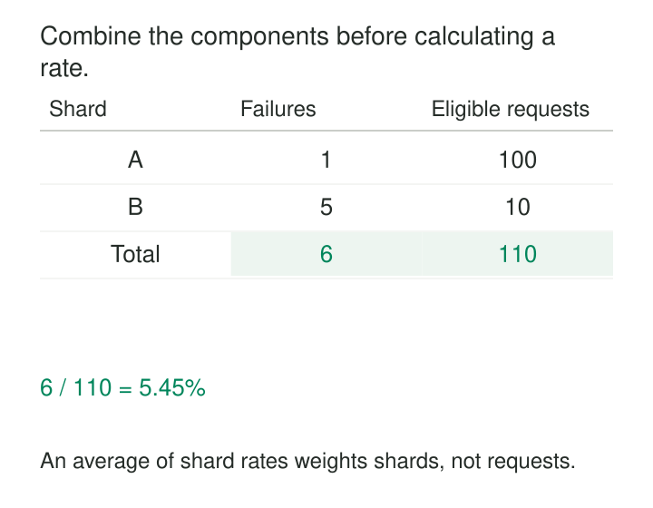

Two servers report failure rates of 1% and 50%. A dashboard averages them and displays 25.5%. The calculation looks reasonable—until someone discovers that the first server handled one hundred requests and the second handled ten.

The service actually failed six of 110 requests: about 5.45%.

[[data-store-additive-components|Store Additive Components]] preserves the quantities behind a derived measurement so they can be combined before calculating the final result. Instead of retaining only a percentage, average, or unit rate, retain the counts, totals, or weighted contributions that give it meaning.

The purpose is to keep calculations correct as data moves through partitions, time buckets, aggregate tables, and reporting hierarchies.

## Preserve the population behind the number

A percentage alone does not reveal whether it describes ten observations or ten million. A rounded average also discards information needed for accurate recombination.

For many useful metrics, the solution is compact:

| Derived measurement | Components to retain |
|---|---|
| Failure rate | Failed requests; eligible requests |
| Mean latency | Total measured duration; valid measurement count |
| Realized average unit price | Net sales amount; units sold |
| Gross margin percentage | Gross profit amount; net sales amount |

Each pair needs its own business definition. “Eligible requests” might mean completed requests with known outcomes. “Net sales” might exclude tax and include specified adjustments.

For compatible, nonoverlapping groups, add corresponding components and calculate the derived measure at the requested reporting level. Kimball recommends this approach for non-additive facts: retain additive components where possible, then calculate the final measurement after aggregation. [Kimball Group: Additive and Non-Additive Facts](https://www.kimballgroup.com/data-warehouse-business-intelligence-resources/kimball-techniques/dimensional-modeling-techniques/additive-semi-additive-non-additive-fact/)



*The components preserve how much each group contributes. The displayed ratio is calculated afterward.*

## Combine failures and opportunities separately

Consider the illustrative service in the graphic:

| Shard | Failed requests | Eligible requests | Failure rate |
|---|---:|---:|---:|
| A | 1 | 100 | 1% |
| B | 5 | 10 | 50% |

The overall request failure rate is:

`(1 + 5) / (100 + 10) = 5.45%`

The calculation naturally gives each eligible request equal weight.

Averaging the shard percentages gives each shard equal weight. That can be a legitimate metric if the intended question is “What is the mean shard failure rate?” It does not describe the fraction of requests that failed.

A summary table can store both counts by hour, service, and shard. The reporting calculation then becomes:

```sql
SELECT
    1.0 * SUM(failed_request_count)
        / NULLIF(SUM(eligible_request_count), 0)
        AS failure_rate
FROM service_hour;
```

The decimal expression avoids integer division. `NULLIF` leaves the result undefined when no eligible requests exist.

Zero failures among one hundred requests means a 0% failure rate. Zero eligible requests provides no observed rate. Converting both situations to zero hides a meaningful distinction.

## Store the right denominator for an average

Now consider mean latency:

| Worker | Total measured latency | Valid measurements | Mean latency |
|---|---:|---:|---:|
| A | 10,000 ms | 100 | 100 ms |
| B | 5,000 ms | 10 | 500 ms |

The combined mean is 15,000 divided by 110, approximately 136.36 milliseconds. Averaging the worker means would produce 300 milliseconds.

The denominator deserves particular attention when measurements can be missing. If a request lacks latency, counting it in the denominator while omitting its duration lowers the reported mean.

For ordinary SQL averages, the matching components are `SUM(latency_ms)` and `COUNT(latency_ms)`. PostgreSQL documents that `AVG` uses non-null values, while `COUNT(*)` counts rows and `COUNT(expression)` counts non-null expressions. [PostgreSQL: Aggregate Functions](https://www.postgresql.org/docs/current/functions-aggregate.html)

Business validation may exclude additional observations, such as invalid negative durations. Apply the same eligibility rule to both components. Retaining an excluded-observation count can make the measurement’s coverage visible.

The same principle applies to weighted means. Store the sum of each value multiplied by its weight, plus the sum of those weights. The chosen weight expresses the population the metric describes.

## Keep component definitions aligned

Additivity has conditions.

The groups being combined must not overlap. Adding daily components to monthly components that already include those days repeats the observations. A many-to-many join can duplicate both numerator and denominator; the ratio may remain unchanged while the underlying counts become wrong.

Units must agree. Milliseconds and seconds require conversion before their totals can be added. Monetary components need a compatible currency and conversion policy.

Numerator and denominator must also refer to the intended population and time perspective. Failed requests should belong to the eligible requests being counted. A conversion numerator measured from one customer cohort cannot simply be divided by opportunities from another.

Finally, retain enough dimensional detail for the questions you expect. A latency sum and count by service cannot answer a later question filtered to a customer segment that was discarded.

The pattern preserves specified calculations. It does not recover information removed during summarization.

## Published implementations use the same mechanism

Prometheus histograms and summaries retain the count and sum of observations, allowing mean request duration to be calculated from those components.

For cumulative monitoring counters, the desired time interval must first be represented through appropriate reset-aware rates or changes. Adding successive cumulative readings would repeatedly count earlier history. Prometheus documents calculating mean duration by dividing the rate of the observation sum by the rate of the observation count. [Prometheus: Histograms and Summaries](https://prometheus.io/docs/practices/histograms/)

Apache Druid makes the storage decision explicit in its ingestion guidance: for rollup averages, retain `SUM` and `COUNT`, then calculate their quotient at query time. It also distinguishes counting rolled-up rows from summing the stored count of original events. [Apache Druid: SQL-Based Rollup](https://druid.apache.org/docs/latest/multi-stage-query/concepts/#rollup)

Power BI implements a related optimization. Its aggregation engine can satisfy an average from mapped Sum and Count aggregations. [Microsoft: User-Defined Aggregations](https://learn.microsoft.com/en-us/power-bi/transform-model/aggregations-advanced)

These are documented product mechanisms, rather than claims that a particular deployment achieved a universal performance improvement.

## Maintain components through corrections

Components need the same maintenance discipline as the facts they summarize.

A duplicated event must not contribute twice. A correction should remove the old contribution and add the replacement. A deletion should reverse the applicable contribution where the measure supports that operation.

Late observations may change historical buckets. Recomputing affected buckets is often simpler than maintaining every correction incrementally, though it requires more computation.

Publish related components together so readers do not divide an updated numerator by an old denominator. Preserve enough lineage or source detail to reconcile them.

Numeric representation also matters. Large totals can overflow undersized types, floating-point addition can accumulate rounding differences, and rounding each intermediate ratio loses precision. Use suitable representations and round the final presentation according to the metric’s requirements.

## Recognize calculations that need richer state

Simple sums and counts do not preserve every statistic.

Distinct counts cannot generally be added across groups because the same entity can occur in several groups. Exact recombination requires sufficient identity information; approximate recombination can use compatible mergeable sketches.

Percentiles and medians cannot generally be reconstructed from sums and counts. Nor does averaging group percentiles produce the combined percentile. Prometheus distinguishes precomputed quantiles, which cannot be aggregated this way, from histogram representations that retain mergeable distribution information. [Prometheus: Histograms and Summaries](https://prometheus.io/docs/practices/histograms/)

Inventory balances have another restriction: a balance may be additive across locations at one instant, while summing successive daily balances answers a different question.

## Trade a little more stored state for reusable calculations

The pattern is especially useful in aggregate fact tables, distributed computation, streaming summaries, monitoring systems, and dashboards that roll up across changing groups.

Its costs include additional columns, consistent eligibility logic, correction handling, and more explicit metric definitions. In return, the stored state supports multiple reporting levels and makes the population behind a result inspectable.

[[data-aggregate-fact-tables|Aggregate Fact Tables]] provides a common place to retain these components. [[data-declare-the-grain|Declare the Grain]] defines what contributes once. [[data-conformed-facts|Conformed Facts]] keeps component meanings compatible across sources. [[data-shared-metric-definitions|Shared Metric Definitions]] specifies how the components become the final business measurement.
