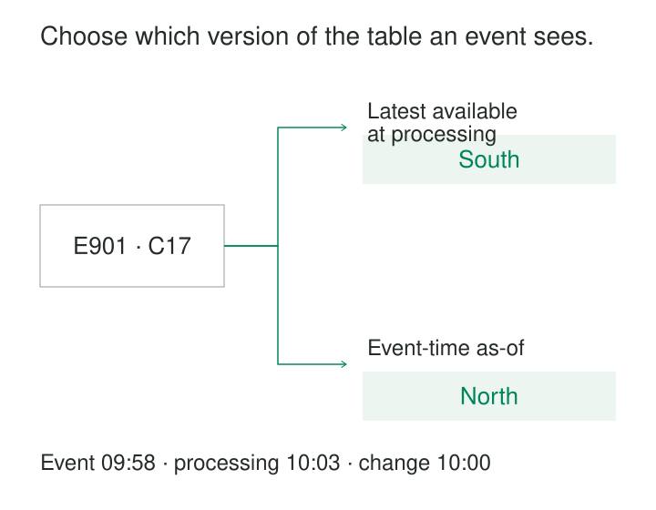

A purchase event contains a customer identifier, an amount, and a timestamp. The dashboard also needs the customer’s region. A routing service needs their current account team. Neither attribute travels with the event.

Both consumers can look up the customer, but they may need different versions of that customer’s information.

**Stream-Table Enrichment attaches table context to events as they flow through a pipeline.** The table supplies keyed attributes; the stream supplies the events that need them. The central design decision is which table state each event should observe.

A successful enrichment preserves the event’s identity and meaning while making the selected context—and its limitations—explicit.

## Use the table as keyed context

The lookup side might be a bounded reference dataset, a local table maintained from change events, a replicated table, or an external database.

An incoming event supplies a lookup key. The processor finds the applicable row, attaches selected attributes, and emits the enriched event.

For ordinary enrichment, the intended relationship is usually many events to one applicable table row. Duplicate lookup rows can multiply events and inflate downstream totals. Historical tables require uniqueness for the selected key and time, rather than uniqueness across all stored versions.

Kafka Streams provides a documented implementation through `KStream`–`KTable` joins: stream records trigger lookups against a table represented by a changelog. Its examples include enriching user activity with profile information. [Kafka Streams stream-table join documentation](https://kafka.apache.org/41/streams/developer-guide/dsl-api/#joining)

The table therefore represents accumulated context, even when updates reach it through another stream.

## Choose the temporal contract

Three common contracts answer different questions:

| Contract | Context selected | Typical purpose |
|---|---|---|
| Pinned snapshot | An explicitly selected table release | Repeatable classification |
| Latest available | The row available when processing the event | Current operational context |
| As of event time | The version effective at the event timestamp | Historical analysis |

“Latest available” needs careful interpretation. A local replica can lag its source. A cache can retain an older row. The lookup observes the state available through that mechanism, not necessarily the freshest state anywhere in the organization.

Spark documents stream-static joins as one implementation for combining a stream with a bounded table input. A design using this approach still needs an explicit policy for selecting and refreshing that input. [Spark stream-static join documentation](https://spark.apache.org/docs/latest/streaming/apis-on-dataframes-and-datasets.html#stream-static-joins)



## Route an event using current responsibility

Customer C17 changes region at 10:00:

| Customer | Effective period | Region |
|---|---|---|
| C17 | Before 10:00 | North |
| C17 | From 10:00 | South |

An activity event E901 occurs at 09:58 and is processed at 10:03. Assume the updated South row is already available to the enrichment operator.

A service routing the activity to the team currently responsible for C17 may correctly attach **South**.

The output should make that interpretation clear. A field such as `current_responsibility_region` communicates more than an ambiguous `region`.

Flink documents processing-time lookup joins against external tables, including a customer lookup in MySQL. Its lookup semantics also prevent later customer updates from automatically changing previously emitted results. [Apache Flink lookup-join documentation](https://nightlies.apache.org/flink/flink-docs-release-2.3/docs/sql/reference/queries/joins/#lookup-join)

Replaying E901 later can therefore produce different current context. Reproducing the original routing decision requires retaining the selected values or a recoverable reference version.

## Attribute the same event historically

An analytical report asks which region the customer belonged to when E901 occurred.

Under that definition, the applicable region is **North**. The event’s delayed arrival does not move its occurrence past 10:00.

An event-time temporal join can express the selection:

```sql
SELECT e.event_id, e.customer_id, r.region
FROM activity AS e
LEFT JOIN customer_regions
  FOR SYSTEM_TIME AS OF e.occurred_at AS r
ON e.customer_id = r.customer_id;
```

In Flink, this requires a properly defined versioned table, time attributes, matching keys, and suitable watermarks on both inputs. The table timestamps must represent the history the question requires. Database commit time and business effective time are not automatically interchangeable.

Flink documents this mechanism using orders enriched with historical currency rates. It also states that subsequent changes on the table side do not retroactively revise completed temporal-join results. [Apache Flink event-time temporal joins](https://nightlies.apache.org/flink/flink-docs-release-2.3/docs/sql/reference/queries/joins/#event-time-temporal-join)

Retaining versions makes historical selection possible. It does not, by itself, provide a historical restatement policy.

## Handle an event that outruns its reference row

A sale event references new product P88. The product exists in the source application, but its change event has not yet reached the enrichment table.

An immediate lookup finds no row.

Several interpretations remain possible: the reference is invalid, table replication is behind, initial loading is incomplete, or the lookup service is unavailable. Treating all four as “unknown product” conceals the operational cause.

A left join can retain unmatched events with an explicit status. Other policies include bounded buffering, retry, quarantine, or publication followed by a correction workflow. Null-key behavior also needs verification for the selected operator.

Now P88’s table row arrives. That does not necessarily repair the earlier output. Kafka Streams documents that stream-side records trigger stream-table joins, while table-side updates change lookup state without re-emitting previous stream records. [Kafka Streams join semantics](https://kafka.apache.org/41/streams/developer-guide/dsl-api/#joining)

If repair is required, the system needs to retain and reprocess unresolved events or maintain a result that explicitly responds to table changes.

## Make context readiness part of correctness

A locally materialized table needs a trustworthy starting point. Loading an initial snapshot and applying subsequent changes must avoid gaps, stale overwrites, and ignored deletions.

The processor also needs a readiness policy. Events arriving before the table is initialized should not be indistinguishable from genuine missing-key cases.

For historical enrichment, retained history must cover the accepted event horizon. Selecting a fallback current row when the required historical version has expired silently changes the temporal contract.

Keys need consistent namespaces, types, and normalization. The same textual identifier from two independent systems may identify different entities. Trimming leading zeros or casting identifiers to numbers can create incorrect matches.

Useful output evidence includes the original event identifier, lookup key, enrichment status, selected reference version where available, and processing timestamp. Preserve original event values when attaching derived context.

## Place the table where the workload permits

A partitioned local table distributes lookup state but may require events to be repartitioned by the lookup key. A replicated reference table makes local access convenient at the cost of maintaining a copy on each worker.

An external lookup avoids storing the whole table in the processor, but adds request latency, connection pressure, retries, and dependency on another service. Caching reduces requests while introducing a freshness policy. Cached misses can also delay recognition of newly created reference rows.

Small side inputs provide another implementation. Beam documents periodically refreshed side inputs, while warning that processing-time refreshes match event-time records nondeterministically and that the reference data should fit in memory. [Apache Beam side-input patterns](https://beam.apache.org/documentation/patterns/side-inputs/)

Increasing refresh frequency does not turn such a lookup into an event-time historical join. That requires versioned context and an explicit selection rule.

## Know when enrichment should revise the past

This pattern is useful for attaching product categories, account attributes, device metadata, routing rules, or other reusable context without carrying every attribute in every event.

Its limits become visible when consumers expect table changes to update all previous events. That requires a different maintenance policy: table-driven recomputation, an updating relational result, or historical restatement.

The costs include table loading, replication, retained history, cache management, lookup traffic, and recovery. Operational monitoring should distinguish lookup latency, replication lag, unmatched keys, unavailable lookups, and expired history.

Verification should cover missing rows, duplicate keys, delayed reference updates, deletions, startup, and replay. The key question is whether each event received the context promised by its contract.

## Related patterns

[[data-reference-data-enrichment|Reference-Data Enrichment]] establishes the broader responsibility to preserve facts while attaching governed context.

[[data-as-of-joins|As-of Joins]] selects the reference version applicable to a historical timestamp.

[[data-snapshot-then-stream|Snapshot Then Stream]] can initialize and maintain a local lookup table.

[[data-historical-restatement|Historical Restatement]] repairs outputs when later reference corrections must change earlier interpretations.
