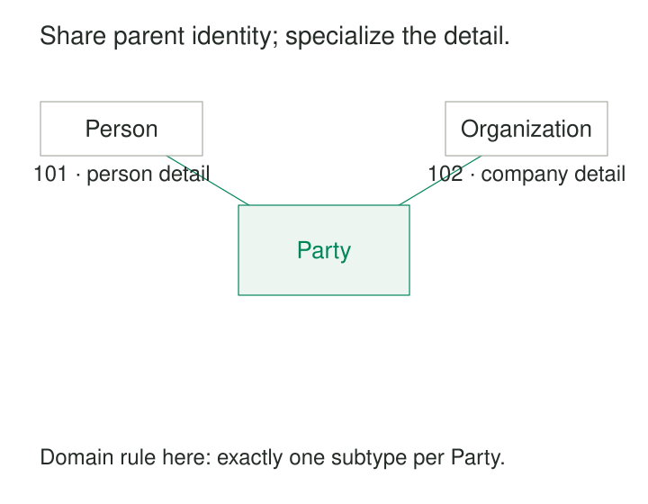

A service desk accepts requests from both individuals and organizations. Everyone needs an identifier and a display name, but their details differ: a person has personal names; an organization has a registered name.

The first design puts everything in one contact table. Soon, nobody knows whether an empty organization field means “individual,” “unknown,” or “registration incomplete.” Another design separates people and organizations entirely, leaving every request with two possible requester references.

**Supertype-Subtype Modeling gives related kinds of entity a shared identity and common facts while preserving their specific attributes and rules.** It is useful when the business needs to treat things collectively in some situations and distinguish their kinds in others.

## One entity, described at different levels

A **supertype** describes the broader category. A **subtype** describes a more specific category whose members are also members of the supertype.

For the service desk, `Party` can mean “an individual or organization that can submit a request.” `Person` and `Organization` specialize that category.

The defining relationship is **“is a.”** A person is a party. An organization is a party. Every rule attached to Party must therefore make sense for both.

In a common relational implementation, shared attributes live in a parent table. Each subtype has its own table, using the parent’s identifier as both its primary key and a foreign key.

Party `101` and Person `101` describe the same entity. The subtype row adds detail; it does not create another person.

That shared identity lets a request reference `Party` through one ordinary foreign key. A feature available only to organizations can instead reference `Organization`, making its narrower eligibility explicit.

## Example: people and organizations submitting requests

Consider the illustrated records:

| Table | Identifier | Facts stored |
|---|---|---|
| Party | 101 | Kind: person; display name: Maya Chen |
| Person | 101 | Given name: Maya |
| Party | 102 | Kind: organization; display name: North Supplies |
| Organization | 102 | Registered name: North Supplies Ltd |

A request with `requester_party_id = 102` belongs to North Supplies. A general requester list reads Party. A registration review joins Party to Organization.

This arrangement gives each fact a clear home. Updating North Supplies’ display name affects its shared identity record; recording its registered name affects its organization details.

The abstraction still needs a precise boundary. Here, Party covers individuals and organizations recognized by this service. It does not automatically include households, informal groups, or every possible legal arrangement. Adding those categories requires revisiting the model’s meaning.

Shared attributes also need shared semantics. A field called `name` is insufficient justification for combining two categories if one value means a trading label and another means an account username.

## Declare which subtype memberships are allowed

Two independent decisions determine the shape of a subtype model:

| Decision | Alternatives | Question |
|---|---|---|
| Exclusivity | Disjoint or overlapping | May one entity belong to multiple subtypes in this set? |
| Coverage | Complete or partial | Must every supertype entity belong to at least one subtype in this set? |

A **disjoint, complete** Party model requires exactly one of Person or Organization. An **overlapping, partial** model permits multiple memberships and also permits entities belonging to none of the listed subtypes. IBM’s modeling documentation defines disjointness and completeness as separate constraints. [IBM: Generalization set properties](https://www.ibm.com/docs/en/ida/9.1.1?topic=sets-generalization-set-properties)

These choices must follow the domain. They should not emerge accidentally from an application’s class hierarchy.

Shared primary keys enforce only part of the agreement. A primary key and foreign key on `Person.party_id` ensure that each Person has a Party and that there is at most one Person row per Party. They do **not**, by themselves, prevent the same Party from also having an Organization row, require every Party to have a subtype, or ensure that a stored `kind` agrees with its subtype rows.

Those rules need additional enforcement. Depending on the database, this may involve discriminator-aware constraints, deferred checks, triggers, or a controlled write interface. Concurrent writes must be considered: two transactions creating different subtype rows can violate exclusivity unless enforcement coordinates them, for example by locking the shared parent.

Where completeness is required, parent and subtype creation should form one atomic operation.

## Example: a university person can be both student and staff

Suppose a university maintains a shared Person identity and separate Student and Staff profiles.

| Person ID | Student profile | Staff profile |
|---|---|---|
| 501 | Student number S-182 | Employee number E-944 |
| 502 | Student number S-183 | — |
| 503 | — | — |

Person `501` studies and works at the university. Person `503` is a visiting researcher who currently has neither profile.

This model is overlapping and partial. A single discriminator containing either `student` or `staff` cannot express its membership rules.

The example also exposes a boundary between subtypes and relationships. A university-wide student number might belong in a Student profile. Enrollment in a particular program belongs in an association between the person and that program. Employment dates for several appointments belong with those appointments.

Subtypes work best when they express meaningful entity-level categories. Roles that vary by organization, contract, or time often need their own relationship records.

## Choose the storage arrangement deliberately

A conceptual subtype model does not dictate one physical schema. Common mappings make different compromises:

| Mapping | Storage arrangement | Main consequence |
|---|---|---|
| Single table, often called TPH | Shared and subtype fields together, usually with a discriminator | Simple shared queries; subtype-specific validity needs conditional rules |
| Shared parent and subtype tables, often called TPT | Common fields in the parent; specific fields in linked tables | Clear separation; reconstructing entities requires joins |
| Concrete subtype tables, often called TPC | Each concrete type stores its common and specific fields | Direct subtype reads; shared definitions repeat and cross-type queries need unions |

EF Core implements all three approaches. Its documentation also warns that TPT frequently performs worse than TPH, so the visually cleanest schema should be tested against representative queries. [Microsoft: Inheritance mapping](https://learn.microsoft.com/en-us/ef/core/modeling/inheritance)

A simple single-discriminator arrangement suits mutually exclusive types. Overlapping memberships need a different representation. Concrete tables also complicate references to the whole hierarchy because there may be no shared parent table to target.

## Verified implementation: Django’s places and restaurants

Django implements the shared-parent approach through **multi-table inheritance**. Its official example defines a `Place` with a name and address, then a `Restaurant` with fields describing whether it serves hot dogs and pizza.

Django creates separate tables and automatically links Restaurant to Place through a one-to-one field that is also the restaurant’s primary key. Restaurant objects expose the common place fields even though those fields reside in the parent table. A Place can also exist without a Restaurant. [Django: Multi-table inheritance](https://docs.djangoproject.com/en/6.0/topics/db/models/#multi-table-inheritance)

This is a concrete framework implementation of shared identity and subtype-specific storage. It also demonstrates partial coverage: the broader category includes places that are not restaurants.

## The costs appear in queries, writes, and change

The pattern earns its complexity when shared identity matters and subtypes have substantial differences in attributes, relationships, or validation.

With separate tables, reading a complete entity requires joins. Creating or deleting it can affect several records and indexes. Deep hierarchies compound this work. With one table, subtype-specific columns accumulate and validation becomes increasingly conditional. Concrete tables repeat common definitions and make changes to shared fields broader migrations.

Adding a subtype affects more than storage. Imports, forms, APIs, reports, and authorization rules may all contain assumptions about the existing set of types. Operational checks should look for missing subtype rows, contradictory discriminators, and prohibited overlaps.

Database features named “inheritance” also require inspection. PostgreSQL’s native table inheritance does not extend primary-key, unique, or foreign-key enforcement across the hierarchy in the way a designer might expect. Its behavior differs from the shared-primary-key arrangement illustrated here. [PostgreSQL: Inheritance caveats](https://www.postgresql.org/docs/current/ddl-inherit.html#DDL-INHERIT-CAVEATS)

## Keep the hierarchy smaller than the business vocabulary

A category deserves a subtype when membership carries meaningful facts or rules. A label used only for filtering may need a controlled vocabulary. Independent capabilities may be clearer as separate components.

Lifecycle states also deserve care. Turning `PendingOrder` into `ApprovedOrder` can force unnecessary movement between tables. When identity persists through a sequence of states, an explicit lifecycle model is usually easier to maintain. If subtype membership itself changes, decide whether the system needs current membership, historical membership, or both.

For analytics, count entities at the shared identity grain. Combining parent and child rows as though each represented a separate entity produces inflated totals.

[[data-declare-the-grain|Declare the Grain]] establishes that identity boundary. [[data-normalized-relations|Normalized Relations]] helps place shared and specific facts according to their dependencies. [[data-relationships-with-attributes|Relationships with Attributes]] handles roles scoped to another entity or agreement. [[data-model-lifecycle-states-explicitly|Model Lifecycle States Explicitly]] handles changes through time without multiplying entity kinds.
