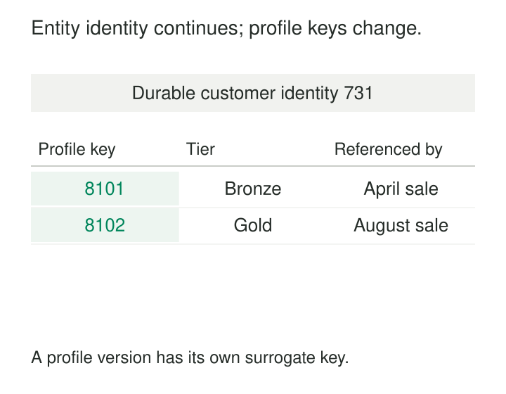

Customer codes are renumbered during an accounting migration. Orders, support cases, and payment records all use those codes as references. A change intended to reorganize one system now requires coordinated updates across many tables.

Surrogate keys give records an identity independent of changing business attributes. Instead of making every relationship depend on an account number, product code, or other external identifier, the system assigns a separate key and maintains the connection to those business identifiers.

This makes references easier to preserve. It also creates a responsibility: the system must assign, retain, and resolve those keys correctly.

## Give the record an independent reference

A **surrogate key** is an identifier introduced for a model rather than taken from the business attributes of the thing being modeled. Common implementations include generated integers and UUIDs.

The value carries no business classification. Customer `731` is not inherently older, more valuable, or in a different region from customer `732`. Those meanings belong in attributes.

A surrogate key often serves as a table’s primary key, with related tables storing it as a foreign key. Business identifiers remain available for lookup, exchange, reconciliation, and uniqueness checks.

The crucial question is **what the key identifies**. In an operational customer table, it might identify a customer account. In a historical dimension, it might identify one version of that customer’s profile. Both are surrogate keys, but they support different relationships.



## Example: change the business code, preserve the relationship

Suppose an authoritative customer register contains:

| Customer key | Customer code | Name |
|---|---|---|
| `731` | `C104` | North Supplies |

An order references customer key `731`.

The business later renumbers this account as `AC0091`, confirming that it remains the same account. The customer code changes; the customer key and the order’s reference remain unchanged.

A minimal PostgreSQL definition could be:

```sql
CREATE TABLE customer (
    customer_id bigint GENERATED ALWAYS AS IDENTITY PRIMARY KEY,
    customer_code text NOT NULL UNIQUE,
    customer_name text NOT NULL
);
```

This assumes one authoritative customer-code namespace. The surrogate primary key identifies the row; the separate unique constraint prevents two current customer records from claiming the same business code.

PostgreSQL’s identity mechanism generates values through an implicit sequence. Identity generation alone does not guarantee uniqueness, which is why the primary-key constraint still matters. [PostgreSQL: Identity Columns](https://www.postgresql.org/docs/current/ddl-identity-columns.html)

The surrogate does not automatically resolve incoming references to the old code. If older messages can still arrive carrying `C104`, the system needs an alias or historical mapping from that code to `731`, with assignment dates when codes can be reused.

## Example: preserve the profile that applied at the time

A customer moves from Bronze to Gold status on 1 June 2026. Reports need to show sales under the tier that applied when each sale occurred.

Overwriting Bronze with Gold would cause earlier sales to appear under Gold. A Type 2 slowly changing dimension instead retains separate profile rows:

| Profile key | Durable customer ID | Tier | Valid from | Valid until |
|---|---|---|---|---|
| `8101` | `731` | Bronze | 2026-01-01 | 2026-06-01 |
| `8102` | `731` | Gold | 2026-06-01 | Open |

Here, validity intervals include their start and exclude their end.

An April sale references profile key `8101`; an August sale references `8102`. Customer identity `731` connects the versions when analysis needs the customer’s complete history.

Kimball’s Type 2 technique assigns a new surrogate primary key when a new dimension version is created, allowing facts to reference the appropriate profile. [Kimball Group: Type 2—Add New Row](https://www.kimballgroup.com/data-warehouse-business-intelligence-resources/kimball-techniques/dimensional-modeling-techniques/type-2/)

Correct assignment requires the relevant business time. An April sale arriving in August should still resolve to the April profile. Looking up only the current row would assign a valid foreign key with the wrong historical meaning.

A concrete implementation appears in IBM InfoSphere DataStage’s Slowly Changing Dimension stage. Its documented mechanism retrieves an existing surrogate key when a matching record is found, obtains a new key when needed, and can output the surrogate reference in place of source dimension information. [IBM: Surrogate Keys in a Slowly Changing Dimension Stage](https://www.ibm.com/docs/en/iis/11.7.0?topic=stage-surrogate-keys-in-slowly-changing-dimension)

## Example: integrate identifiers from several systems

Three source records arrive:

| Source system | Source customer ID | Integrated customer key |
|---|---|---|
| CRM | `17` | `731` |
| Billing | `882` | `731` |
| Support | `17` | `905` |

The CRM and Billing records have been confirmed to describe the same customer. Support’s `17` describes someone else.

The mapping must therefore include the source namespace. Matching on the bare value `17` would incorrectly merge two customers.

A surrogate gives the integrated model a consistent reference, but the mapping requires evidence: an authoritative cross-reference, a governed identity-resolution process, or another defensible rule.

Assigning a fresh key to every incoming record would produce three distinct references and fail to integrate the first two. Assigning keys based only on matching names could merge unrelated customers.

Key generation and identity resolution are separate mechanisms. Surrogate keys provide somewhere to record the result of an identity decision.

## What must hold for correctness

**Assignments must persist.** Once other records reference a key, rebuilding the parent table must preserve that assignment or remap every dependent reference consistently. Numbering rows afresh during each refresh can silently connect facts to different entities.

**Repeated processing must resolve existing identities.** A retry should look up the previously assigned key using a reliable business or source identity. Generating another unique number produces a duplicate record rather than a safe retry.

**The key’s scope must be clear.** Integer `731` in one database has no necessary relationship to `731` in another. Combining independently generated datasets requires namespaces, remapping, or an appropriately designed distributed identifier scheme.

**Historical resolution must be unambiguous.** For the tier example, each relevant event time should resolve to one appropriate profile. Overlapping intervals can produce multiple matches; gaps can leave facts unresolved. Corrections and late-arriving dimension data need explicit handling.

Foreign-key constraints can protect the existence of references. They cannot prove that a referenced customer or historical version is the correct one.

## The operating cost of owning identity

Surrogate keys are especially useful when business identifiers change, several systems must be integrated, composite identifiers would spread through many tables, or historical versions need separate references.

Compact integer keys can reduce the width of repeated foreign keys compared with long business identifiers. Actual performance depends on the database, indexes, and workload.

The operational bill includes key allocation, mapping storage, lookup work, duplicate handling, and recovery procedures. Historical dimensions add version rows and time-based resolution. Merging duplicate entities may require redirecting mappings and dependent references while preserving an audit trail.

Generator choice also matters. A database sequence is straightforward within its allocation scope. UUIDs support independent generation with a very low collision probability when generated correctly, but use wider values than typical integer keys. [PostgreSQL: UUID Type](https://www.postgresql.org/docs/current/datatype-uuid.html)

## Common mistakes and limits

Adding an `id` column does not establish the table’s grain or prevent business duplicates. Ten rows can have ten valid surrogate keys while all describing the same account.

A deterministic hash can make keys reproducible, but it inherits the stability and encoding rules of its inputs. Hashing a mutable customer code does not insulate the reference from code changes.

Sequence values should not become business counts or ordering rules. Likewise, convenient local IDs should not be assumed meaningful across environments.

Surrogates also introduce indirection: someone investigating key `8101` must inspect the referenced row to understand it. Retain readable business identifiers and provenance.

Where a small, stable natural key already fits the model, an additional surrogate may add little value. The choice should follow the identity and reference requirements.

## Related patterns

[[data-natural-keys|Natural Keys]] preserves the business identifiers used to recognize and reconcile records.

[[data-declare-the-grain|Declare the Grain]] establishes whether a key identifies an entity, event, relationship, or version.

Durable identity is the neighboring concept of continuity across changing identifiers and historical rows; it remains distinct from the key for one profile version.

[[data-version-dimension-rows-scd-type-2|Version Dimension Rows — SCD Type 2]] uses separate version references to preserve the attributes that applied when facts occurred.
