A customer identifier starts in an operational database. Soon it appears in warehouse tables, development extracts, support exports, and diagnostic logs. Most of these systems need to recognize the same customer across records. Few need the original identifier.

**Tokenization replaces a sensitive value with a substitute that downstream systems can use while access to the original remains tightly controlled.** A pipeline can join orders to refunds using a customer token without distributing the customer’s identifying value to every analyst.

The design question is what the substitute must preserve: equality across records, compatibility with an existing field, or the ability to recover the original through an authorized workflow.

## Move useful references beyond the sensitive boundary

In a vault-based design, a protected service assigns an opaque token and stores the relationship separately:

| Restricted mapping | Downstream representation |
|---|---|
| Customer identifier `C17` ↔ token `T_A7` | Order `O91`, customer token `T_A7` |
| Customer identifier `C28` ↔ token `T_K2` | Order `O92`, customer token `T_K2` |

The downstream system receives a usable reference. Recovering the original requires access to the protected mapping and permission to use it.

Tokenization can also use cryptographic transformations rather than a stored mapping. Terminology varies across products, so the word *token* alone does not establish how recovery or matching works.

| Approach | Mechanism | Recovery |
|---|---|---|
| Random token with a vault | Assign a substitute and retain its mapping | Authorized lookup |
| Reversible cryptographic token | Encrypt the value using a protected key | Authorized decryption with the required context |
| One-way keyed token | Compute a keyed digest, such as HMAC | No decryption operation |

Google Sensitive Data Protection implements reversible AES-SIV tokenization and one-way HMAC-SHA-256 pseudonyms, among other options. These mechanisms have different operational and security properties. [Google’s pseudonymization documentation](https://docs.cloud.google.com/sensitive-data-protection/docs/pseudonymization)

*The diagram shows a vault-based implementation. Token labels are shortened for illustration.*

## Preserve the relationships the work requires

Suppose a retailer wants to compare purchases and refunds without exposing source customer identifiers.

Its protected pipeline produces:

| Dataset | Record | Customer token | Amount |
|---|---|---|---:|
| Orders | O91 | T_A7 | $100 |
| Orders | O93 | T_A7 | $40 |
| Refunds | R12 | T_A7 | $20 |
| Orders | O92 | T_K2 | $60 |

The analyst can associate the $20 refund with the customer who purchased $140. The analysis does not require recovering `C17`.

For this to work, repeated identifiers must receive the same token within the intended scope. A vault can reuse an existing mapping. A deterministic transformation can reproduce the token from the same input and configuration.

Fresh random tokens for every row would break customer grouping. A single placeholder such as `REDACTED` would collapse different customers together.

Stable tokens preserve an identifier’s equality, however, rather than establishing a person’s identity. Two accounts belonging to one person still receive different tokens if their source identifiers differ. A shared email address remains shared. **Tokenization does not resolve duplicate identities or make a weak business key reliable.**

The input contract matters too. Source namespace, data type, normalization, and tokenization version must agree across participating pipelines. Customer `17` in two unrelated systems must not become the same customer merely because both systems use the number seventeen.

## Keep payment details out of ordinary application storage

Payment collection illustrates another use: allowing an application to request an operation without routinely handling the underlying sensitive value.

Stripe’s recommended payment integrations collect card information and transmit it directly to Stripe without passing it through the merchant’s servers. This reduces the merchant’s exposure to raw card data and can reduce PCI obligations, although compliance remains a shared responsibility. [Stripe integration security guide](https://docs.stripe.com/security/guide)

A merchant’s order system can retain the provider reference needed for its payment workflow instead of copying the full card number into its database, logs, and reporting tables.

The reference’s lifecycle must match the operation. Stripe’s card Token API, for example, creates **single-use** tokens. Such a token is not a permanent identifier that can simply be reused for every future charge. [Stripe card token API](https://docs.stripe.com/api/tokens/create_card)

This exposes a broader distinction: some tokens support stable analytical matching; others represent a limited transaction or provider workflow. A token’s appearance says little about its permitted use.

Possessing a reference must also remain separate from authorization. An application should verify that the requesting customer may use the referenced payment method or record. An opaque identifier does not replace that check.

## Choose how far linkage should travel

A research organization runs two unrelated studies. Both contain participant `P17`, but there is no approved reason for the recipients to connect their records.

A universal token would create that connection immediately. Separate token scopes can instead produce:

| Original identifier | Scope | Illustrative token |
|---|---|---|
| P17 | Study A | T_A7 |
| P17 | Study A | T_A7 |
| P17 | Study B | T_B2 |

Study A retains repeat-participant analysis. Direct equality matching between studies no longer works.

Google’s reversible tokenization supports a context field that changes the output for the same identifier across contexts. The context is also needed for reversal. Its HMAC option does not expose that same context-field feature; scope separation must follow the chosen mechanism’s supported design. [Google’s context-tweak documentation](https://docs.cloud.google.com/sensitive-data-protection/docs/pseudonymization#using_context_tweaks)

Separate scopes sacrifice some convenience. Cross-study analysis may require a separately approved linkage process. That friction reflects the intended boundary.

Other attributes still matter. Exact locations, rare diagnoses, or detailed activity histories may identify someone even when the participant identifier is replaced. The ICO treats pseudonymization as a risk-reduction measure and emphasizes protecting the additional identifying information separately. Tokenized data should not automatically be described as anonymous. [ICO guidance on pseudonymisation](https://ico.org.uk/for-organisations/uk-gdpr-guidance-and-resources/data-sharing/anonymisation/pseudonymisation/)

## The assumptions behind a trustworthy token

Protection depends on separating access. If analysts can read the token table and its mapping, or call an unrestricted recovery service, the intended boundary disappears.

Token creation needs controls too. A service that accepts unlimited guesses and returns stable tokens can let someone test candidate identifiers against a dataset. Keyed hashing avoids some weaknesses of plain, unsalted hashes, but access to the key or an unrestricted token-generation endpoint can undermine that protection.

Correctness also requires an adequate token space and collision handling. Truncating tokens to fit a legacy column can merge unrelated values. A vault must handle concurrent requests consistently when repeated values are meant to reuse one mapping. Missing values need explicit treatment; a common “missing” token must not accidentally become a shared customer.

Replacing known structured fields is easier to verify than finding every identifier embedded in free text. Originals may survive in rejected records, logs, temporary files, or backups. The protection covers only the paths that actually perform the replacement.

## Pay for the boundary you create

Vaults add storage, lookup latency, availability requirements, backups, and recovery testing. Cryptographic approaches reduce mapping storage but introduce key management and transformation costs. Both require authorization, monitoring, and operational ownership.

Failures need a deliberate response. If the service is unavailable, quietly publishing the original identifier defeats the pattern. Holding affected records for retry is often preferable to bypassing protection.

Changing tokenization keys can also change stable tokens and break joins between historical and newly processed data. Google’s reference architecture explicitly identifies re-tokenization as a consequence of changing the underlying token encryption key. Treat that change as a data migration. [Google’s de-identification architecture](https://docs.cloud.google.com/architecture/de-identification-re-identification-pii-using-cloud-dlp)

Tokenization is useful when systems need record relationships or controlled operations while most consumers have no reason to see the original values. It is less useful when consumers require the original values throughout their work, or when dropping unnecessary fields would satisfy the purpose more simply.

## Related patterns

[[data-dynamic-masking|Dynamic Masking]] changes what a query returns according to policy. Tokenization supplies substitutes that can travel through downstream datasets, each of which still needs appropriate protection.

[[data-surrogate-keys|Surrogate Keys]] also introduce substitute identifiers. Tokenization adds a protection objective and requires control over how the substitute relates to the original.

**Namespace Identifiers** establish the scope in which an identifier means something. Tokenization must preserve that distinction to avoid false matches.

[[data-row-and-column-level-access|Row- and Column-Level Access]] controls who may use data. It complements tokenization by restricting access to tokenized records, protected originals, and recovery functions.
