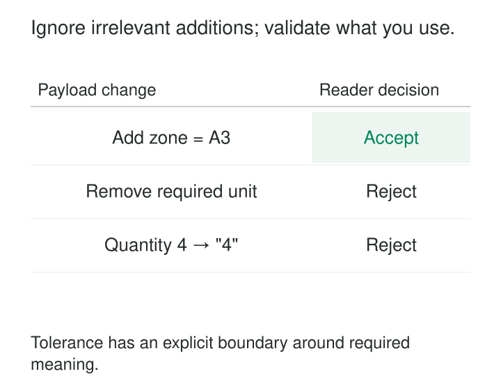

An inventory producer adds a warehouse-zone field. The stock report does not use it, but its deserializer rejects every record containing an unexpected property. A useful addition becomes an outage for an unrelated consumer.

At the other extreme, another reader keeps processing by replacing missing quantities with zero and assuming every unknown unit means “each.” Its dashboard stays available while its numbers become unreliable.

[[data-tolerant-readers|Tolerant Readers]] depend on the smallest explicit portion of an interface that their task requires. They accept permitted extensions while continuing to validate the information needed for correct interpretation.

The purpose is to reduce unnecessary coupling without concealing incompatible changes.

## Make dependencies smaller and more precise

A reader should distinguish three things:

- Information it requires and must validate.
- Optional information with documented absence behavior.
- Permitted extensions it does not need to interpret.

This makes the consumer’s actual dependency visible. An inventory report may require warehouse identity, product identity, quantity, and unit. It need not depend on a newly introduced picking-zone description.

Martin Fowler’s [Tolerant Reader description](https://martinfowler.com/bliki/TolerantReader.html) recommends consuming the information needed, minimizing incidental structural assumptions, and concentrating payload-reading logic behind a local interface. It also connects that reader to consumer-driven tests that producers can run.

The local interface matters. Decode and validate at the boundary, then give the rest of the application a small, dependable representation. Scattering loosely interpreted payload access throughout business logic creates many different readers with inconsistent assumptions.

## Accept an added field while protecting quantity semantics

Consider an illustrative inventory snapshot:

```json
{
  "warehouse_id": "W1",
  "sku": "S17",
  "on_hand": 4,
  "unit": "EA",
  "warehouse_zone": "A3"
}
```

The consumer needs the first four fields. Its contract requires nonempty identifiers, a nonnegative integer quantity, and unit `EA`.

If the interface permits additional properties, the reader can ignore `warehouse_zone` and produce the same local inventory object as before.

That tolerance does not extend to a missing `unit` or `on_hand: "four"`. Those changes affect the information required to interpret the record.



[Pydantic’s configuration](https://docs.pydantic.dev/latest/api/config/) provides a concrete implementation mechanism: `extra='ignore'` ignores additional inputs, while `strict=True` disables ordinary type coercion for the model’s fields. Required fields and value constraints remain separate declarations.

The extension policy must be deliberate. [JSON Schema](https://json-schema.org/understanding-json-schema/reference/object#additionalproperties) allows additional properties by default, while `additionalProperties: false` rejects them. A reader cannot assume that every interface promises extensibility.

Acceptance also has a scope: this reader has validated its dependencies, not certified every unused field in the producer’s message.

## Select warehouse columns by their documented names

The same principle applies to analytical readers.

A stock-export query can explicitly select its dependencies:

```sql
select warehouse_id, sku, on_hand, unit
from inventory_snapshot;
```

Adding `warehouse_zone` does not change that result’s column set. A `SELECT *` export, by contrast, may acquire another column and break a downstream positional reader.

This approach reduces dependence on unrelated additions. It does not protect against changes to existing names, types, units, or grain.

Suppose the producer starts returning one row per warehouse zone instead of one row per warehouse and SKU. The selected columns still exist, but formerly unique keys may now repeat. The consumer therefore needs a check on the promised `(warehouse_id, sku)` grain.

For files, use headers or another documented field-identification mechanism where available. Ignoring trailing columns is appropriate only when the file contract defines that extension behavior. A position-based format cannot safely be interpreted as a name-based one by guesswork.

## Preserve what downstream readers may need

A final consumer can discard information irrelevant to its result. A relay has a different obligation.

Imagine a new producer adds `delivery_priority`. An older intermediary reads the message, updates a routing field, and publishes it again. If it reconstructs the message using only its known fields, the new priority disappears before reaching a newer fulfillment consumer.

The intermediary tolerated the input but damaged the onward interface.

Protobuf implements useful preservation behavior: its [Proto3 documentation](https://protobuf.dev/programming-guides/proto3/#unknown-fields) explains that binary messages retain unknown fields through parsing and serialization. It also documents operations that can lose them, including conversion to JSON and field-by-field reconstruction.

Test the actual relay operation. Successful parsing alone does not establish that unrecognized information survives forwarding.

Avro offers a related reading mechanism: its [schema-resolution rules](https://avro.apache.org/docs/1.12.0/specification/#schema-resolution) allow a reader to ignore writer fields absent from the reader schema. Correct decoding still requires the applicable writer schema; tolerance does not make arbitrary bytes self-describing.

Whether to discard, retain, or forward additional information follows the component’s role and contract.

## Give unfamiliar values their own policy

An unknown field and an unknown value inside a required field are different situations.

A report may safely ignore a new descriptive property. A fulfillment handler receiving a new order state cannot assume that state means “ready to ship.”

Choose behavior according to the decision involved. A descriptive analysis might retain the unfamiliar value in an explicit “unrecognized” category, report its frequency, and continue. A workflow whose next action depends on that value may need to hold the record for investigation.

Defaults need equivalent care. Missing delivery instructions may mean “not recorded.” Missing quantity does not automatically mean zero. An absent currency cannot safely inherit whichever currency is most common.

Document any coercion or fallback that is allowed. Repeatedly repairing undocumented producer errors can turn accidental behavior into a permanent dependency.

The IAB’s [RFC 9413, *Maintaining Robust Protocols*](https://www.rfc-editor.org/rfc/rfc9413.html), distinguishes designed extension mechanisms from implementations improvising around unexpected input. Clear extension and error-handling rules make tolerance predictable.

## Keep flexibility at a controlled boundary

Minimal dependence does not mean abandoning structure.

Read fields from their documented locations. Searching an entire document for the first element named `amount` can accidentally select a nested refund, historical value, or unrelated summary.

Likewise, treat alternative spellings, date formats, and units as explicit supported variants. An expanding collection of guesses makes failures difficult to reproduce and producer defects difficult to discover.

The enclosing message must still be well formed. Ignoring an unused property does not mean accepting malformed JSON, ambiguous identifiers, or incomplete framing. Apply appropriate payload-size and nesting limits even when some content is not used.

Producers should continue emitting their declared contract. A tolerant consumer is not permission to remove required information or silently change its meaning.

## Test tolerance and refusal together

Useful tests cover both the changes the reader should survive and those it must expose.

Start with representative valid records, then add permitted fields, reorder properties, vary optional-field presence, and exercise supported historical forms. The local business result should remain unchanged where those variations are irrelevant.

Also remove required fields, change critical types, introduce unsupported units, and break key assumptions. Verify the documented failure outcome rather than merely checking that an exception occurred.

For relays, test preservation through the complete parse-modify-serialize sequence.

Share the consumer’s actual requirements with producers. A contract test that accepts any string cannot establish that a handler understands every possible status. Conversely, asserting the complete producer payload can accidentally recreate the coupling the pattern is intended to remove.

## Budget for flexibility without hiding drift

Tolerant readers are useful when producers evolve independently, payloads contain information for several consumers, or additive changes are frequent.

Their costs include boundary adapters, compatibility fixtures, preservation logic, and observability. Excessively flexible readers accumulate conversion paths and inconsistent interpretations. Excessively broad logging of ignored content adds volume without necessarily improving diagnosis.

Monitor meaningful drift: unfamiliar values in required categories, increasing fallback use, missing dependencies, or changed key multiplicity. Routine permitted additions need not become operational noise.

The pattern cannot preserve a dependency whose semantics have changed. Changes to grain, identity, units, or required behavior may need a new interface version and migration.

[[data-explicit-data-contracts|Explicit Data Contracts]] defines permitted extensions and required meaning. [[data-additive-schema-evolution|Additive Schema Evolution]] supplies changes tolerant readers can accommodate. [[data-compatibility-checks-in-delivery|Compatibility Checks in Delivery]] tests supported reader behavior. [[data-quarantine-invalid-records|Quarantine Invalid Records]] provides a controlled destination when required information cannot be interpreted.
