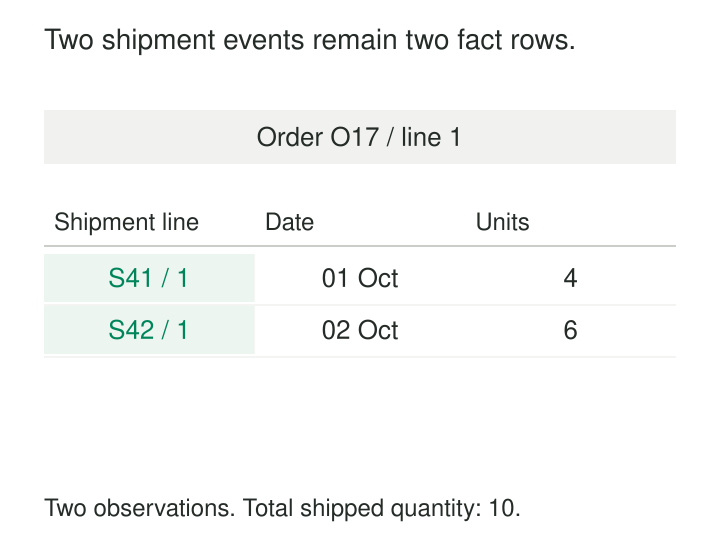

An order line requests ten units. Four leave the warehouse on Monday; the remaining six leave on Tuesday.

A table containing only the order’s latest shipped quantity can report ten units shipped. It cannot explain the two shipments, their dates, or which warehouse handled each one. Recording the original ten-unit order quantity on both shipment rows creates another problem: summing it produces twenty.

**Transaction Fact Tables preserve measurements at the grain of an identifiable business occurrence.** Each row describes one occurrence, carries its appropriate dimensional context, and stores measures that belong to that occurrence.

The purpose is to retain enough detail for reliable aggregation and investigation without confusing an event with the continuing state of an order, account, or process.

## Declare the occurrence before choosing columns

The word “transaction” does not require a financial payment or a database commit. A shipment line, checkout line, or payment capture can each provide a transaction grain.

A useful declaration is concrete:

> One row represents one shipment line recorded by a source system.

This determines which measurements belong in the row. Shipped units belong there. The complete order’s requested quantity usually belongs elsewhere.

Kimball describes transaction facts as measurements associated with an occurrence at a particular place and time, with dimension keys and measures consistent with that grain. Rows exist when measurements occur, so activity can be sparse or dense. [Kimball: Transaction Fact Tables](https://www.kimballgroup.com/data-warehouse-business-intelligence-resources/kimball-techniques/dimensional-modeling-techniques/transaction-fact-table/)

A source delivery containing a thousand records is a loading batch. It does not make those records one business occurrence.

## Example: one order line, two shipment facts

Order O17, line 1, produces:

| Shipment line | Shipment date | Order reference | Shipped units |
|---|---|---|---:|
| S41 / 1 | October 1 | O17 / 1 | 4 |
| S42 / 1 | October 2 | O17 / 1 | 6 |

The two rows preserve the shipment observations. Their quantities sum to ten, while their dates support a daily shipping report.

*The order reference connects the observations. It does not define their grain.*

Counting these rows gives two shipment lines, not two orders. Counting distinct order identifiers gives one order in this example. A shipment containing several lines would also require a distinct shipment count when the question concerns shipments rather than lines.

The event identity must survive extraction retries. A key such as source system, shipment identifier, and shipment-line identifier can distinguish a genuine second shipment from another delivery of the first shipment’s data.

Dimension keys alone may not establish uniqueness. Two legitimate shipment lines can share the same product, customer, warehouse, and date.

## Attach context that belongs to the event

A shipment fact might reference product, customer, shipping location, carrier, and shipment date dimensions. It may retain order and shipment identifiers directly for grouping and investigation.

Each relationship needs a defined interpretation. The shipping location is where this shipment originated, rather than whichever location currently handles the customer.

When historical descriptions matter, resolve the dimension version applicable at the event’s time. A late-arriving June event should not automatically inherit a customer classification introduced in August.

Dimensions must also join without multiplying the observation. If a line genuinely involves several allocations, locations, or participants, choose a finer grain or an explicit multivalued relationship.

Microsoft’s Fabric guidance illustrates fact-table structures with dimension keys, transaction identifiers, measures, and optional audit attributes. It also describes special dimension members for missing or unknown context. [Microsoft: Modeling fact tables](https://learn.microsoft.com/en-us/fabric/data-warehouse/dimensional-modeling-fact-tables)

A provisional dimension member can let a known event load before its descriptive details arrive. Completing that member later does not create another shipment.

## Example: store amounts that aggregate correctly

A retail receipt contains two lines:

| Line | Units | Net amount, USD cents |
|---|---:|---:|
| Two notebooks | 2 | 1,200 |
| One pen | 1 | 300 |

The receipt contains three items and USD 15 of net merchandise sales.

Those components support a weighted average selling amount of 500 cents per item:

`1,500 cents ÷ 3 items = 500 cents per item`

Averaging the two unit prices produces 450 cents, which gives each line equal weight despite their different quantities. Summing unit prices is also unhelpful.

Store extended amounts and quantities where possible, then derive ratios at the required reporting grain. Kimball’s fact-table guidance emphasizes additive measures and illustrates storing extended price rather than relying on unit price as an additive fact. [Kimball: Fact Tables](https://www.kimballgroup.com/2008/11/fact-tables/)

Additivity still requires compatible meaning. Currency amounts need a shared currency or an explicit conversion policy. Quantities need compatible units.

A receipt-level delivery fee also needs separate treatment. Repeating a USD 5 fee on both merchandise lines produces USD 10 when summed. Keep it at receipt grain or allocate it through a documented rule.

## A published implementation: AdventureWorks

Microsoft’s AdventureWorks warehouse installation script provides a concrete implementation in `FactInternetSales`.

The table includes sales order number and line number, product and customer keys, order/due/ship date keys, and measures including order quantity, extended amount, sales amount, and total product cost. [AdventureWorks warehouse schema](https://github.com/microsoft/sql-server-samples/blob/master/samples/databases/adventure-works/data-warehouse-install-script/instawdbdw.sql)

This demonstrates how transaction identifiers, descriptive context, and numeric measurements coexist in a fact structure.

It is a published sample implementation, not a claim about a particular company’s production warehouse. A shipment process allowing multiple deliveries against one sales line still needs its own shipment-level grain.

## Handle retries, corrections, and returns deliberately

Transaction facts generally preserve the occurrence as measured. Loading them does not mean blindly appending every incoming record.

A replay of S41 / 1 should not add another four shipped units. Match the stable event identity and apply an explicit duplicate and revision policy.

If S42 / 1 was incorrectly recorded as six units and is corrected to five, decide how the analytical interface represents that correction. It might replace the erroneous value while retaining revision evidence separately, or use an explicit adjustment design. Recompute affected summaries accordingly.

A later return is a new business occurrence. In a signed sales-movement model, a sale of 100 and a return of 20 can contribute +100 and −20, producing net 80. Event types preserve the ability to report gross sales and returns separately. A separate return fact table with conformed dimensions is another valid design.

Neither approach should silently erase the original occurrence.

## Keep activity separate from state and milestones

Transaction facts answer questions about occurrences: what shipped, sold, or was captured, and when.

Periodic snapshots record measurements at recurring boundaries, such as closing inventory by product and location. Accumulating snapshots track a process through milestones, such as release, first shipment, full shipment, and delivery.

These structures complement one another. A shipment fact preserves individual dispatches; an accumulating order snapshot summarizes progress; a daily inventory snapshot records the resulting balance.

Kimball distinguishes these three fact-table forms by their grains and update behavior. [Kimball: Fact Tables](https://www.kimballgroup.com/2008/11/fact-tables/)

Absence also needs interpretation. No shipment row may mean no activity, missing capture, or an incomplete delivery. Reporting zero activity requires an appropriate calendar or coverage set and confidence in data completeness.

## Costs, useful situations, and limits

This pattern is especially useful when consumers need detailed slicing, event-level reconciliation, historical investigation, or summaries that can evolve beyond today’s reporting questions.

Its costs include storage, dimension lookups, duplicate handling, correction processing, and scanning large histories. Partitioning, clustering, and aggregate tables can improve access while retained detail supports investigation.

Late events can change prior reporting periods. Preserve event time separately from ingestion and publication times, and define whether reports restate history.

A detailed fact table is not automatically an operational event store or a complete audit trail. Its transformation may filter records, normalize values, or omit source attributes. Retain appropriate source evidence and lineage when those distinctions matter.

Before publishing, check uniqueness at the declared grain, dimension relationships, compatible units, and source-to-target totals. Avoid joining separate detailed fact tables in ways that multiply their rows.

## Related patterns

[[data-declare-the-grain|Declare the Grain]] establishes what one fact row means. [[data-star-schema|Star Schema]] organizes the dimensions around those measurements.

[[data-store-additive-components|Store Additive Components]] preserves quantities and amounts needed for correct derived measures.

[[data-periodic-snapshots|Periodic Snapshots]] and [[data-accumulating-snapshots|Accumulating Snapshots]] provide complementary views of state and process progress.
