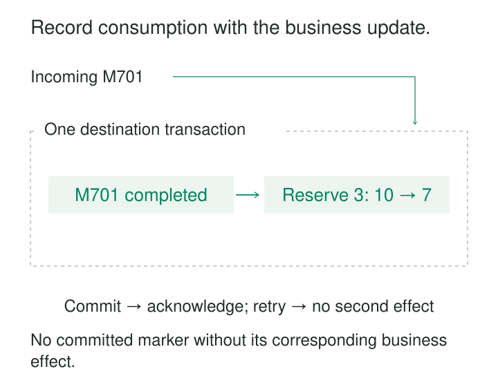

A consumer reserves three units of stock, commits the database transaction, and crashes before acknowledging its message. The broker delivers the message again. Without a durable record of completion, the consumer reserves another three units.

Acknowledging first creates the opposite failure: the message disappears from the broker, then the database update fails.

A Transactional Inbox closes this gap on the receiving side. It records that a message has been handled in the same database transaction as the business changes caused by that message. A redelivery can then distinguish completed work from work that still needs to happen.

The purpose is to make repeated delivery safe across crashes, retries, and competing consumers.

## Make completion part of the business transaction

An inbox is a durable record of incoming message identity and processing state. Its key normally includes the logical consumer and the message ID, plus a source namespace when IDs are not globally unique.

“Logical consumer” means the handler or subscription whose work must happen once. It does not mean a particular worker process. Two workers running the same handler must share the same deduplication scope.

In the simplest design, processing follows this sequence:

1. Begin a database transaction and claim the message through a unique inbox key.
2. Apply the business changes and record completion within that transaction.
3. Commit, then acknowledge the delivery.

If the transaction rolls back, neither completion nor the business effect remains. If it commits but acknowledgment fails, redelivery finds the committed inbox record and skips the effect.

This is the consumer-side transactional deduplication described by the **Idempotent Consumer** pattern. Its separate processed-message table uses a consumer-and-message key to recognize repeated deliveries. [Idempotent Consumer pattern](https://microservices.io/patterns/communication-style/idempotent-consumer.html)

The broker acknowledgment remains outside the local transaction. The inbox makes the resulting uncertainty recoverable.

## Example: reserve three units once

Message M701 asks the inventory consumer to reserve three units. Available stock starts at ten.

A successful transaction records `(inventory, M701)` as completed and changes available stock to seven. Subsequent copies of M701 leave it at seven.

| Failure point | Durable database state | Recovery |
|---|---|---|
| Before commit | No completed reservation | Retry the transaction |
| After commit, before acknowledgment | Completion recorded; stock is seven | Skip the effect and acknowledge |
| After acknowledgment | Completion recorded; stock is seven | No further work required |

The claim must remain part of the transaction. Committing an inbox marker first and updating stock afterward can leave a message permanently marked complete even though its work failed.

A separate “does M701 exist?” query is also insufficient under concurrency. Two workers can both observe absence. A unique constraint, row lock, or equivalent transactional mechanism must arbitrate ownership.

PostgreSQL’s `ON CONFLICT` provides a database-enforced way to handle competing inserts against a unique key. Application logic must still ensure that only the successful claim proceeds with the business effect. [PostgreSQL conflict handling](https://www.postgresql.org/docs/current/sql-insert.html)

Different messages introduce a separate concern. M701 and M702 may both legitimately reserve stock. Their transactions still need suitable isolation or conditional updates to prevent overselling. Inbox deduplication protects against repeating the same message; it does not enforce every business invariant.

## “Received” and “completed” are different states

Some systems persist incoming messages before executing their handlers. This creates a durable local work queue and allows the transport acknowledgment to happen earlier.

That design has two transactional boundaries:

- **Acceptance:** durably store the message and enough information to process it.
- **Completion:** atomically commit the business changes and the message’s completed status.

After durable acceptance, the inbox owns recovery. The broker may already consider delivery finished.

An existing row therefore does not always mean “skip processing.” A row marked `Received` means work is pending. A row marked `Completed` means the committed effect must not be repeated.

The distinction determines whether a duplicate delivery should trigger business processing, leave existing pending work alone, or simply be acknowledged.

## Example: accept a webhook, process it later

A supplier sends a webhook containing delivery report R88. Processing requires validation, reference-data lookup, and several database updates.

The receiver first stores the stable report ID, payload, schema version, and receipt time. Only after that transaction commits does it return a successful acceptance response.

A worker later claims R88. It applies the report and marks the inbox row completed in one transaction.

If the worker crashes before commit, the pending report remains recoverable. If it crashes afterward, recovery sees completion and avoids applying the report again. If the HTTP response was lost, the supplier’s repeated webhook resolves to the same inbox identity.

Wolverine documents this store-first model for durable endpoints: it persists an incoming envelope before acknowledging the broker, then processes it locally. With appropriate transactional middleware, its handled status participates in the message-handling transaction. [Wolverine durable-endpoint idempotency](https://wolverinefx.net/tutorials/idempotency)

A store-first inbox needs worker recovery, durable retry scheduling, and safe ownership transfer. An expired worker lease alone cannot permit two workers to commit the same pending operation. Ownership checks or transactional locking must protect completion.

The early response means “accepted durably.” It does not mean “business processing succeeded.”

## Example: create a customer and publish an event

A consumer receives M880, creates customer C17, and must publish `CustomerCreated`.

An inbox protects the customer insert from repeated handling, but publishing directly introduces another gap. If the database commits and publication fails, the customer exists without its event. If publication happens first and the transaction fails, downstream systems observe a customer that was never committed.

The consumer can combine inbox and outbox:

**One transaction records incoming completion, creates C17, and stores the outgoing event intent.**

A relay publishes the outbox entry afterward. Publication may repeat, so downstream consumers need their own duplicate protection.

NServiceBus implements this combination within its Outbox feature. It deduplicates incoming message IDs, executes business changes, and stores outgoing messages in the database transaction; dispatch happens afterward. Its documentation explicitly separates these phases and excludes effects that do not enlist in the transaction. [NServiceBus Outbox mechanism](https://docs.particular.net/nservicebus/outbox/)

On redelivery, completed business work should stay skipped while unfinished outgoing delivery remains recoverable. Treating “incoming message already processed” as permission to abandon pending outgoing work breaks the combined design.

## What the guarantee depends on

Message identity must survive retries and republishing. A newly generated identifier for every delivery attempt defeats the inbox. Broker delivery tags and worker IDs are generally unsuitable substitutes for stable logical message identity.

The same key must also retain the same meaning. A repeated message ID with a different payload should produce a conflict signal rather than silently suppressing potentially legitimate work. A stored payload fingerprint can help detect this mismatch.

Inbox completion and protected business changes must share the actual transaction. Using the same database server through unrelated transactions does not provide atomicity.

The guarantee covers committed transactional effects. Handler code may execute more than once, and direct emails, HTTP requests, or filesystem changes remain outside that guarantee. Those effects need an outbox, destination-supported idempotency, or reconciliation.

Ordering is separate too. An inbox can prevent duplicate application while still allowing version 12 to arrive before version 11.

## Retention, recovery, and operating costs

Completed inbox identities must remain available across the expected redelivery horizon, including delayed retries and manual replay. After removal, an old message can appear new again. NServiceBus documents this retention dependency explicitly. [NServiceBus deduplication retention](https://docs.particular.net/nservicebus/outbox/#outbox-expiration-duration)

Pending messages need a different lifecycle. They must remain recoverable until completed or explicitly moved to a terminal state such as dead-letter storage. A malformed message should not block healthy work indefinitely, but moving it aside does not mean its business effect succeeded.

Costs include inbox inserts, completion updates, unique indexes, transaction-log traffic, cleanup, and possibly retained payloads. Store-first designs add polling, ownership coordination, and a local backlog that needs capacity limits.

Useful signals include duplicate deliveries suppressed, oldest pending-message age, retry counts, stuck claims, payload conflicts, transaction duration, and cleanup lag.

The pattern is particularly useful when at-least-once messages cause non-idempotent database changes. It offers less value when operations are already harmless to repeat or when the required effects cannot participate in a suitable transaction.

## Related patterns

[[data-idempotent-writes|Idempotent Writes]] describes the broader goal; a transactional inbox supplies a reusable consumer-side mechanism. [[data-transactional-outbox|Transactional Outbox]] preserves outgoing intent alongside the same business transaction.

[[data-per-key-ordering|Per-Key Ordering]] governs the sequence of distinct messages. [[data-state-expiration|State Expiration]] explains why deleting completed inbox identities also ends a period of duplicate protection.
