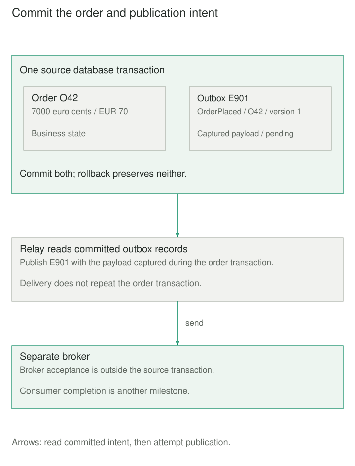

## Purpose and problem

An order service saves O42, then publishes `OrderPlaced`. The database commits, but the process crashes before publication. The order exists; fulfillment never hears about it. Publishing first reverses the failure: fulfillment can receive an event for an order that later rolls back.

The service needs to accept orders independently of temporary broker outages while retaining a dependable obligation to notify downstream systems. Two successful-looking calls in one method do not make the database and broker atomic.

## Core idea

**Commit the change and the obligation; deliver afterward.** Transactional Outbox stores an outgoing message in the same local transaction as the business change. A relay sends committed messages later.

Both local writes commit, or neither does. This removes the gap between saved business state and saved publication intent. Delivery still requires a functioning relay and destination; it can repeat. “Outbox pattern” is common shorthand. A normal email outbox or an in-memory queue alone does not establish the transactional guarantee.



## How it works

### Preserve what was accepted

The sender saves business data and a serialized message within one supported database atomic boundary. Relational systems can use two tables; document systems can embed pending messages within their atomic write scope. Separate transactions on two connections do not suffice.

Capture the intended payload now. Rebuilding `OrderPlaced` from the current order during delivery could describe a later amendment under an earlier event name. Retain stable event identity, entity identity, event type, schema version, and required ordering information.

### Send before recording dispatch

A polling relay selects committed pending records, publishes, and records success after acknowledgment. Marking first creates a loss window. Sending first creates a repeat window if acknowledgment is lost or the relay crashes before recording dispatch. Retry with the same event ID.

Broker acceptance and consumer completion are different milestones. A dispatch flag proves only the milestone its protocol defines. An idempotent consumer can record event identity and its local business effect atomically; a remote shipping request needs its own repeat protection. The outbox does not deduplicate client commands either.

A CDC relay instead follows committed outbox inserts through a transaction log. Debezium's documented router carries event identity and uses an aggregate-derived message key. Such routing helps ordering within a partition; it cannot repair messages published in the wrong order. Concurrent updates, relays, retries, and consumers must preserve the order actually needed per entity.


## Worked example

### One order, two broker acceptances

Saving O42 commits one order and one pending message together. The broker then accepts E901, but its acknowledgment is lost, so the relay still sees E901 as pending. The next attempt sends E901 again and records success. One order remains, the pending count reaches zero, and the broker has accepted the same logical message twice.

Follow the paired local writes and the relay’s publish-before-mark order. Duplicate handling at the receiver remains a separate responsibility.

Save `outbox.py` and `demo.py` together; run `python3 demo.py` with Python 3.11+. O42 totals 7000 euro cents, or EUR 70.00. IDs contain 1–64 ASCII letters, digits, underscores, or hyphens; totals are integer euro cents from 1 to 100,000,000.

The source connection is dedicated and initially idle. `BEGIN IMMEDIATE` starts the order transaction; its context commits or rolls back. The relay refuses an active transaction so it cannot publish that connection's uncommitted records. It holds no database transaction during publication. One relay owns this bounded polling loop; parallel workers would need coordination.

```python
import json
import re
import sqlite3


def identifier(value):
    if not isinstance(value, str) or not re.fullmatch(r"[A-Za-z0-9_-]{1,64}", value):
        raise ValueError("Invalid identifier")
    return value


def connect(path):
    db = sqlite3.connect(path, isolation_level=None, timeout=5)
    try:
        db.execute("""CREATE TABLE IF NOT EXISTS orders (
            order_id TEXT PRIMARY KEY NOT NULL,
            total_cents INTEGER NOT NULL CHECK (total_cents BETWEEN 1 AND 100000000)
        )""")
        db.execute("""CREATE TABLE IF NOT EXISTS outbox (
            sequence INTEGER PRIMARY KEY AUTOINCREMENT,
            event_id TEXT NOT NULL UNIQUE, payload TEXT NOT NULL,
            dispatched INTEGER NOT NULL DEFAULT 0 CHECK (dispatched IN (0,1))
        )""")
    except BaseException:
        db.close()
        raise
    return db


def place_order(db, order_id, total_cents, event_id):
    order_id, event_id = identifier(order_id), identifier(event_id)
    if type(total_cents) is not int or not 1 <= total_cents <= 100000000:
        raise ValueError("Invalid total in euro cents")
    payload = json.dumps({"type": "OrderPlaced", "schema": 1,
        "order_id": order_id, "order_version": 1,
        "total_cents": total_cents, "currency": "EUR"}, sort_keys=True)
    db.execute("BEGIN IMMEDIATE")
    with db:
        db.execute("INSERT INTO orders VALUES (?, ?)", (order_id, total_cents))
        db.execute("INSERT INTO outbox (event_id,payload) VALUES (?,?)",
                   (event_id, payload))


def relay_once(db, publish):
    if db.in_transaction:
        raise ValueError("Relay requires an idle connection")
    row = db.execute("""SELECT sequence,event_id,payload FROM outbox
        WHERE dispatched=0 ORDER BY sequence LIMIT 1""").fetchone()
    if row is None:
        return False
    sequence, event_id, payload = row
    publish(event_id, payload)  # Return only after acceptance; raise on uncertainty.
    db.execute("UPDATE outbox SET dispatched=1 WHERE sequence=?", (sequence,))
    return True
```

The second database is a **durable acceptance test log**, not a real broker. Its insert commits independently. The wrapper records acceptance then raises to simulate a lost acknowledgment. Reopening both files demonstrates retry from persisted state:

```python
from contextlib import closing
from pathlib import Path
from tempfile import TemporaryDirectory
import sqlite3
from outbox import connect, place_order, relay_once


def send(broker, event_id, payload):
    broker.execute("INSERT INTO accepted VALUES (?,?)", (event_id, payload))


def counts(source):
    orders = source.execute("SELECT count(*) FROM orders").fetchone()[0]
    pending = source.execute("SELECT count(*) FROM outbox WHERE dispatched=0").fetchone()[0]
    return orders, pending


with TemporaryDirectory() as directory:
    source_path, broker_path = [Path(directory) / name for name in ("source.db", "broker.db")]
    with closing(connect(source_path)) as source, closing(sqlite3.connect(
            broker_path, isolation_level=None)) as broker:
        broker.execute("CREATE TABLE accepted (event_id TEXT, payload TEXT)")
        place_order(source, "O42", 7000, "E901")
        print("local:", *counts(source))

        def lose_ack(event_id, payload):
            send(broker, event_id, payload)
            raise ConnectionError("Acknowledgment lost")

        try:
            relay_once(source, lose_ack)
        except ConnectionError:
            print("after lost ack pending:", counts(source)[1])
    with closing(connect(source_path)) as source, closing(sqlite3.connect(
            broker_path, isolation_level=None)) as broker:
        relay_once(source, lambda event_id, payload: send(broker, event_id, payload))
        ids = [r[0] for r in broker.execute("SELECT event_id FROM accepted ORDER BY rowid")]
        print("broker IDs:", ids)
        print("final:", *counts(source))
```

Outputs are `local: 1 1`, `after lost ack pending: 1`, `broker IDs: ['E901', 'E901']`, and `final: 1 0`. One order remains, E901 is dispatched, and both accepted payloads describe the original EUR 70.00 order. An insertion failure in either source table rolls back both writes.

The caller closes connections. A real publisher needs bounded timeouts and a defined durable acknowledgment contract. This example provides no network broker, consumer, authentication, parallel-relay claims, backoff, or cleanup. Unique order IDs reject a repeat insert; they do not implement a complete client-retry protocol.

## When to use it

Use an outbox when a committed business change must reliably initiate asynchronous work, such as fulfillment, search indexing, or integration notifications, without a shared database-and-broker transaction.

For work entirely inside one database transaction, use that transaction. If losing an optional notification is acceptable, the additional delivery machinery may not earn its cost.

## Tradeoffs and common mistakes

The outbox adds serialization, writes, indexes, storage, relay operation, and cleanup. Monitor pending count, oldest pending age, repeated failures, and publication latency. A durable backlog is not proof of downstream progress. Permanent failures need visible recovery ownership; skipping one event can break required order.

Multiple polling workers need recoverable claims or another coordination policy. For example, `OrderCancelled` must not overtake the earlier `OrderPlaced` when consumers depend on that sequence. The single-worker demonstration avoids that race; it does not establish broker-wide ordering.

Keep pending records until their delivery obligation is resolved. Align dispatched-record cleanup and consumer deduplication retention with possible redelivery. Cover administrative scripts and alternate business writers. Apply access controls to payloads and relay credentials. An outbox can be cleaned up and need not be a complete authoritative history.

## Related patterns

- [[idempotent-receiver|Idempotent Receiver]] protects a receiving business effect from repeated deliveries; the outbox protects publication intent at the sender.
- [[data-transactional-inbox|Transactional Inbox]] records received identity and its local effect together, closing the receiver's persistence gap.
- [[data-log-based-change-data-capture|Log-Based Change Data Capture]] can drive the relay from committed inserts rather than polling. It transports changes; the outbox supplies intentional messages.
- [[data-event-sourcing|Event Sourcing]] makes retained events authoritative for reconstruction. An outbox can support publication while ordinary business tables remain authoritative.

## Sources

- Richardson: [Transactional Outbox](https://microservices.io/patterns/data/transactional-outbox.html), [Polling Publisher](https://microservices.io/patterns/data/polling-publisher.html), and [Transaction Log Tailing](https://microservices.io/patterns/data/transaction-log-tailing.html) establish the atomic write and relay alternatives.
- [AWS: Transactional Outbox](https://docs.aws.amazon.com/prescriptive-guidance/latest/cloud-design-patterns/transactional-outbox.html) documents the dual-write problem and relational/CDC approaches.
- [Particular: NServiceBus Outbox](https://docs.particular.net/nservicebus/outbox/) explains dispatch phases, repeated sends, receiving deduplication, and retention boundaries.
- [Debezium: Outbox Event Router](https://debezium.io/documentation/reference/stable/transformations/outbox-event-router.html) documents event identity, aggregate keys, and captured-insert routing.
- [SQLite: Transactions](https://www.sqlite.org/lang_transaction.html) and [Python: sqlite3](https://docs.python.org/3/library/sqlite3.html) support the example's transaction and resource behavior.

The O42/E901 scenario, executable acceptance simulation, and illustrations are original teaching material.
