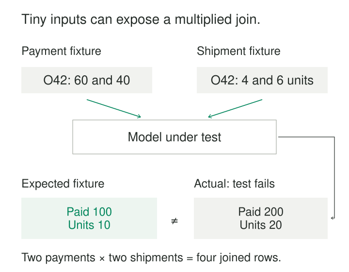

An order summary produces one row per order, with sensible column names and no missing identifiers. Its uniqueness checks pass. Yet the payment totals are doubled.

The problem is in the transformation: joining payments to shipments creates several combinations before the query calculates its sums. A small example containing two payments and two shipments would have exposed the mistake immediately.

**Transformation Unit Tests run a defined piece of production transformation logic against controlled inputs and compare its output with independently specified expectations.** Their purpose is to make business behavior checkable before a change reaches a large dataset.

## Turn a business rule into an executable example

A transformation unit test brings together three things: input fixtures, the actual transformation, and an expected result.

The unit might be a SQL model, a reusable pipeline transform, or a function that calculates one business classification. Choose a boundary that expresses a coherent responsibility, such as “produce one payment summary per order.”

The test supplies the inputs that responsibility depends on. It then executes the production logic and checks the resulting records.

dbt implements this approach for SQL models using small static inputs. Its unit-test properties include `given` input relations and `expect` output rows, making the relationship between fixtures and expectations explicit. [dbt unit-test properties](https://docs.getdbt.com/reference/resource-properties/unit-tests)

The expectation needs an independent basis: an agreed business rule, a worked calculation, or a reviewed example. Copying the transformation’s current output into an expected-results file can preserve a bug.

## A four-row join that doubles the answer

Suppose a model combines orders, payments, and shipments.

Order O42 has two payments, USD 60 and USD 40, and two shipments, four units and six units. Order O43 has one USD 25 payment and no shipment yet.

The intended output is:

| Order | Paid USD | Shipped units |
|---|---:|---:|
| O42 | 100 | 10 |
| O43 | 25 | 0 |

Here, zero shipped units follows an explicit rule: an order with no recorded shipments has shipped nothing.

A query that joins both detail tables before aggregating creates four combinations for O42. Each payment appears alongside both shipments, and each shipment appears alongside both payments. The resulting sums become USD 200 and 20 units. This follows ordinary join behavior: each qualifying pair contributes a result row. [PostgreSQL table expressions](https://www.postgresql.org/docs/current/queries-table-expressions.html)



*The expected result comes from the business example. It is not generated by the model being tested.*

The usual repair is to summarize payments and shipments independently at order grain before joining those summaries to orders.

O43 tests another requirement. An inner join to shipments would remove it entirely. Comparing the complete expected output catches that loss, even if every surviving row contains correct values.

Avoid repairing the multiplication with `SUM(DISTINCT amount)`. Two legitimate payments can have equal amounts; distinct values do not identify distinct payments.

## Put consequential boundaries in the fixtures

A shipping promotion applies when merchandise value **after discount** is at least 5,000 cents. The source contract explicitly defines a missing discount as no discount.

Three small cases distinguish several plausible implementations:

| Gross cents | Discount cents | Expected eligibility |
|---:|---:|---|
| 5,000 | 0 | Eligible |
| 5,500 | 1,000 | Ineligible |
| 5,000 | NULL | Eligible |

The first catches an accidental strict comparison that excludes the threshold. The second catches a calculation using gross value before discount. The third checks the documented treatment of missing discounts.

The mechanism can be expressed briefly:

```text
net_cents = gross_cents - coalesce(discount_cents, 0)
eligible = net_cents >= 5000
```

The null treatment belongs to this source contract. If NULL instead means “discount unknown,” replacing it with zero would assert knowledge the system does not have.

Good fixtures concentrate on conditions that change the answer. A hundred ordinary orders above the threshold may provide less useful evidence than these three cases.

## Exercise the incremental branch deliberately

An incremental model can behave correctly during a full rebuild and still miss corrections during routine processing.

Assume the model selects records updated after a checkpoint of 10:00. All timestamps below belong to the same day and time zone:

| Event | Event time | Source updated at | Expected selection |
|---|---|---|---|
| E1, corrected | 09:50 | 10:03 | Include |
| E2, new | 10:02 | 10:02 | Include |
| E3, unchanged | 09:40 | 09:59 | Exclude |

Filtering on event time would miss E1. The fixture demonstrates why source modification time matters under this extraction contract.

The test must activate incremental behavior and supply the existing state or checkpoint that branch reads. A full-refresh test does not exercise the same decision.

dbt supports overriding incremental mode and supplying existing-model fixtures. Its documentation distinguishes the expected rows selected for insertion or merging from the final destination table after materialization. [dbt incremental unit tests](https://docs.getdbt.com/docs/build/unit-tests#unit-testing-incremental-models)

That boundary matters. Checking the selected changes does not establish that a warehouse merge correctly updates existing rows, handles concurrent writers, or commits atomically. Those behaviors need additional tests at the storage boundary.

## Execute the code that will actually run

A test loses much of its value if it exercises a separately rewritten version of the transformation.

For SQL, execute the model’s compiled logic with controlled relations. For a pipeline, invoke its reusable transformation directly. Substitute external inputs while retaining the code responsible for the behavior being checked.

Apache Beam documents this arrangement using `TestPipeline`, static inputs created with `Create`, the actual transform, and output assertions such as Java’s `PAssert`. Its examples include checking expected elements without depending on their order. [Apache Beam pipeline testing](https://beam.apache.org/documentation/pipelines/test-your-pipeline/)

Keep relevant dependencies controlled: business date, time zone, reference-data version, configuration, and existing state. A test that consults today’s exchange rates or the wall clock may change its answer without any code change.

Execution semantics also matter. A substitute engine can differ in decimal arithmetic, timestamp conversion, collation, or null handling. Where those differences affect the rule, use the production engine or verify the substitute’s relevant behavior.

## Compare records precisely

For ordinary relational output, compare rows without assuming an incidental order. Preserve duplicate counts: converting both outputs into sets can hide an extra identical row.

Check the columns that express the contract. A test concerned with payment totals may ignore an unrelated execution timestamp, but it should still detect unexpected orders, missing orders, and repeated rows.

Represent monetary expectations with the intended precision. Use tolerances only where approximate arithmetic is part of the contract; a generous tolerance can conceal a meaningful error.

Useful failures identify the input case and show missing, unexpected, or changed records. “The query completed” establishes little about its business result.

## Costs, useful situations, and limits

This pattern is especially useful for branching classifications, joins, allocations, deduplication, date boundaries, and incremental selection. It also makes refactoring safer by preserving examples of required behavior.

Operating costs include fixture maintenance, reviewing expectations, test execution, and keeping the test environment sufficiently faithful. Small fixtures can still incur warehouse startup time and query charges. Focus coverage on consequential decisions and known failure modes.

Keep cases compact enough for a reviewer to calculate the answer. Turn production incidents into sanitized regression examples, retaining the condition that caused the failure.

A passing collection demonstrates behavior for its specified cases. It does not establish production freshness, source completeness, performance at scale, recovery correctness, or every possible input combination. Continue checking actual datasets and exercising important system boundaries.

## Related patterns

[[data-representative-test-fixtures|Representative Test Fixtures]] supplies realistic cases and meaningful combinations for these tests. [[data-property-based-data-tests|Property-Based Data Tests]] explores broader input spaces and checks general properties.

[[data-business-invariant-checks|Business Invariant Checks]] examines rules that must hold in produced datasets. [[data-publication-quality-gates|Publication Quality Gates]] decides which evidence, including relevant transformation tests, must pass before a candidate becomes visible.
