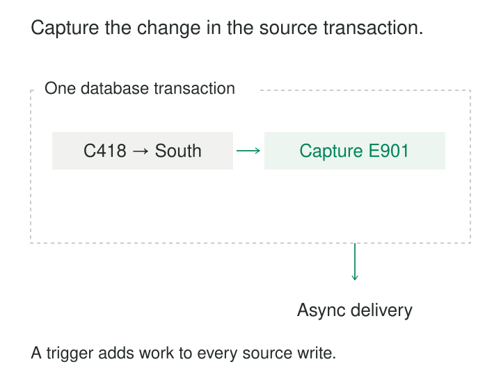

Three applications update the same customer table. One maintains a modification timestamp, another sometimes forgets, and a maintenance script deletes obsolete records outright. The warehouse’s incremental query gradually misses changes.

The database sees all these writes, even when the applications do not report them consistently.

[[data-trigger-based-change-capture|Trigger-Based Change Capture]] attaches database triggers to selected tables. When a relevant insert, update, or delete occurs, the trigger writes a record into a local change table. A separate process reads those records and delivers them downstream.

The pattern makes capture part of the source write. That provides a useful transactional guarantee—and places additional work on the operational database.

## Capture locally, deliver separately

The usual design has two stages.

Inside the source transaction, the trigger records the operation, row identity, and required values. After commit, a worker reads committed capture records, delivers them, and tracks acknowledgment.

For transactional tables participating in the same transaction, the source mutation and capture insert succeed or roll back together. PostgreSQL explicitly documents that triggers execute within the triggering transaction; an error can roll back both effects. An `AFTER` trigger still runs inside that transaction, rather than after commit. [PostgreSQL: Trigger Behavior](https://www.postgresql.org/docs/18/trigger-definition.html)

This guarantee assumes transactional capture storage and error handling that preserves atomicity. Swallowing a failed capture insert can allow the source change to commit without its record.

Sending an HTTP request directly from the trigger does not provide the same guarantee. A remote service might accept a message before the database transaction later rolls back. Keeping the capture write local separates transaction correctness from network delivery.

## Example: preserve an update and a deletion

Customer C-418 changes region from North to South. Later, a separate transaction deletes that customer.

A capture table might contain:

| Capture ID | Operation | Customer key | Before region | After region |
|---|---|---|---|---|
| E-901 | Update | C-418 | North | South |
| E-902 | Delete | C-418 | South | Absent |

The update gives the warehouse enough information to revise the customer’s current representation. The delete gives it a positive removal signal, even though the customer row is no longer available to query.

PostgreSQL row triggers expose `OLD` values for updates and deletes and `NEW` values for inserts and updates. Its documentation includes an audit-trigger example that records all three operations in a separate table. [PostgreSQL: Trigger Functions](https://www.postgresql.org/docs/18/plpgsql-trigger.html)

The captured payload should match the downstream purpose. A current-state replica may need the new row and deletion key. A historical analysis may also need previous values.

Recording only “customer C-418 changed” and rereading the customer later is a different contract. Two rapid updates can collapse into one observed state, and a deletion leaves nothing to reread. That approach can support refresh notifications, but cannot promise a complete history of row states.

## A documented implementation: SymmetricDS

SymmetricDS uses database triggers as one of its capture mechanisms. Its documentation describes triggers writing into `SYM_DATA`, with records containing operation type, row data, identifiers, and transaction information.

Separate routing and synchronization processes package and deliver the captured changes. This illustrates the division between lightweight capture inside the database and delivery work outside the write transaction. [SymmetricDS: How It Works](https://symmetricds.org/docs/how-to/how-symmetricds-works/)

A custom capture table follows the same broad architecture, but must supply its own delivery, acknowledgment, retention, and recovery behavior. Installing triggers alone does not create a reliable synchronization system.

## Example: one statement changes thousands of rows

A maintenance operation updates the category of 5,000 products in one statement.

A trigger written under the assumption that each invocation represents one row may capture only part of that change set.

Trigger granularity varies by database. SQL Server DML triggers must handle multirow sets: one statement can place many rows in the `inserted` and `deleted` tables. Microsoft recommends set-based logic rather than treating those tables as single records. [Microsoft: Multirow DML Triggers](https://learn.microsoft.com/en-us/sql/relational-databases/triggers/create-dml-triggers-to-handle-multiple-rows-of-data?view=sql-server-ver17)

In PostgreSQL, the design can use row-level triggers or statement-level triggers with transition tables containing the affected rows. Its documentation demonstrates auditing with both approaches. [PostgreSQL: Auditing with Transition Tables](https://www.postgresql.org/docs/18/plpgsql-trigger.html#PLPGSQL-TRIGGER)

The correctness requirement is coverage of every relevant affected row. The performance choice is how to achieve that coverage without excessive work per statement.

## Example: capture IDs do not establish commit order

A tempting extractor reads `capture_id > last_seen_id`, then saves the largest ID returned.

Consider two concurrent transactions:

1. Transaction A allocates capture ID 101 but remains uncommitted.
2. Transaction B allocates 102 and commits.
3. The reader sees 102 and saves it as its checkpoint.
4. Transaction A commits, making 101 visible.

The next query asks for IDs greater than 102. Record 101 is permanently skipped.

A sequence provides allocation order, not a guarantee about transaction completion. PostgreSQL documents concurrent sequence allocation and that allocated values are not reclaimed when transactions abort; gaps are therefore also normal. [PostgreSQL: Sequence Functions](https://www.postgresql.org/docs/18/functions-sequence.html)

Safe delivery needs a protocol that accounts for outstanding transactions. Options include tracking acknowledgment of individual committed records or using an established commit-aware capture framework. A fixed lookback reduces some risk but does not prove completeness when transactions can remain open longer than that window.

Capture timestamps generated inside the transaction have a similar limitation: they precede commit and cannot automatically serve as commit-order checkpoints.

## Delivery needs its own recovery rules

Once a capture record is committed, a worker may deliver it successfully and crash before saving acknowledgment. Restarting can deliver it again.

The destination therefore needs duplicate handling, usually based on stable capture-record identity. Current-state application also needs suitable ordering or version checks so an older update cannot overwrite a newer state.

If several consumers require the feed, retention must respect all required acknowledgments. A single “delivered” flag is insufficient when it describes delivery to only one destination.

Existing source rows need initialization too. Triggers begin observing changes from installation onward; they do not recreate prior history. Establishing an initial snapshot requires coordination with capture so writes during the copy are neither missed nor incorrectly applied.

Transaction metadata can help group related changes, but atomic capture does not automatically make their downstream application atomic.

## The source write pays the cost

Every captured operation adds work: trigger execution, payload construction, change-table insertion, index maintenance, and additional database logging.

The cost appears directly in write latency and transaction duration. Bulk updates can multiply it substantially. Contention on capture-table indexes or shared bookkeeping rows can turn a small trigger into a bottleneck.

Keep capture logic focused. Large joins, business transformations, and remote delivery make operational writes depend on more work and more failure conditions.

Storage and cleanup are continuing costs. A stalled consumer can grow the capture table; premature cleanup can destroy undelivered changes. Monitoring should cover capture failures, oldest undelivered records, backlog growth, and source write latency.

The pattern is useful when log-based capture is unavailable or unsuitable, trigger installation is permitted, and the source can tolerate measured overhead. It can also cover several applications writing through the same database tables without changing each application individually.

## Coverage must survive maintenance

Triggers can be disabled, omitted from newly created tables, or invalidated by schema changes. Ordinary row triggers may not cover truncation or other database-specific operations. Bulk-loading and replication modes also require explicit verification.

The capture table itself should not accidentally feed a recursive capture loop. Schema evolution needs compatible payload handling while older undelivered records remain in flight.

Finally, a trigger observes a database mutation. It does not necessarily know the business reason, the real human actor behind a shared connection, or the effective date of a change. Those meanings require additional source context.

## Related patterns

[[data-log-based-change-data-capture|Log-Based Change Data Capture]] observes database logs instead of executing capture logic with each table write.

[[data-transactional-outbox|Transactional Outbox]] shares the local atomic-write mechanism, but typically records intentional application messages rather than generic row mutations.

**Idempotent Processing** makes repeated delivery safe.

[[data-full-snapshot-extraction|Full Snapshot Extraction]] establishes existing state and supports reconciliation when capture coverage becomes uncertain.
