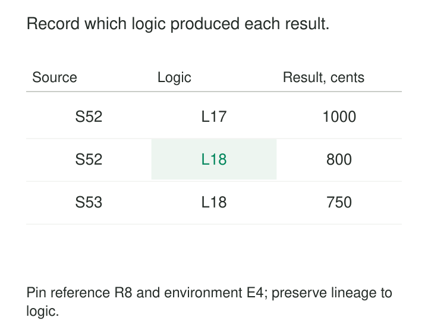

A team reruns last month’s sales pipeline to replace a missing partition. The job succeeds, but the result differs from the published report.

The source files are unchanged. The transformation is not: someone corrected its cancellation filter last week.

Both runs are understandable in isolation. Without a record of which logic produced each result, they are difficult to explain together.

**Version Transformation Logic gives each executable transformation an identifiable, retained version and connects that version to the outputs it produced.** It makes calculation changes traceable, supports deliberate backfills, and provides a foundation for reproducing earlier results.

## Preserve the recipe that actually ran

Keeping SQL or Python in version control is the starting point. The operational requirement is stronger: identify the exact implementation executed for a particular run.

A branch name such as `main` moves. A release label is useful only if it resolves reliably to retained content. A source revision can also be insufficient when a deployment includes local edits, generated code, independently updated functions, or unresolved dependencies.

A practical release connects its source revision to an immutable executable artifact: a packaged application, container image, compiled transformation bundle, or equivalent retained representation.

OpenLineage provides a concrete mechanism for recording source identity. Its source-code-location facet includes a `version` field defined as the actual unique deployed version, such as a commit identifier, rather than a branch name. The producing integration still has to populate that information accurately. [OpenLineage source-code-location specification](https://github.com/OpenLineage/OpenLineage/blob/main/spec/facets/SourceCodeLocationJobFacet.json)

The record should describe what ran, rather than merely what the scheduler intended to launch.

## Connect logic identity to execution context

A logic version identifies a recipe. Reproducing its result also requires the ingredients and relevant execution conditions.

| Record | Why it matters |
|---|---|
| Logic artifact and source revision | Identifies the executable implementation |
| Parameters and configuration | Captures thresholds, modes, and feature flags |
| Dependency and runtime versions | Identifies libraries, functions, and engine behavior |
| Input and reference-data versions | Establishes which facts and mappings were read |
| Starting state | Explains incremental or streaming calculations |
| Run and output identifiers | Connects execution evidence to published results |

These records can live in a run ledger and release manifest. They need not become extra columns on every business row.

A partition may reference its producing run; a dataset release may reference a manifest containing the lineage of all its components. The important property is that the connection remains available after later runs occur.

## Example: correcting a cancellation filter

Suppose a source snapshot contains these orders:

| Order | Status | Amount, cents |
|---|---|---:|
| O1 | Completed | 600 |
| O2 | Completed | 200 |
| O3 | Cancelled | 200 |

Logic release L17 accidentally includes all three orders and produces 1,000 cents. Release L18 correctly excludes cancelled orders and produces 800 cents.

Running both releases against the same snapshot isolates the effect of the logic correction.

Later, the source corrects O1 from 600 to 550 cents. L18 now produces 750 cents. That difference comes from changed input, even though the logic version remains the same.

The release labels in this example resolve to immutable artifacts. The source snapshots are retained, and relevant configuration and runtime conditions are held fixed.

A backfill can therefore state its purpose precisely: reproduce the earlier calculation, apply corrected logic to the original facts, or calculate from corrected facts. Each is a different operation with a different output identity.

## Example: a shared macro changes many models

A warehouse model calls a shared macro that classifies customers as active. The macro’s threshold changes from 30 days to 90 days.

The model’s own SQL file remains unchanged. Its executable meaning does not.

Versioning only the model file misses this dependency. The release must identify the macro implementation and threshold used, including whether the threshold came from code, a runtime parameter, or a reference table.

dbt’s artifacts provide useful building blocks. Its manifest represents project resources, including models, macros, configurations, and dependencies. Run results record executed nodes, statuses, and timing, and can include rendered compiled code. Archiving the corresponding artifacts with the deployment identity helps explain the executed transformation. [dbt manifest](https://docs.getdbt.com/reference/artifacts/manifest-json), [dbt run results](https://docs.getdbt.com/reference/artifacts/run-results-json)

Those artifacts do not freeze warehouse contents or independently managed functions. Compiled SQL that calls a mutable database function still depends on that function’s implementation.

The same issue appears in metadata-driven pipelines: changing a mapping table can change transformation behavior without changing application code. That mapping needs its own retained version or snapshot.

## Example: changing a stateful streaming calculation

A streaming job changes its rolling window from ten minutes to thirty minutes.

Deploying a new code version does not automatically create the additional twenty minutes of history. The existing state may already have discarded it.

The release therefore needs a state-transition plan: restore compatible state, transform it, rebuild it from retained events, or establish a defined warm-up period. Results during that transition need an explicit validity policy.

Apache Flink supports job updates through savepoints and maps saved state back to operators using operator identifiers. Its documentation recommends assigning stable operator IDs because automatically generated identifiers can change when program structure changes. [Flink savepoints](https://nightlies.apache.org/flink/flink-docs-stable/docs/ops/state/savepoints/)

Successful restoration establishes that state could be mapped into the program. It does not establish that the restored history satisfies a new business calculation.

For a meaningful replay, retain the relevant state or sufficient source history, along with the logic version. If the necessary events have expired, the old code alone cannot reconstruct them.

## Separate deployment time from business applicability

A transformation may be deployed today while implementing a rule that applies from the beginning of next month.

Conversely, a correction may need to restate several earlier periods.

Record both when a version was deployed and the rule governing where it applies. A blanket instruction to use “the latest logic” leaves historical treatment ambiguous.

Logic versions, run identifiers, and dataset releases serve different purposes. One logic version can produce many runs from changing inputs. One published dataset can contain partitions produced by several logic versions.

That mixture may be intentional, but it should be discoverable. If consumers require consistent treatment across periods, the rollout needs a coordinated restatement or a clearly versioned interface.

## Make reproduction an explicit capability

Docker illustrates one part of this mechanism: an image digest pins an exact image version, whereas tags can resolve to updated content. [Docker image digests](https://docs.docker.com/reference/cli/docker/image/pull/#pull-an-image-by-digest-immutable-identifier)

An image does not freeze external data, remote services, warehouse engine behavior, or execution order. Reproducibility depends on controlling the dependencies that affect the result.

Time-dependent expressions, random values, unstable tie-breaking, and floating-point execution differences also need attention. Define whether reproduction means identical business values, agreement within justified numerical tolerances, or identical output bytes.

Retaining an old release supports rollback, but does not reverse its effects. Reverting code leaves already written data in place unless a separate repair or publication action changes it.

## Keep the history useful

This pattern is especially valuable for shared metrics, feature engineering, recurring reports, incident investigation, and historical restatement.

Its costs include artifact storage, dependency retention, lineage collection, compatibility testing, and maintaining a way to execute selected historical releases. Keeping every old environment runnable indefinitely may be impractical. Set retention around actual reproduction and support obligations.

A version identifier records provenance; it does not prove correctness. Tests, comparison runs, and publication checks remain necessary.

Avoid silent edits to released logic, mutable “versioned” lookup tables, and backfills whose output records omit the chosen release. Preserve the reason for meaningful changes alongside their technical identity so that future readers can understand both what changed and why.

## Related patterns

[[data-deterministic-transformations|Deterministic Transformations]] make a fixed recipe and fixed inputs produce stable results.

[[data-run-ledgers|Run Ledgers]] connect logic versions, execution context, validation evidence, and outputs.

[[data-replayable-backfills|Replayable Backfills]] use explicit logic selection to reproduce or intentionally recalculate historical data.

**Versioned Dataset Interface** governs consumer-visible meaning. A new implementation version may preserve that interface, while a changed business definition may require a new one.
