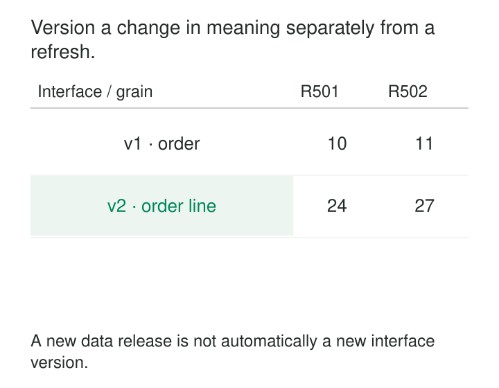

A shared dataset gains useful detail. The producer changes it from one row per order to one row per order line. Existing reports still run, but order counts jump and joins multiply.

The data may be correct under the new definition. Consumers were depending on the old one.

[[data-versioned-dataset-interface|Versioned Dataset Interfaces]] give materially different dataset contracts separate, stable identities. Consumers explicitly choose the interface they understand, while producers introduce replacements alongside it.

The purpose is to let shared data evolve without silently changing the meaning of existing dependencies. A version identifies a promise about the dataset—not simply its latest contents.

## Version the promise consumers depend on

A dataset interface includes more than column names and types. Its contract can establish:

- Grain, identifiers, and uniqueness.
- Business definitions, units, and eligible populations.
- Time interpretation, corrections, updates, and deletions.
- Freshness, historical coverage, ownership, and support.

A change to any of these can matter even when queries remain executable.

Expose versions through explicit relations, model references, API paths, or another resolvable identifier. The mechanism should let consumers select a particular supported contract and inspect its definition.

dbt’s [model-versioning documentation](https://docs.getdbt.com/docs/mesh/govern/model-versions) describes this approach for shared analytical models: multiple versions coexist, allowing producers to introduce changes while consumers migrate.

The version needs behavioral stability behind its name. Calling a table `orders_v1` does not protect consumers if its implementation starts returning order lines tomorrow.

## Separate the interface from the data release

An active interface can keep refreshing without changing its contract.

Today, `orders/v1` might expose ten orders; an hour later, eleven. It still promises one row per order. Meanwhile, `orders/v2` might expose their individual lines.



Keep three identities distinguishable:

| Identity | What it identifies |
|---|---|
| Interface version | The supported shape and meaning |
| Published data release | A particular available data state |
| Implementation revision | The code and configuration that produced it |

Pinning an interface version does not reproduce yesterday’s query result. Reproducibility also requires the published data state and relevant query dependencies—or the source snapshots, implementation, and configuration needed to reconstruct it.

A schema identifier is narrower still: two interfaces can share the same structural schema while assigning different meanings to their values.

## Let order-level and line-level consumers coexist

Suppose order O17 contains two lines worth 400 and 600 minor currency units.

Version 1 exposes one order row with a total of 1,000. Version 2 exposes two line rows, each with its own line identifier and amount.

An order dashboard pins version 1. A fulfillment analysis adopts version 2. Both receive updated data under their chosen definitions.

Within dbt, a consumer can make that dependency explicit:

```sql
select order_id, order_total_minor
from {{ ref('orders', v=1) }}
```

The documented [`ref` function](https://docs.getdbt.com/reference/dbt-jinja-functions/ref#versioned-ref) resolves a specified model version. Without the version argument, a reference to a versioned model resolves to the maintainer’s declared latest version.

That distinction creates two consumption policies. A pinned reference adopts breaking changes deliberately. An unpinned reference accepts the consequences of moving latest.

GitLab’s published [dbt guide](https://handbook.gitlab.com/handbook/enterprise-data/platform/dbt-guide/#versions) describes producing enabled model versions side by side so reports can continue using an earlier interface during migration.

The producer must also specify whether supported older versions continue receiving fresh data. Quietly leaving version 1 frozen would change its service behavior even if its columns remained intact.

## Version a changed definition even when types stay identical

Consider a dataset with an integer column called `order_value_minor`.

Its original definition excludes refunds. A proposed definition subtracts refunds. For an illustrative order with item value of 10,000 and refunds of 2,000, the two definitions produce different answers:

| Interface | Defined calculation | Result |
|---|---|---:|
| Version 1 | Item value before refunds | 10,000 |
| Version 2 | Item value less refunds | 8,000 |

Assume the same currency, source boundary, and treatment of other components.

Nothing about the column’s name or integer type reveals this change. Replacing the calculation inside version 1 would silently alter existing analysis.

A separate interface version makes the choice explicit. Give the new definition a clear description and preferably clearer field names. Explain expected differences so consumers can distinguish a successful migration from a data defect.

Correcting an implementation to match its documented definition is different from deliberately changing that definition. A correction may remain within the same interface version, although resulting historical restatements still need communication and evidence.

## Keep model features aligned with their consumers

A predictive model uses a customer feature called `purchase_count`, defined over the preceding 30 days. Another model needs a 90-day count.

Both values are integers. Substituting the longer window under the existing interface changes the input distribution without changing its physical type.

Publish separate feature interfaces or otherwise bind each model to the required definition. Include entity keys, time windows, missing-value behavior, and feature derivation—not just feature names.

Feast’s [feature-retrieval documentation](https://docs.feast.dev/getting-started/concepts/feature-retrieval#feature-services) describes feature services as logical feature groups used for historical and online retrieval, with one feature service expected per model version.

That grouping helps identify dependencies. It does not, by itself, make every underlying feature definition immutable. Producers still need controls preventing a referenced definition from changing incompatibly.

A training record should identify the feature interface and the historical data selection used. Serving should resolve the intended definitions too. Interface versioning alone does not establish point-in-time correctness or guarantee agreement between offline and online calculations.

## Preserve compatibility through the dependency chain

An older interface implemented as a view over the newest model can reduce duplication—but only while that mapping preserves the older contract.

Renaming a field may be straightforward. Reconstructing removed historical attributes, changing grain, or reversing a lossy transformation may be impossible.

Version shared dependencies accordingly. If version 1 depends on an unversioned intermediate model whose units change, its stable public name offers little protection.

Validate each supported interface independently. Structural contracts help: [dbt model contracts](https://docs.getdbt.com/docs/mesh/govern/model-contracts) check declared output shape, with constraint enforcement depending on the platform. Business definitions, grain, temporal behavior, and service commitments require additional tests and monitoring.

Compare versions at matched source boundaries. Expected differences should be documented; unexplained differences should block promotion.

## Make adoption and retirement visible

Introduce a new version as a candidate before changing any default reference. Publish its contract differences, representative examples, historical coverage, service expectations, and migration guidance.

Track consumers as they adopt it. Include dashboards, scheduled exports, notebooks, machine-learning jobs, and recovery tools. Query logs help, but short observation windows can miss infrequent dependencies.

A latest alias is a moving pointer. Changing it is a release decision for every unpinned consumer, so use compatibility evidence and an explicit adoption policy.

Retirement needs a communicated support window and accountable owners. dbt’s [`deprecation_date` mechanism](https://docs.getdbt.com/reference/resource-properties/deprecation_date) provides warnings and lifecycle information. Its documentation also explains that deprecation does not automatically stop builds or drop warehouse relations.

Removing the interface is therefore operational work: confirm migration, close rollback obligations, and clean up the actual objects and permissions. An unsupported version should fail clearly rather than silently redirecting consumers to incompatible semantics.

## Pay for stability deliberately

Maintaining several live versions costs compute, storage, validation effort, documentation, and support. Shared transformations and compatibility views can reduce those costs, but excessive coupling makes old promises fragile.

Use versions for consequential contract changes. Compatible additions and internal optimizations need not create a new interface when supported behavior remains intact.

This pattern is especially useful when consumers deploy independently, shared datasets have many dependents, or changes alter interpretation without causing obvious errors. It is less useful for short-lived internal models whose consumers can be migrated together.

Avoid accumulating permanent forks with no retirement plan. Equally, avoid treating a version number as proof of stability: the promise must be supported by implementation, evidence, and ownership.

[[data-explicit-data-contracts|Explicit Data Contracts]] defines each interface’s meaning. **Expand-Migrate-Contract** organizes the transition between versions. [[data-compatibility-checks-in-delivery|Compatibility Checks in Delivery]] protects supported consumers. [[data-atomic-publication|Atomic Publication]] controls which validated data release becomes visible through each interface.
