A pipeline is calculating purchases for the five-minute interval from 10:05 up to, but not including, 10:10. The clock reaches 10:11, but some phones are offline and one source partition is delayed.

Should the pipeline publish the total? Keep waiting? Discard the saved information it needs to update that interval’s total?

Wall-clock time cannot answer those questions reliably. The system needs evidence about how far the input has progressed through **event time**: when each purchase happened, according to its timestamp.

**Watermarks communicate that progress.** A watermark identifies an event-time position that a processing step, or *operator*, can use to decide when to publish window results or discard saved state. Its meaning depends on the source’s guarantees or estimation policy.

The purpose is to make finite decisions about an unbounded stream while stating how much uncertainty the system accepts.

## A progress signal with a defined scope

A watermark at 10:05 communicates that events from earlier event times are expected to be sufficiently complete for the configured computation to move forward.

That expectation may rest on a strong source contract or a heuristic. Apache Beam describes its watermark as an estimate of when the data for a window has arrived. Delayed records can still violate that estimate. [Apache Beam model basics](https://beam.apache.org/documentation/basics/)

A watermark also has a scope. A source partition, input stream, and downstream operator may each have different progress positions. “The pipeline watermark” can conceal the input that is actually holding a result back.

Three decisions remain separate:

- **Window assignment** determines which events belong together.
- **Triggers** are rules that determine when results are emitted.
- **Retention and late-data policies** determine when the saved information, or *window state*, is removed and which delayed records can still revise a result.

A watermark supports those decisions. It does not independently establish that a result is complete forever.



## Generate progress from a source assumption

A common strategy tracks the greatest event timestamp observed and subtracts a configured disorder allowance.

Suppose a source has delivered events timestamped through 10:12. With a two-minute allowance, its watermark is approximately 10:10. Exact endpoint arithmetic and emission timing depend on the implementation.

Conceptually:

```text
greatest_event_time = max(greatest_event_time, event.timestamp)
candidate = greatest_event_time - disorder_allowance
watermark = max(previous_watermark, candidate)
```

The watermark moves forward as newer event-time evidence arrives. Receiving an older event does not move it backward.

Flink provides a bounded-out-of-orderness generator implementing this general strategy, alongside a strategy for sources whose timestamps increase monotonically. The assumptions differ: monotonic ordering permits more aggressive progress than bounded disorder. [Apache Flink built-in watermark generators](https://nightlies.apache.org/flink/flink-docs-release-2.3/docs/dev/datastream/event-time/built_in/)

The two-minute value is therefore an operational claim about the source. It is not automatically two minutes behind the current clock, nor a guarantee that every device delivers within two minutes.

A disconnected device may arrive hours later. The system needs a policy for that exception.

## Publishing a window does not require forgetting it immediately

Consider a purchase window `[10:05, 10:10)` containing two observed events:

| Event | Event time | Amount |
|---|---|---:|
| E1 | 10:06 | 30 |
| E2 | 10:09 | 70 |

Later records advance the source watermark beyond 10:10. An end-of-window trigger can publish the observed total of `100`.

Then E3 arrives with event time 10:08 and amount `20`.

E3 belongs to the original window. Whether the total becomes `120` depends on the operator’s late-data policy and whether it still retains the required state.

Flink documents allowed lateness as a way to retain window state beyond the initial watermark crossing. Accepted late records can cause further firings; records arriving after retention expires can be directed to a late-data side output. [Apache Flink window-lateness documentation](https://nightlies.apache.org/flink/flink-docs-release-2.3/docs/dev/datastream/operators/windows/#allowed-lateness)

These are distinct controls. The watermark policy governs how conservatively progress advances. In Flink’s event-time window model, allowed lateness governs how far the watermark may advance beyond the window’s end before the window is removed. If the watermark pauses, the window can remain available longer in wall-clock time. Calling both controls a “lateness setting” obscures that difference.

The destination must also understand revisions. Publishing `120` after `100` requires replacement or an explicit change protocol. Adding both totals would misrepresent the purchases.

## Combine inputs according to the completeness policy

Now consider two active regional inputs:

| Input | Watermark |
|---|---|
| West | 10:12 |
| East | 10:06 |

A downstream operator using their minimum advances only to 10:06. A window ending at 10:10 remains waiting even though West has progressed beyond it.

When East advances to 10:11, the combined watermark becomes 10:11. The window can then satisfy an end-of-window trigger.

Flink documents this minimum-based combination for operators consuming multiple inputs. It preserves the slower input’s opportunity to contribute according to its declared progress. [Apache Flink event-time documentation](https://nightlies.apache.org/flink/flink-docs-release-2.3/docs/concepts/time/)

This is a completeness choice. Spark Structured Streaming similarly uses the minimum of input watermarks by default, while offering a maximum policy that follows the fastest input and can aggressively discard data from slower streams. [Spark multiple-watermark documentation](https://spark.apache.org/docs/latest/streaming/apis-on-dataframes-and-datasets.html#policy-for-handling-multiple-watermarks)

Changing that policy to make output appear sooner changes which delayed records the computation may retain.

## Handle silence explicitly

What happens if East stops producing records?

An event-observing generator may receive no new evidence with which to advance. West can continue processing while downstream windows remain pending.

Flink offers idleness detection that marks an inactive input so it no longer holds back the combined watermark. [Apache Flink watermark-generation documentation](https://nightlies.apache.org/flink/flink-docs-release-2.3/docs/dev/datastream/event-time/generating_watermarks/)

That is useful for legitimately quiet partitions, but silence is ambiguous. It can mean no activity, a broken producer, a network outage, or unread backlog.

If an excluded input resumes with older events, downstream progress has already advanced. Those records encounter the applicable late-data policy.

Idle timeout selection therefore needs an understanding of source behavior. A timeout that works for a busy clickstream may be inappropriate for a device that reports once an hour.

Source-provided progress markers can help where supported, but they must have meaningful completeness semantics. A heartbeat saying “I am alive” does not necessarily establish that every earlier event has been delivered.

## Avoid turning an estimate into a universal discard rule

Framework semantics matter.

For supported watermark-based aggregations, Spark documents a one-sided guarantee: data within the configured delay behind the latest processed event time will not be dropped. Data farther behind may or may not still be processed. The delay is not a universal rule that every older record disappears immediately. [Spark watermark guarantees](https://spark.apache.org/docs/latest/streaming/apis-on-dataframes-and-datasets.html#semantic-guarantees-of-aggregation-with-watermarking)

Likewise, watermark progress is not a recovery checkpoint. A checkpoint records recoverable processing state; a watermark describes progress in event time.

The term also appears in incremental extraction, where a “high watermark” often means a cursor value used to select subsequent rows. That cursor does not automatically carry the event-time completeness meaning described here.

## Pay for the uncertainty you retain

Conservative watermarks allow more disorder before closing results, but increase latency and retained state. Aggressive watermarks release results sooner while creating more late-data exclusions or correction work.

Uneven input speeds can also increase buffering. Flink’s watermark alignment can pause faster sources so they do not run excessively ahead of slower ones, trading some throughput for more controlled downstream state growth. [Apache Flink watermark-alignment documentation](https://nightlies.apache.org/flink/flink-docs-release-2.3/docs/dev/datastream/event-time/generating_watermarks/#watermark-alignment)

Timestamp quality is a prerequisite. One record dated far into the future can distort a maximum-timestamp strategy. Validate implausible timestamps before allowing them to influence progress.

Useful monitoring separates input backlog, watermark position, late-record volume, idle-input status, and state size. A large difference between wall-clock time and the watermark might indicate normal delay, intentional buffering, replay, or a stalled source.

Watermarks are especially useful for event-time windows, bounded temporal joins, timers, and stateful deduplication. Their value comes from making progress assumptions explicit and connecting them to observable consequences.

## Related patterns

[[data-event-time-processing|Event-Time Processing]] defines the chronology that watermarks measure.

[[data-allowed-lateness|Allowed Lateness]] defines the acceptance horizon for delayed records once the watermark has passed a window’s end. [[data-early-results-with-corrections|Early Results with Corrections]] explains how consumers handle successive answers.

[[data-state-expiration|State Expiration]] determines when saved processing information can be removed. [[data-historical-restatement|Historical Restatement]] repairs results when valid corrections arrive beyond the live pipeline’s acceptance horizon.
