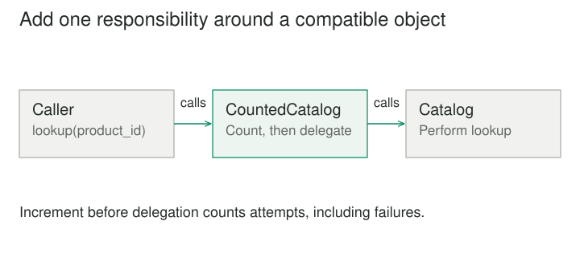

## Purpose and problem

A data writer begins as a simple file writer. Then it gains compression, encryption, and checksumming. Inheritance produces CompressedWriter, EncryptedWriter, CompressedEncryptedWriter, and several more combinations. Every independent option adds pressure to a hierarchy that is trying to represent all combinations in advance.

## Core idea

Decorator moves optional responsibilities into wrappers. Each decorator implements the same useful contract as the wrapped object, holds a reference to that object, and adds behavior before, after, or around delegation. Features can then be composed as layers instead of encoded into compound subclasses.



## How it works

Suppose Writer supports write and close. FileWriter handles the underlying file. CompressionWriter transforms bytes before passing them to its wrapped writer. EncryptionWriter encrypts bytes before delegation. The client can hold a Writer regardless of the selected layers.

The distinguishing intent is to add responsibility while preserving a compatible interface. A decorator may keep extra state, such as a compression buffer, but callers should still be able to use it through the agreed contract.

Compatibility includes behavior. If write promises that data is immediately available to readers, a buffering decorator changes that promise unless the contract permits delayed flushing. The wrapper structure is easy to draw; maintaining honest substitution is the harder work.

## Worked example

### Compression and encryption with explicit ordering

For a pipeline intended to compress plaintext and then encrypt the compressed bytes, the outer compression wrapper delegates to an inner encryption wrapper, which delegates to the file writer. Data passes from the caller through compression, then encryption, then storage.

Reversing the wrappers encrypts before compression, usually leaving the compressor with data that offers little useful redundancy. The two wrappers may share an interface, but their order is not interchangeable. Composition must reflect semantics, not just type compatibility.

Closing the pipeline also needs a contract. A compressor may emit final bytes during close; an encryptor may finalize its output afterward; the file must remain open until those operations finish. If a wrapper closes its inner writer too early, the composition can lose data.

This example concerns the arrangement of responsibilities, not a recommendation for a particular cryptographic implementation. Production encryption should use an appropriate established library and a defined format. Decorator does not supply the security properties of the operation it wraps.

### A small implementation

A metrics wrapper preserves the catalog lookup contract and adds a call count around delegation. It can wrap any compatible catalog. This small example avoids introducing compression or encryption code that would distract from the wrapping mechanism.

```python
class Catalog:
    def lookup(self, product_id):
        return {"id": product_id, "name": "Notebook"}


class CountedCatalog:
    def __init__(self, inner):
        self.inner = inner
        self.calls = 0

    def lookup(self, product_id):
        self.calls += 1
        return self.inner.lookup(product_id)


catalog = CountedCatalog(Catalog())
print(catalog.lookup("book-1")["name"])
print(catalog.calls)
# Notebook
# 1
```

The caller still uses lookup; the added responsibility lives in the wrapper. The counter records attempts, including failed calls, because it increments before delegation. If success-only counts are required, increment after the call. Even a small decorator needs a precise account of the behavior it adds.

### Instrumenting a service without duplicating it

A catalog service supports lookup(product_id). A metrics decorator records elapsed time and success or failure, then delegates to the real service. A caching decorator can satisfy some requests from a cache and delegate misses. Different deployments can assemble the layers they need.

Before decoration, metrics code appears inside the catalog implementation and must be copied into a test or remote implementation. Afterward, the metrics wrapper can work with either implementation through the shared contract.

Order changes the meaning of measurements. Metrics outside the cache measures the caller's total lookup time and counts cache hits. Metrics inside the cache measures only calls that reach the underlying service. Neither placement is automatically right. The composition boundary should choose based on the operational question being answered.

Caching is often discussed as a Proxy responsibility because it controls access to the underlying service. The same wrapper may therefore resemble both patterns. Naming it according to its primary role helps communicate intent: optional instrumentation emphasizes Decorator; access mediation emphasizes Proxy.

## When to use it

- Independent behaviors need to be combined at runtime.
- Inheritance is producing a class for every feature combination.

Consider a simpler design when wrapper order cannot be understood or constrained, or when the feature needs broad access to internal invariants rather than the public contract.

## Tradeoffs and common mistakes

Decorator is useful when responsibilities are independently optional and should be selected per object or deployment. It can avoid subclass combinations and keep features localized. It also supports reusing a behavior layer around different concrete implementations of the same contract.

The cost is indirection. A deep wrapper stack can make it difficult to locate behavior, understand ordering, or inspect identity. Two wrappers around the same underlying object are not necessarily equivalent objects. Equality, serialization, and resource ownership need deliberate handling.

An especially common mistake is requiring callers to unwrap decorators to access ordinary operations. If normal clients repeatedly reach through the stack, the common contract may be incomplete or the chosen wrapping boundary may be wrong. Occasionally a specialized capability is appropriate, but it should be explicit.

Decorators can also become a hiding place for unrelated policy. A wrapper that both logs, retries, validates permissions, and mutates requests is harder to compose or reason about than focused layers. Splitting responsibilities helps only when their interaction remains understandable.

## Related patterns

[[proxy|Proxy]] preserves a subject interface mainly to regulate access, such as lazy loading or remote mediation. Decorator preserves a compatible interface mainly to extend responsibility. Their implementation shapes overlap; intent and lifecycle explain the difference.

[[composite|Composite]] represents multiple children as a component, while Decorator typically adds behavior around one component. [[strategy|Strategy]] supplies an interchangeable algorithm inside a context. Decorator adds a layer around the context or collaborator itself.

## Sources

Decorator is one of the 23 patterns in Gamma, Helm, Johnson, and Vlissides, [*Design Patterns: Elements of Reusable Object-Oriented Software*](https://www.informit.com/store/design-patterns-elements-of-reusable-object-oriented-9780201633610). The examples, code, and illustrations here are original educational explanations.
