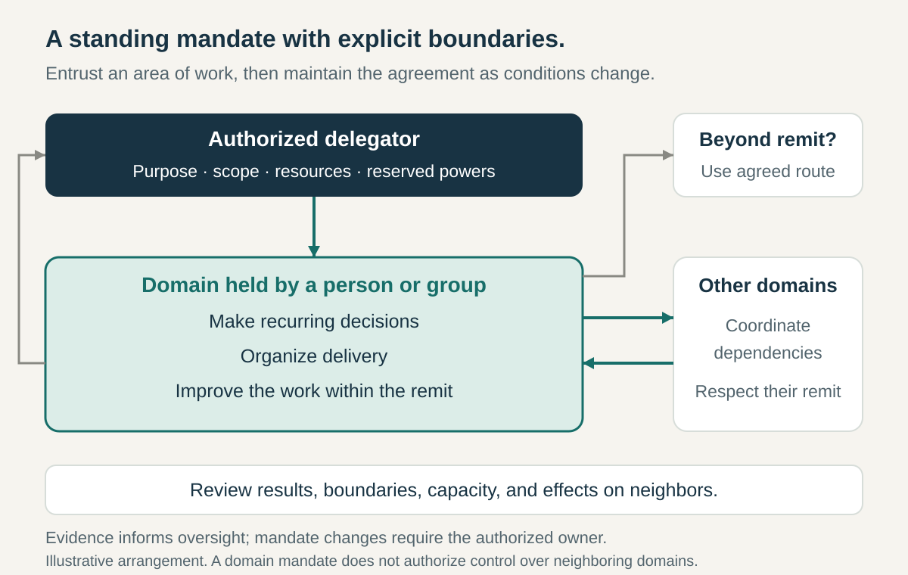

**Core question:** How can we give people lasting authority over an area of work without leaving its limits, dependencies, and accountability unclear?

## What it is for

Imagine a hypothetical museum network. Its education team is responsible for school visits, yet needs a director’s approval to change a workshop or adjust booking arrangements. Other departments make promises about those visits without consulting it. The team owns the workload but cannot reliably shape the service.

Delegated Domains replaces that uncertain responsibility with a continuing mandate. A person or group receives authority to care for a defined area, make ordinary choices, and improve how it operates within agreed limits.

The pattern applies to roles, teams, departments, regional operations, and specialist councils. It is useful where work recurs and develops over time.

## The core idea

**Delegate an area of responsibility together with the authority and means to govern it, while making reserved powers and connections to other domains explicit.**

A domain might concern a service, customer group, process, facility, or body of standards. “School-visit services across our museums” is more usable than “education,” which could include exhibitions, staff development, or public programming.

Sociocracy 3.0 describes domains as areas of responsibility and authority, with delegation giving individuals or groups discretion within constraints while the delegator retains overall accountability. This article uses that general distinction without requiring its wider governance method. [Sociocracy 3.0, _Domains and Delegation_](https://patterns.sociocracy30.org/domain.html)

Explicit Decision Rights identifies who settles particular choices. Delegated Domains bundles related responsibilities and choices into a standing remit. Mission Command emphasizes adapting action to intent; this pattern emphasizes the continuing allocation and upkeep of authority. Neither a department name nor ownership of a task list establishes that allocation by itself.

## How it works

**Define what is entrusted.** Describe the domain’s purpose, work, recipients, and expected contribution. State what lies outside it. The museum education team could control workshop design and booking processes while exhibition content and building access remain elsewhere. Draw boundaries around how the service actually works.

**Identify both sides of the delegation.** Name the person or body authorized to grant the remit and the role or group receiving it. Specify retained responsibilities: providing resources, resolving certain conflicts, or revising the mandate. If a group holds the domain, explain how it makes decisions internally. Delegation to a team does not automatically give every member independent authority over everything.

**Give usable discretion and means.** Clarify which changes the holder can make without renewed permission, what budget, capacity, and information it can use, and which commitments need approval. Separate responsibility for delivering the service from authority to hire, alter prices, or commit another department’s time. Limited authority is legitimate; disguised absence of authority is not.

**Agree the connections.** Identify inputs needed from neighbors and commitments made to them. Distinguish consultation from permission to affect something another domain controls. The education team may choose workshop activities while agreeing room availability with museum operations. A shared booking system needs a named owner and a change process, rather than two overlapping claims of unrestricted control.

**Keep the mandate visible.** Publish a concise description that holders and affected colleagues can find. Include concrete examples of ordinary choices and boundary cases. When people change roles, transfer access, commitments, unresolved issues, and decision context alongside the title.

**Review results without reapproving every action.** Agree what evidence will show whether the domain is serving its purpose and meeting obligations. Review outcomes, constraints, capacity, and cross-domain effects. Oversight need not mean prior permission for each routine adjustment.

**Provide a route to change the arrangement.** Escalate disputed scope, proposals beyond the mandate, or dependencies holders cannot resolve. Identify who can authorize exceptions, amend boundaries, or withdraw the delegation. Record changes and communicate their effective scope. Repeated escalations may reveal a poorly drawn domain rather than weak local judgment.

## Why it works

A standing mandate can reduce repeated negotiation. People close to the work can make connected decisions over time without rebuilding an approval agreement for each one. Others have a stable point of contact for the area.

Linking responsibility with discretion also makes improvement possible: the holder can change a process whose results it must explain. Defined dependencies make the limits of that independence visible before conflicting promises accumulate.

These benefits depend on capability, adequate resources, credible boundaries, and respect for legitimate decisions. Strongly interdependent work still needs coordination. The domain description provides an agreement to examine; it cannot make the underlying work independent by declaration.

## Examples

### Handelsbanken’s UK branch mandates in 2025

Handelsbanken plc’s 2025 annual report locates customer and credit responsibility with branch managers or employees they appoint. Branch colleagues make customer-related credit decisions within policy; central departments and credit teams provide support when needed. The report also describes delegated decision limits and a common control environment. [Handelsbanken plc, _Annual Report and Financial Statements 2025_, printed pages 59–60](https://www.handelsbanken.co.uk/tron/gbpu/info/contents/v1/document/52-278301)

This is continuing responsibility for local relationships, not a fresh delegation for every customer question. Yet the report explicitly keeps credit policy, risk frameworks, business strategy, and other common elements centralized. A local mandate therefore does not include rewriting the bank’s overall rules.

The arrangement places recurring choices near customer knowledge while retaining common constraints and support. That is the domain interpretation here. The report documents stated arrangements for that period, without independently isolating their effects or implying unrestricted lending authority.

### Python’s Typing Council model adopted in 2023

Python’s PEP 729 established a council responsible for developing and maintaining the language’s type system. Its rationale identified a persistent specialist area that the Steering Council could not adequately attend to alongside its wider responsibilities. [Zijlstra and Jain, _PEP 729: Typing Governance Process_, adopted November 2023](https://peps.python.org/pep-0729/)

The model authorizes the Typing Council to make smaller specification changes directly. Broader language direction and typing-related enhancement proposals remain with the Steering Council unless separately delegated. The Typing Council remains accountable to it. The model also calls for community input and public decisions, and explicitly gives the council no direct authority to force independent type checkers to implement its choices.

The useful distinction is between an enduring specialist remit and its external dependencies. Maintaining a specification does not mean controlling every implementation or the whole language. This describes the adopted governance model, not a claim that all illustrative decisions in the proposal subsequently occurred or that delegation eliminated coordination costs.

## Useful when

- **Responsibility recurs but permission starts over.** A capable team repeatedly seeks approval for ordinary choices in the same area.
- **Ownership is broad and ambiguous.** Several units make incompatible promises about one service or process.
- **Specialist work needs sustained attention.** A central body cannot maintain every area in sufficient detail.
- **Delegation must survive personnel changes.** Authority and commitments need to belong to a recognizable role or group, not private understandings.

## Common mistakes and limits

**Delegating work while retaining every lever.** Match expected results to powers and resources the holder can actually use.

**Drawing territory instead of serving a purpose.** Exclusive control can become a barrier to useful contributions. Define access and coordination arrangements where others need to participate.

**Leaving overlaps unresolved.** Naming two owners does not explain how a shared resource or conflicting requirement gets governed.

**Treating the mandate as permanent.** New services, dependencies, and capabilities can make old boundaries unsuitable. Review the design as well as the holder’s performance.

**Intervening through hidden channels.** Informal overrides teach people to seek permission anyway. Use the agreed review or intervention route.

A narrowly defined task or temporary project may need simple delegation rather than a standing domain. Highly coupled or consequential decisions may require retained central authority. Smaller domains are not automatically better: fragmentation can increase the coordination burden.

## Related patterns

- [[teamwork-clarify-decision-rights|Explicit Decision Rights]] specifies participation and authority for choices within a domain and at its boundaries.
- [[mission-command|Mission Command]] adds shared intent and prepared initiative when circumstances require local adaptation.
- [[strategic-guardrails|Strategic Guardrails]] supplies strategic boundaries and principles that guide choices across several delegated domains.
