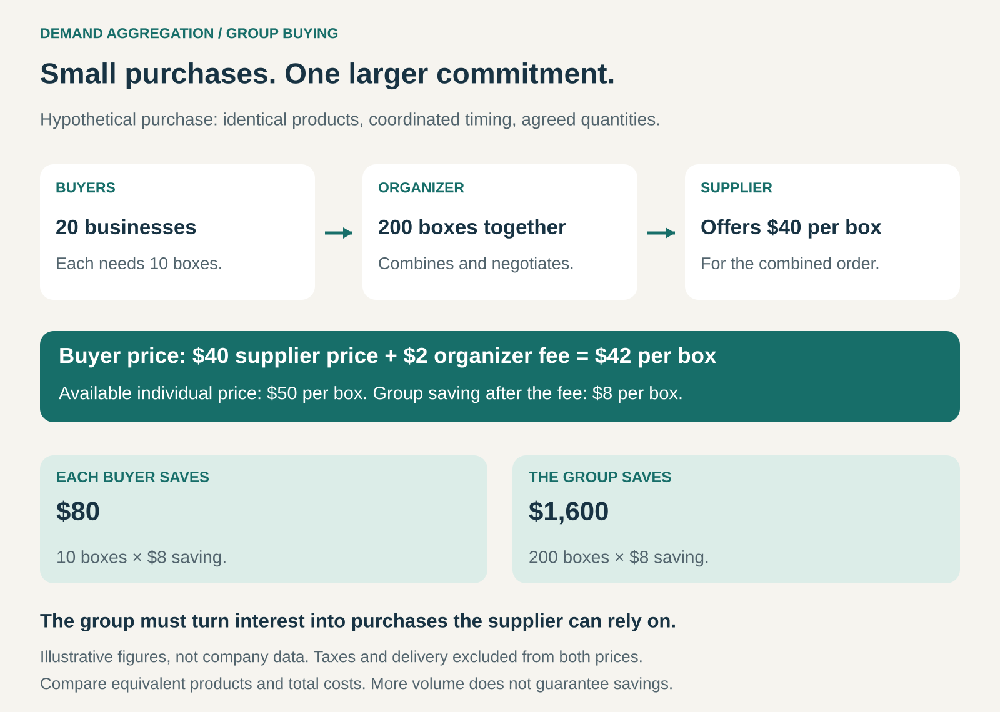

## What it is for

A small restaurant needs packaging, but its order is too small to attract a good supplier price. Several clinics purchase the same supplies through separate negotiations. Thousands of customers want a product, but each approaches the seller alone.

Demand Aggregation brings those purchases together so buyers can obtain terms that would be harder to secure individually.

It is useful when customers have compatible needs and combined purchasing volume can improve prices, availability, service, or access to suppliers.

For a business organizing the group, the opportunity is to earn money by coordinating demand and negotiating on buyers’ behalf.

## The core idea

Turn scattered purchasing needs into a larger, more credible commercial opportunity.

The basic exchange is:

**Buyers coordinate their demand → suppliers offer terms for the combined opportunity → participants purchase under those terms.**

The coordination can take several forms:

- **A buying event:** customers join a particular offer, sometimes subject to a minimum participation threshold.
- **A purchasing group:** organizations use negotiated contracts for recurring purchases.
- **A pooled procurement round:** an organizer gathers requirements and invites suppliers to compete for the business.

Group buying does not require everyone to receive one shipment, pay through one account, or own anything together. The essential feature is that their combined demand influences the offer.

## How it works

An organizer identifies buyers with sufficiently similar requirements. It establishes quantities, acceptable specifications, timing, and the degree of commitment participants will make.

It then negotiates with suppliers, runs a competitive procurement process, or presents a supplier’s conditional offer to prospective buyers.

In the hypothetical example above, 20 businesses each need 10 identical boxes. Their combined order is 200 boxes.

The supplier offers $40 per box. After a $2 organizer fee, buyers pay $42 instead of an available individual price of $50. Each business saves $80 on its ten boxes; the group saves $1,600.

That saving depends on the agreement actually being fulfilled. A list of interested buyers is less valuable than purchases a supplier can reasonably expect.

## Why it works

**It strengthens bargaining power.** A supplier may offer better terms to win a larger account or a coordinated group of customers.

**It can reduce selling costs.** One negotiation or campaign can reach many buyers. Suppliers may spend less time finding customers, preparing proposals, and processing separate commercial discussions.

**It can improve planning.** Clear quantities and purchase schedules help suppliers organize production, purchasing, staffing, or delivery.

**It can make otherwise inaccessible offers viable.** A minimum production run, delivery route, or contract may be uneconomical for one small buyer but practical for a group.

These mechanisms are different. Some savings reflect lower operating costs; others reflect a supplier accepting a smaller margin to win the business. A group discount alone does not reveal which mechanism produced it.

## Famous examples

### Groupon: the participation threshold

Groupon’s early model popularized offers that became available once enough people agreed to participate. Its origins lay in The Point, a platform built around collective action that proceeded after reaching a “tipping point.” Groupon applied that framework to buying. [Groupon’s account of its origins](https://www.groupon.com/pages/groupon-about)

This created a reason for customers to recruit other customers: participation helped make the offer happen.

The historical qualification matters. Groupon has also offered formats without a minimum participation threshold, so the early mechanism should not be assumed to describe every Groupon deal. [Groupon’s explanation of its Now! format](https://www.groupon.com/legal/nowfaq)

The example also reveals a capacity problem. Groupon’s founder described merchants encountering too many customers as the platform grew. Coordinated demand must remain manageable for the business serving it. [Groupon’s 2011 founder letter](https://www.sec.gov/Archives/edgar/data/1490281/000104746911006333/a2204399zs-1a.htm)

### Pinduoduo: making group formation part of shopping

Pinduoduo’s “team purchase” model encourages buyers to share product information and invite friends, family, and other contacts to form shopping teams in exchange for more attractive prices.

PDD Holdings’ 2025 annual report describes this social mechanism alongside the platform’s ability to aggregate demand and generate large order volumes for merchants. [PDD Holdings’ 2025 annual report](https://investor.pddholdings.com/static-files/e15edea4-5e6d-4740-808a-63a3dd1b2ce4)

This connects purchasing coordination with customer acquisition. Buyers have a reason to bring others into the transaction, while merchants gain access to concentrated demand.

The broader lesson is that aggregation can happen through a shopping interface and sharing behavior. It does not always require a formal purchasing association.

### Vizient: purchasing commitments across healthcare organizations

Healthcare purchasing groups demonstrate the recurring institutional version.

Health Resource Services, a Vizient channel partner, describes negotiating contracts using members’ combined purchasing power, including opportunities for additional savings where buyers make stronger commitments to particular vendors. [HRS: How group purchasing works](https://hrsgpo.com/faq/)

Vizient’s description of its Achieve Committed Program similarly links enhanced contract value with purchasing commitments, compliance monitoring, and support for product standardization. [Vizient’s Achieve program description](https://vizientinc-delivery.sitecorecontenthub.cloud/api/public/content/30854742c16c4eccafa44a9561befe0d)

Here, the valuable asset is continuing purchasing behavior across participating organizations. The organizer helps turn negotiated terms into actual purchasing activity.

## The economics

Three parties need a workable arrangement.

**Buyers** need a worthwhile improvement after fees, delivery, administrative effort, switching costs, and any restrictions.

**Suppliers** need enough revenue and margin to serve the group reliably. A discounted order can still be attractive if it reduces selling effort, improves utilization, or supplies predictable volume.

**Organizers** need income sufficient to cover recruitment, negotiation, administration, support, and any fulfilment responsibilities.

Revenue models can include membership fees, transaction fees, supplier commissions, or a margin where the organizer buys and resells goods.

In the graphic’s example, the organizer receives $400 in fees across 200 boxes. That is before its expenses. The value of the goods purchased is not automatically the organizer’s revenue, and the fees are not automatically profit.

Who pays the organizer also matters. Supplier-funded compensation can create a conflict between choosing the best offer for buyers and choosing the most rewarding supplier relationship.

## Useful when

Demand Aggregation is particularly useful when:

- Many buyers need comparable products or services.
- Individual purchases are too small to attract favorable terms.
- Buyers can coordinate timing, specifications, or supplier selection.
- Suppliers value predictable volume or lower selling costs.
- The potential improvement exceeds the effort required to organize the group.

It is less useful when requirements differ substantially, purchases are urgent, or buyers already obtain equally good terms individually.

## Common mistakes and limits

**Confusing interest with commitment.** Registrations, survey responses, and expressions of interest can help estimate demand. They do not necessarily justify a supplier’s production or capacity commitment.

**Comparing against an inflated reference price.** The meaningful comparison is an equivalent offer buyers could actually obtain, including delivery, fees, service, and contractual conditions.

**Ignoring differences between buyers.** Different specifications, delivery locations, payment terms, or support needs can make apparently identical purchases expensive to combine.

**Overlooking the supplier’s capacity.** A large wave of orders can create delays, rushed service, or quality problems. The ability to negotiate volume is separate from the ability to deliver it.

**Making participation too restrictive.** A lower price may require minimum spending, supplier exclusivity, or reduced choice. Those commitments can outweigh the saving for some buyers.

**Encouraging unnecessary purchases.** Buying more than needed to reach a discount threshold can increase total spending, storage costs, and waste.

**Treating scale as a permanent advantage.** Buyers may find better alternatives, suppliers may renegotiate, and coordination can become costly. The organizer must keep delivering measurable value.

## Related patterns

[[preorder-funding|Preorder Funding]] — A group purchase can collect money before production, combining pooled demand with early funding. Group buying itself does not require advance payment.

[[demand-driven-production|Demand-Driven Production / From Push to Pull]] — Aggregated orders can tell suppliers what to produce and in what quantities, reducing dependence on forecasts.

[[bundling|Bundling]] — Bundling combines products or services into an offer. Demand Aggregation combines purchasing needs across buyers; the two can operate together.

[[membership|Membership]] — A continuing purchasing group can make negotiated access one of its member benefits, supported by recurring participation or fees.
