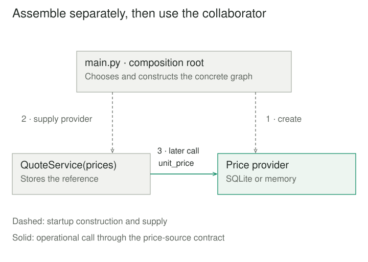

## Purpose and problem

A quoting service opens a database connection whenever it is constructed. Its arithmetic is simple, but checking a total requires database setup. A command-line tool needs prices from a small fixture; a web application needs the database. Both callers must accept the service's hidden choice of storage and connection lifetime.

The service needs access to prices. It does not necessarily need responsibility for selecting a database, opening connections, or finding test data. Mixing those decisions makes a small calculation difficult to reuse and its resource ownership difficult to see.

## Core idea

**Dependency Injection** supplies a component's collaborators from outside the component. The consumer states what it needs; assembly code chooses suitable implementations and passes them in. The consumer then uses those collaborators through an agreed contract.

The mental model is **assemble separately, then use**. Martin Fowler's [2004 article](https://martinfowler.com/articles/injection.html) names the pattern and contrasts it with Service Locator, where the consumer actively asks a registry for a dependency. Injection does not require a container, reflection, or a framework.

“Inversion of Control” is broader: frameworks can invert event handling and other decisions too. The Dependency Inversion Principle concerns the direction of source dependencies toward abstractions; injection concerns how collaborators are supplied. They can support one another without being synonyms. Constructor injection is one form of the pattern, not a separate alias for its whole scope.



## How it works

### Make requirements visible

A constructor can require collaborators before an object becomes usable. A function can receive a collaborator as an argument. Setter injection supplies one after construction, which needs a rule about when initialization is complete. Fowler also describes interface injection, where a dedicated interface defines the injection operation.

A contract includes more than a method name: argument meanings, return units, missing-data behavior, and relevant failures must agree. A Python protocol can document the expected shape without requiring providers to inherit from it. [Python's typing documentation](https://docs.python.org/3/library/typing.html#typing.Protocol) explains structural compatibility; annotations alone do not validate objects at runtime.

### Compose near the application boundary

Startup code creates providers, resolves configuration, and builds consumers in dependency order. Mark Seemann calls this application assembly location a [Composition Root](https://blog.ploeh.dk/2011/07/28/CompositionRoot/). Keeping concrete choices there lets business behavior remain independent of the wiring mechanism.

A container can automate a large graph. It is an implementation aid, not the pattern's defining mechanism. Passing the whole container into ordinary business code usually recreates lookup: the real requirements disappear behind calls to resolve services. For a small graph, direct constructors often make assembly easiest to inspect.

### Specify lifetime and ownership

Decide who creates, retains, and releases each resource. A consumer may borrow an injected connection; receiving it does not automatically transfer ownership. The owner must keep it alive for every operation that needs it and close it afterward, including exceptional exits.

A long-lived object that retains a request-scoped resource can outlive that resource or accidentally retain request state. Microsoft's [DI guidelines](https://learn.microsoft.com/en-us/dotnet/core/extensions/dependency-injection/guidelines) discuss lifetime mismatches and disposal. They also distinguish thread-safe container resolution from thread safety of the resulting objects. Injection does not synchronize shared collaborators or establish transaction boundaries.


## Worked example

### Change the assembly, keep the calculation

Before the change, `QuoteService()` chooses SQLite and owns its connection implicitly. Afterward, `QuoteService(prices)` needs only a source that returns a unit price in integer cents or raises `KeyError` for an unknown product. The caller chooses the source and manages resources.

Save these three files together and run `python3 main.py` using Python 3.8 or later. Only the standard library is required.

**quotation.py — consumer and its price-source contract**

```python
from typing import Protocol


class PriceSource(Protocol):
    def unit_price(self, sku: str) -> int:
        """Return nonnegative integer cents; raise KeyError if missing."""
        ...


class QuoteService:
    def __init__(self, prices: PriceSource):
        self._prices = prices

    def total(self, sku: str, quantity: int) -> int:
        if type(quantity) is not int or quantity <= 0:
            raise ValueError("Quantity must be a positive integer")
        cents = self._prices.unit_price(sku)
        if type(cents) is not int or cents < 0:
            raise ValueError("Price must be nonnegative integer cents")
        return cents * quantity
```

**prices.py — two providers with the same contract**

```python
from contextlib import closing


class SqlitePrices:
    def __init__(self, connection):
        self._connection = connection  # Borrowed; owner closes it.

    def unit_price(self, sku):
        with closing(self._connection.execute(
            "SELECT unit_cents FROM prices WHERE sku = ?", (sku,)
        )) as cursor:
            row = cursor.fetchone()
        if row is None:
            raise KeyError(sku)
        return row[0]


class MemoryPrices:
    def __init__(self, prices):
        self._prices = dict(prices)

    def unit_price(self, sku):
        return self._prices[sku]
```

**main.py — explicit composition and connection ownership**

```python
import sqlite3
from contextlib import closing
from prices import MemoryPrices, SqlitePrices
from quotation import QuoteService


with closing(sqlite3.connect(":memory:")) as connection:
    connection.execute(
        "CREATE TABLE prices (sku TEXT PRIMARY KEY, unit_cents INTEGER)"
    ).close()
    connection.execute("INSERT INTO prices VALUES (?, ?)", ("pen", 125)).close()
    connection.commit()
    database_quotes = QuoteService(SqlitePrices(connection))
    print("sqlite", database_quotes.total("pen", 3))

fixture_quotes = QuoteService(MemoryPrices({"pen": 125}))
print("memory", fixture_quotes.total("pen", 3))
# sqlite 375
# memory 375
```

The input is product `pen`, quantity three, priced at 125 cents per unit. Both assemblies return 375 cents. The fixture demonstrates substitution without patching globals or starting a database. Neither provider inherits from `PriceSource`; both expose the required behavior.

Zero, negative, fractional, or Boolean quantities fail before a provider call. Missing products raise `KeyError` from either provider. A zero-cent price is valid; negative or noninteger prices violate the contract and are rejected by the consumer. These checks are example policy, not automatic features of injection.

The application closes the SQLite connection at scope exit. The adapter closes each query cursor it creates, while borrowing the connection. Python's [closing helper](https://docs.python.org/3/library/contextlib.html#contextlib.closing) guarantees cleanup on exceptional exits. A connection's own [context manager](https://docs.python.org/3/library/sqlite3.html#sqlite3-connection-context-manager) manages transactions rather than closing it; the explicit wrapper matters.

Using `database_quotes` afterward would fail against a closed connection. Database failures propagate; injection supplies no fallback. This single-threaded, in-memory database example demonstrates composition and ownership, not durable storage, pricing reservations, or concurrent access.

## When to use it

Use injection when a component needs an external capability whose concrete choice, configuration, or lifetime belongs elsewhere. Storage, clocks, message senders, and external clients are common examples. A fixed clock supplied to an expiry calculation can make its boundary behavior reproducible without changing the computer's clock.

The pattern also helps when several entry points share behavior but compose different environments. A small pure calculation with ordinary input data may need only a function. Do not introduce a container or an interface for every value merely to make code look architectural.

## Tradeoffs and common mistakes

**Hidden lookup remains hidden coupling.** Inject the needed capability rather than a registry that can return anything. Explicit dependencies make incomplete wiring visible, though contracts still need validation and integration tests.

**Too many constructor arguments.** Injection can expose a component that has too many responsibilities. Bundling unrelated services into a “dependencies” bag hides that signal rather than repairing the design.

**Test substitutes that promise too much.** A memory provider can verify arithmetic but cannot establish SQLite locking, deployment configuration, or network-client behavior. Test the real provider's contract too.

**Incorrect lifetimes and trust.** A shared dependency can leak mutable state between requests; a borrowed resource can be closed too early. Factories can create shorter-lived collaborators when creation is part of the consumer's operation, but their ownership must remain explicit. Injection also provides no sandbox: a supplied implementation executes with the process's permissions.

## Related patterns

[[ports-and-adapters|Ports and Adapters]] defines application-owned conversations with external technologies. Injection can connect a chosen adapter to such a port.

[[strategy|Strategy]] varies an algorithm behind a stable contract. Injection can supply a strategy, but many injected collaborators provide infrastructure rather than an algorithmic choice.

[[abstract-factory|Abstract Factory]] supplies a family of related objects. An injected factory can defer creation until needed; injection itself can supply an already-created object.

[[adapter|Adapter]] translates an existing interface. `SqlitePrices` adapts a database API while injection determines which price provider the consumer receives.

## Sources

Fowler's [Dependency Injection article](https://martinfowler.com/articles/injection.html) establishes the terminology, forms, lookup distinction, and separation of assembly from use. Seemann's [Composition Root](https://blog.ploeh.dk/2011/07/28/CompositionRoot/) explains where application wiring belongs. [Microsoft](https://learn.microsoft.com/en-us/dotnet/core/extensions/dependency-injection/guidelines) discusses lifecycle and thread-safety concerns; official Python documentation supports the protocol and resource-handling details linked above.

The quotation scenario, implementation, and diagrams are original teaching material. The example uses manual constructor injection without a DI container.
