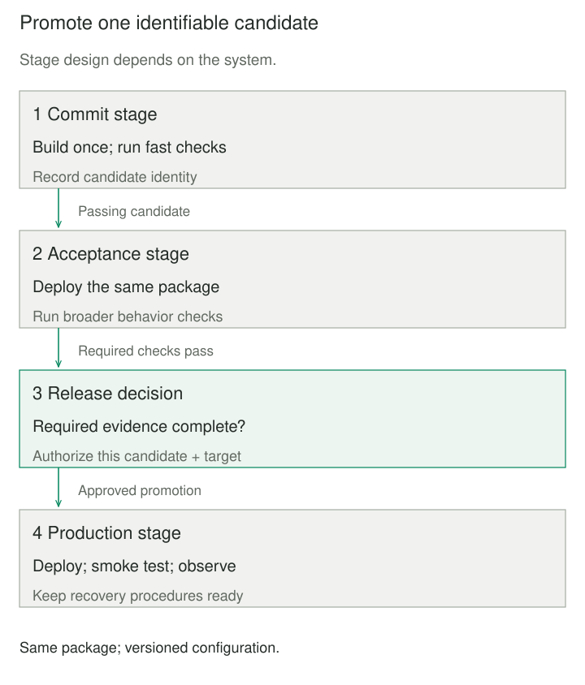

## Purpose and problem

A team can build its order service in minutes, but releasing it takes days. Someone copies a package into staging, another person runs acceptance checks, and an operator later rebuilds from the same branch for production. When the release fails, nobody can establish whether production received the tested package or which checks applied to it.

Fast feedback competes with comprehensive validation. Manual handoffs also lose evidence and make deployment knowledge depend on particular people. Deployment Pipeline makes the path from a versioned change to an operating release explicit, repeatable, and visible.

## Core idea

**Build an identifiable candidate, then promote it with evidence.** Early stages provide inexpensive feedback. Later stages perform broader or environment-dependent checks. A failed prerequisite prevents promotion of that candidate until the failure is addressed.

The pipeline represents the delivery process, including deployment and its verification. A few unrelated jobs arranged in a CI dashboard do not automatically provide that relationship. Delivery Pipeline is a common descriptive variant. Continuous delivery keeps passing candidates ready for release; continuous deployment additionally automates the production decision. A pipeline can support a deliberate human release decision.



## How it works

Version the source, build definition, deployment procedures, and relevant configuration. Give each candidate an identity that can be traced to its inputs. Humble’s account emphasizes building packages once and using the same packages throughout the pipeline. A later rebuild can resolve different dependencies or incorporate different inputs even when its branch name looks unchanged.

Start with a fast commit stage: compilation or packaging, focused tests, and suitable static checks. Run expensive integration, acceptance, performance, or exploratory checks later. Independent checks can run concurrently, while promotion depends on their required results. Fowler describes stages as increasing confidence at increasing cost; a pipeline need not be a strictly serial list of machines.

Keep environment-specific configuration separate from the package, and identify the configuration used in each deployment. DORA recommends exercising the same deployment process across environments, retrieving packages from an artifact repository, and running a deployment test. Environment similarity reduces surprises; it cannot make a small staging system prove production capacity.

Bind results to the candidate they evaluated, including the relevant test and configuration versions. The orchestrator owns dependencies, status, retries, and cancellation. Stage implementations own their checks and cleanup. Record what was attempted, what passed, what failed, and what is currently deployed. Missing or interrupted results must not become a successful prerequisite by default.

### Promotion is an operational boundary

Protect production credentials and artifact storage. A release decision should identify the candidate and target environment. GitHub’s environment protections illustrate how a job can wait for approval and withhold environment secrets until required reviewers approve; exact capabilities depend on the platform and configuration.

Serialize conflicting operations on the same environment, or use an explicit concurrency policy. An older run finishing later must not overwrite a newer release accidentally. Retrying a partially completed deployment also needs a recovery rule: inspect current state and make repeatable operations safe rather than assuming a green retry undoes earlier effects.

Include post-deployment smoke checks and operational observation. Passing earlier tests grants permission under the pipeline’s policy, not proof that the live release is correct. Database compatibility, traffic switching, and business-effect recovery remain explicit release responsibilities.

## Worked example

### Promoting a tested configuration bundle

The order service ships a small configuration artifact defining a surcharge in integer US cents. Previously, production rebuilt the bundle after staging tests. The revised model retains immutable bytes and associates successful checks with their SHA-256 digest.

This complete Python 3.9+ program uses only the standard library. The invented requirement is a 125-cent surcharge, so a 1,000-cent order totals 1,125 cents. `production` is an in-memory mapping; nothing is deployed to a network or external environment.

```python
from dataclasses import dataclass
from hashlib import sha256
import json


@dataclass(frozen=True)
class Artifact:
    name: str
    payload: bytes

    @property
    def digest(self):
        return sha256(self.payload).hexdigest()


@dataclass(frozen=True)
class Evidence:
    digest: str
    passed: frozenset[str]


def validate(artifact):
    config = json.loads(artifact.payload)
    if config.get("currency") != "USD":
        raise ValueError("unit check: currency")
    if type(config.get("fee_cents")) is not int or config["fee_cents"] < 0:
        raise ValueError("unit check: nonnegative integer cents")
    if 1000 + config["fee_cents"] != 1125:
        raise ValueError("acceptance check: order total")
    return Evidence(artifact.digest, frozenset({"unit", "acceptance"}))


def promote(artifact, evidence, production, approved):
    if evidence.digest != artifact.digest:
        raise ValueError("artifact changed after validation")
    if not {"unit", "acceptance"} <= evidence.passed:
        raise ValueError("required evidence missing")
    if not approved:
        raise PermissionError("release approval missing")
    production["current"] = artifact.payload
    return artifact.digest


if __name__ == "__main__":
    candidate = Artifact("build-42", b'{"currency":"USD","fee_cents":125}')
    evidence = validate(candidate)
    production = {}
    digest = promote(candidate, evidence, production, approved=True)
    assert sha256(production["current"]).hexdigest() == digest
    print("production: build-42; tested bytes preserved")
    changed = Artifact("build-42", b'{"currency":"USD","fee_cents":999}')
    try:
        promote(changed, evidence, production, approved=True)
    except ValueError:
        print("changed artifact blocked")
    else:
        raise AssertionError("expected digest mismatch")
    assert production["current"] == candidate.payload
```

It prints `production: build-42; tested bytes preserved`, then `changed artifact blocked`. The altered package keeps the same human-readable build name, but cannot borrow the original package’s evidence. Validation failures raise before evidence is returned; missing required evidence or approval raises before the mapping changes.

The checks are intentionally small so the promotion mechanism remains visible. Hash equality establishes byte identity, not trustworthy authorship or safety. A real pipeline needs protected evidence writers, artifact provenance, access enforcement, and approvals bound to the actual release; this program’s Boolean is not an authorization system. It does not package application code, execute a remote deployment, model concurrency, or repair partial writes.


A larger service can use the same principle for a container image while running independent contract and performance checks. An infrastructure pipeline may promote a reviewed plan and configuration revision instead. Each needs an explicit definition of the candidate and the evidence that remains valid when inputs change.

## When to use it

Use this when repeated releases involve multiple checks, environments, or teams, especially when handoffs lose status or packages get rebuilt between testing and release. It also helps when diagnosing a failed release requires reconstructing which inputs and decisions produced it.

A small application may need only a build, focused tests, and one automated deployment with a smoke check. Start with that complete path rather than inventing staging environments or approval queues without a concrete reason.

## Tradeoffs and common mistakes

The pipeline becomes production infrastructure that needs ownership, maintenance, capacity, and reliable diagnostics. Flaky tests, long queues, and opaque gates delay feedback and encourage bypasses. Run cheap informative checks early and examine waiting time as well as execution time.

Avoid mixing artifacts from different runs, treating a branch name as immutable identity, or letting production deployment scripts drift from the ones exercised in testing. Keep secrets out of packages and logs. A manual gate should evaluate explicit evidence, not compensate for an unreliable automated path with a ceremonial click.

A green pipeline can miss unexpected behavior and untested compatibility changes. Record recovery procedures, retain appropriate artifacts, and observe the deployed system. Automation makes the process repeatable; the quality of its checks and release design determines what that repetition establishes.

## Related patterns

[[pipes-and-filters|Pipes and Filters]] composes data transformations through compatible channels. Deployment Pipeline instead organizes evidence and promotion through a software delivery lifecycle; a workflow engine can implement either.

[[blue-green-deployment|Blue-Green Deployment]] is a deployment strategy a pipeline can execute, including readiness, cutover, draining, and a bounded return window.

[[ml-canary-rollout-with-rollback|Canary Release]] adds production exposure and evidence gates after initial deployment, so a pipeline may continue beyond the first successful installation.

[[data-expand-migrate-contract|Expand–Migrate–Contract]] manages compatibility across interface and data changes. The pipeline schedules and verifies those transitions rather than making incompatible changes safe automatically.

## Sources

- Jez Humble, [Deployment Pipeline patterns](https://continuousdelivery.com/implementing/patterns/): history, commit stage, package reuse, consistent deployment, and smoke checks; developed further with Dave Farley in *Continuous Delivery*.
- Martin Fowler, [Deployment Pipeline](https://martinfowler.com/bliki/DeploymentPipeline.html): staged feedback, parallel checks, manual decisions, visibility, and audit trail.
- DORA, [Deployment automation](https://dora.dev/capabilities/deployment-automation/): reusable packages, separate configuration, deployment testing, repeatability, and partial-failure concerns.
- GitHub, [Deployments and environments](https://docs.github.com/en/actions/reference/workflows-and-actions/deployments-and-environments): deployment protection rules, reviewers, and environment-secret access.

The configuration bundle, Python model, and illustrations are original teaching examples, not a production pipeline implementation.
