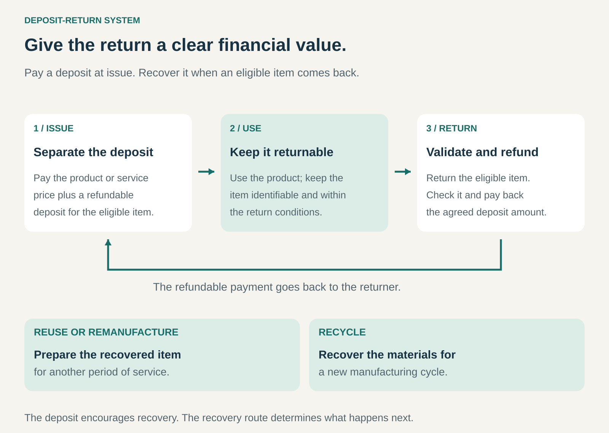

## What it is for

A container leaves the shop with the customer. A worn component remains at a repair site. A reusable cup disappears into someone’s kitchen cupboard.

Each item may still have value, but bringing it back takes effort. Asking people to return it leaves that effort unrewarded.

A Deposit-Return System attaches a refundable payment to the item. The customer pays the deposit when receiving it and recovers the agreed amount when an eligible item comes back.

It is useful when a business or network needs reliable returns for reuse, remanufacturing, or material recovery.

## The core idea

**Give the item a clear financial value at the moment of return.**

The deposit separates two payments:

- **The product or service price:** what the customer pays for consumption or use.
- **The refundable deposit:** money recoverable by meeting the return conditions.

A customer buying a drink might pay for the drink plus a deposit on its container. The drink is consumed; returning the empty container releases the deposit.

The mechanism can support several different recovery routes:

- A reusable cup is washed and issued again.
- A used machinery component becomes an input to remanufacturing.
- A single-use bottle is collected for material recycling.

A deposit therefore encourages recovery without determining what happens afterward.

It also differs from an ordinary collection reward. In a deposit system, the refund corresponds to a payment collected earlier in the system. Where scheme rules permit, the person returning the item can be someone other than its original purchaser.

## How it works

**Define eligible items.** A recognizable mark, product code, asset identifier, or documented specification establishes what belongs in the system. Eligibility must be understandable to customers and return locations.

**Collect the deposit.** The payment is shown separately from the underlying purchase or service charge. Its amount and refund conditions are clear before the customer commits.

**Provide convenient return routes.** Items can come back through shops, collection depots, machines, delivery drivers, or service partners. A shared network can allow return somewhere other than the original point of issue.

**Validate the return and refund.** The system checks eligibility, quantity, and any relevant condition requirements. It then pays cash, issues a redeemable voucher, credits an account, or uses another agreed refund method.

**Recover the item’s value.** Returned items move into washing, refilling, repair, remanufacturing, or recycling.

**Settle between participants.** A retailer may refund deposits on items originally sold elsewhere. Records and settlement arrangements ensure that accepting returns does not leave that retailer carrying another participant’s costs.

The visible customer interaction can be simple. Behind it sits a system for identifying items, preventing duplicate claims, moving recovered goods, and reconciling money.

## Why it works

The deposit changes the customer’s immediate decision. Returning an item produces a tangible financial result, while discarding or keeping it means leaving that amount unclaimed.

It also makes the desired behavior specific. “Return this eligible container and recover €1” is easier to act on than a general request to reduce waste.

A network of return points reduces the effort involved. A deposit worth recovering can still fail if the nearest collection point is inconvenient or frequently unavailable.

For the business, more dependable returns can support reusable inventory, supplies of remanufacturing cores, or collection of identifiable material streams.

The strongest systems combine a meaningful incentive with an easy return experience. Increasing the deposit cannot solve every logistical problem.

## Famous examples

### Germany’s DPG system — deposits supporting material recycling

Germany’s DPG system provides common identification and deposit-processing arrangements for eligible single-use beverage packaging.

Containers carrying the DPG mark have a €0.25 deposit refund. Consumers return eligible packaging through participating retailers, using machines or manual acceptance within the applicable return rules.

The packaging goes into recycling. A returned single-use bottle does not become a refillable bottle simply because a deposit was charged.

DPG also explains why machines compact accepted packaging: this reduces transport volume and prevents the same container from being presented repeatedly for another refund.

This example shows the importance of shared standards. Recognition, validation, refunds, and settlement allow a return network to operate across many businesses. [DPG: consumer questions and recovery process](https://dpg-pfandsystem.de/en/faq-consumer-questions-environment.html)

### RECUP — deposits keeping takeaway containers in circulation

In RECUP’s standard German counter-service model, customers leave a €1 deposit for a reusable cup or €5 for a bowl with its lid.

They can return the borrowed item at participating locations handling that product and receive their deposit back. Food-service partners wash the containers before issuing them again.

The customer does not need to revisit the original café. That flexibility makes the return obligation easier to fulfill.

RECUP also separates the incentive from its commercial service: participating businesses pay a recurring usage contribution, while deposits circulate with the borrowed packaging.

This illustrates how a deposit can support a shared asset pool without being the operator’s service fee. [RECUP: how it works](https://recup.de/en/), [RECUP: partnership and deposit model](https://recup.de/faq/)

### Caterpillar Cat Reman — deposits recovering valuable components

Cat Reman uses core deposits within its exchange model. A customer purchasing a remanufactured replacement can return the used component—the _core_—to obtain a deposit refund or credit under the applicable criteria.

The core supplies future remanufacturing work. Its value lies in recoverable engineering, including components that can be restored and used again.

Acceptance conditions matter. Caterpillar documents criteria by component, and inspection can determine whether a return qualifies for full or partial credit.

This example extends the pattern beyond consumer packaging. A refundable charge can help recover a relatively expensive industrial input, provided customers understand the return requirements and likely credit. [Caterpillar: exchange model](https://www.caterpillar.com/en/company/sustainability/remanufacturing/benefits.html), [Cat Reman: core deposits and acceptance criteria](https://www.cat.com/en_US/blog/cat-reman-core-return-saves-you-money.html)

## The economics

A deposit is an incentive and a flow of funds. Operating income needs a separate explanation.

Consider a hypothetical scheme issuing 10,000 eligible containers with a €1 deposit each. At the reporting date, 9,000 have been returned.

| Deposit movement              |     Amount |
| ----------------------------- | ---------: |
| Deposits collected            |    €10,000 |
| Refunds paid                  |    −€9,000 |
| **Deposits not yet refunded** | **€1,000** |

The €1,000 is not automatically profit. Some items may return later, and the treatment of unclaimed deposits depends on the scheme’s rules and obligations.

Now consider the recovery operation separately. Suppose it receives €1,300 in service funding and €300 from recovered materials. Collection costs €900, processing €400, and administration €200.

That leaves **€100 before other overhead, equipment investment, financing, and tax**.

These figures are illustrative. They show why deposit balances and operating performance must be assessed separately.

For reusable assets, value may come from avoided replacement purchases and repeated use. For remanufacturing, it may come from recovered components. For recycling, producer funding, handling payments, and material sales may support the operation.

A well-performing return system can also increase refund payments and handling costs. Its funding must remain workable when people do exactly what the system encourages.

## Useful when

- **Returned items have recoverable value.** They can be reused, restored, or processed economically.
- **Customers otherwise have little reason to return them.** The deposit gives the action an immediate financial consequence.
- **Eligibility is verifiable.** Staff or equipment can distinguish qualifying returns.
- **Return routes fit existing routines.** Shops, deliveries, service visits, or depots reduce additional effort.
- **Multiple businesses need a common recovery mechanism.** Shared rules can connect issue and return locations.
- **The underlying operation has dependable funding.** Service fees, product margins, recovered value, or other funding cover the work.

## Common mistakes and limits

**Setting the deposit without considering customer effort.** A small refund may not justify a special journey. A large deposit can make the initial purchase less accessible.

**Making refunds difficult.** Confusing eligibility, unreliable machines, restricted hours, or unnecessary steps weaken trust and participation.

**Treating all unreturned items as permanently lost.** Returns can be delayed. A snapshot of outstanding deposits does not establish final losses or final income.

**Ignoring the receiving business.** Return locations need space, staff time, working cash, and reliable settlement. An attractive customer offer can still be burdensome for participating retailers.

**Failing to prevent repeated or invalid claims.** Identification, validation, records, and appropriate handling of accepted items protect the refund mechanism.

**Confusing collection with environmental benefit.** A high collection rate is useful, but the outcome also depends on transport, processing, achieved reuse, and what the recovered output replaces.

## Related patterns

- [[closed-loop-asset-pooling|Closed-Loop Asset Pooling:]] Organizes repeated asset circulation; deposits can encourage users to return items to the pool.
- [[remanufacturing|Remanufacturing:]] Converts suitable returned products or components into verified replacement products.
- [[waste-to-value|Waste-to-Value / Trash-to-Cash:]] Creates value from recovered streams; deposits help bring those streams back.
- [[guaranteed-buyback|Guaranteed Buyback:]] Offers a future repurchase commitment. Deposit-return ties recovery to a refundable amount collected earlier.
