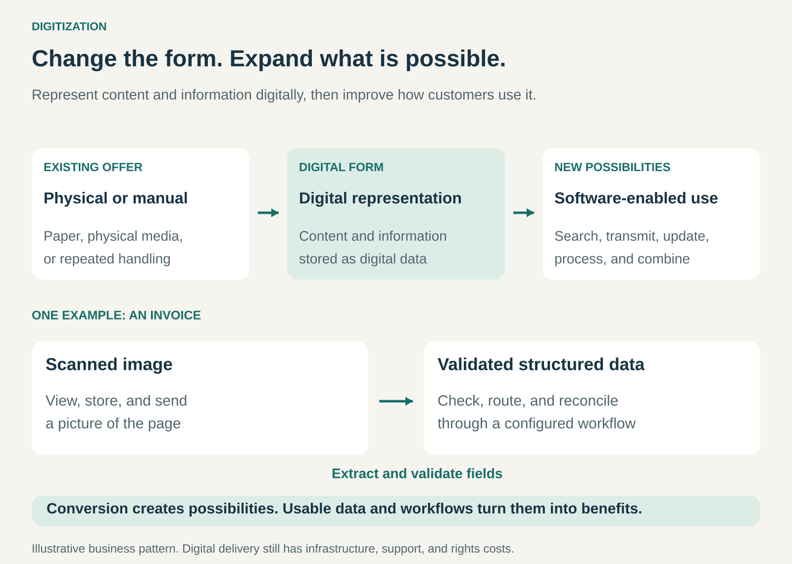

## What it is for

Making an existing offering easier to distribute, search, update, process, or access by representing its information and content digitally.

A printed manual becomes a searchable guide. A book becomes a downloadable publication. A paper form becomes information that can move through a digital workflow.

The customer’s underlying need may remain familiar. What changes is how the business fulfills it.

Digitization can reduce physical handling, expand reach, and enable capabilities that are difficult to provide through paper, physical media, or manual processes.

## The core idea

**Change the form of the offering so that software can do useful work with it.**

In its narrow technical meaning, digitization converts analogue information into digital data. Digitalization describes using digital technologies to change activities. The OECD distinguishes these terms explicitly. [OECD: digitization and digitalization](https://www.oecd.org/en/publications/going-digital-shaping-policies-improving-lives_9789264312012-en/full-report/component-6.html)

As a business pattern, Digitization commonly includes the broader move toward digital versions of existing products and services, with advantages such as faster distribution. [Business Model Navigator: Digitization](https://service.businessmodelnavigator.com/pattern?id=11)

The commercial opportunity comes from what the new form makes possible.

A digital document can travel without a courier. Searchable text can answer a question without someone reading every page. Structured records can support calculations and automated checks.

The conversion creates possibilities. Product design, usable data, and reliable operations turn those possibilities into customer value.

## How it works

The pattern connects three decisions.

**What should become digital?** The relevant element might be content, records, measurements, instructions, or part of a service interaction.

A physical product can remain physical while its documentation, configuration, or ordering process changes.

**What representation is needed?** A photograph of a page preserves its appearance. Searchable text supports retrieval. Structured fields let software distinguish an invoice number from an amount or a payment date.

Different purposes require different representations.

**What will the digital version enable?** Useful capabilities include remote access, search, updates, personalization, integration, and automated processing.

For example, scanning an invoice makes it easier to store and send. Extracting and validating its fields can support checking and routing it through a configured workflow.

That additional step matters. A folder full of scanned pages may preserve information while leaving much of the original manual work intact.

The business also needs to design access, distribution, maintenance, and support around the digital offering.

## Why it works

Physical forms impose constraints.

Printed copies require production, storage, and delivery. Updating distributed material may require replacement copies. Finding information may depend on someone knowing where to look.

Digital representations can loosen those constraints.

The same content can reach customers in many locations. Updates can be distributed without replacing a physical object. Information can become searchable and connect with other systems.

Digital products can also support different commercial packages: individual purchases, subscriptions, libraries, or services built around a growing body of information.

The costs change rather than disappear. Software development, hosting, bandwidth, content rights, support, and ongoing maintenance can remain substantial.

The customer experience can change too. A digital version needs to preserve the qualities customers value while adding capabilities that justify adopting it.

## Famous examples

### Adobe Acrobat and PDF: making documents portable across systems

Adobe launched Acrobat and PDF in 1993 to address the difficulty of exchanging documents reliably across different applications and computer systems. Its account of the project emphasizes preserving document appearance for viewing and printing. [Adobe’s history of Acrobat and PDF](https://blog.adobe.com/en/publish/2018/06/14/evolution-digital-document-celebrating-adobe-acrobats-25th-anniversary)

The digital representation made document exchange less dependent on moving paper or matching the sender’s original software environment.

The business opportunity extended into tools for creating, converting, editing, and managing documents.

The example also illustrates different levels of usefulness: preserving a page’s appearance is valuable, while searchable text and structured information support further tasks.

### Amazon Kindle: combining digital publications with a reading experience

Amazon introduced Kindle in 2007 as a device and service for downloading books and other publications wirelessly. Its retrospective highlights search, a built-in dictionary, and wireless delivery among the original capabilities. [Amazon’s Kindle launch](https://press.aboutamazon.com/2007/11/introducing-amazon-kindle), [Amazon’s account of Kindle’s development](https://www.aboutamazon.com/news/devices/a-look-back-at-10-years-of-the-amazon-kindle)

The customer still wanted to read. The digital format changed acquisition, storage, and navigation.

Amazon’s contribution included the surrounding experience: finding a title, obtaining it, and reading it on a device designed for that purpose.

This shows why a successful digital offering often requires more than converting the content. Distribution and usability help determine whether customers find the new form worthwhile.

### Netflix: using digital delivery to change access

Netflix began streaming in 2007, adding a different delivery route to its DVD-based business. [Netflix’s account of its history](https://www.netflix.com/tudum/articles/netflix-trivia-25th-anniversary)

DVDs already contained digital video. The business change therefore concerned network delivery rather than the initial conversion of analogue content.

Streaming allowed customers to access available titles without waiting for a physical disc to arrive.

The example shows how digital content can support a different service model. It also shows that digital delivery still requires infrastructure, content rights, and an effective customer experience.

## The economics

Consider a hypothetical business distributing **10,000 customer manuals annually**.

Printing and mailing each manual cost **$6**, producing an annual cost of:

**10,000 × $6 = $60,000.**

Suppose a digital alternative costs:

- **$1 per manual delivered**, including variable delivery and support costs.
- **$20,000 annually** for the platform and maintenance.
- **$45,000 initially** for conversion and implementation.

Annual digital operating cost becomes:

**$10,000 + $20,000 = $30,000.**

The annual saving is **$30,000**, giving a simple payback period of:

**$45,000 ÷ $30,000 = 1.5 years.**

This assumes equivalent usefulness, unchanged volume, and genuinely avoidable printing and mailing costs.

Volume matters. At **5,000 manuals annually**, the same assumptions produce only **$5,000 in annual savings**, extending simple payback to **nine years**.

These figures exclude financing and tax. They illustrate why easier distribution does not automatically establish attractive economics.

## Useful when

- Physical production or handling adds substantial cost or delay.
- Customers need remote access or frequent updates.
- Search and navigation can make information more useful.
- Repeated manual work depends on information that software could process.
- A digital version can reach customers beyond existing distribution limits.
- The business can preserve the offering’s essential value in the new format.

It is less useful when physical presence, tactile qualities, personal interaction, or offline reliability are central to what customers purchase.

## Common mistakes and limits

**Confusing conversion with improvement.** Recreating an awkward paper process on a screen may preserve its problems.

**Choosing the wrong representation.** A scanned image, searchable document, and structured record support different activities.

**Assuming distribution is free.** Infrastructure, support, content rights, and maintenance remain part of the economics.

**Neglecting information quality.** Errors, missing context, and inconsistent records can spread quickly once systems begin reusing the data.

**Ignoring customer access.** Devices, connectivity, accessibility, and confidence with technology affect whether people can use the offering.

**Forgetting maintenance.** Digital information still becomes outdated. It needs ownership, version control, and reliable update processes.

**Assuming the whole offering must move online.** A hybrid arrangement may serve customers better: digital information alongside physical products, local service, or printed options.

## Related patterns

- [[e-commerce|E-Commerce:]] Provides a digital purchasing channel; the purchased product may remain physical.
- [[self-service|Self-Service:]] Lets customers act on digital information directly, such as completing a form or managing an account.
- [[long-tail|Long Tail:]] Digital distribution can make a wider range of specialized content economically accessible.
- [[subscription|Subscription:]] Can fund continuing access, updates, and digital services, although digitization does not require recurring pricing.
