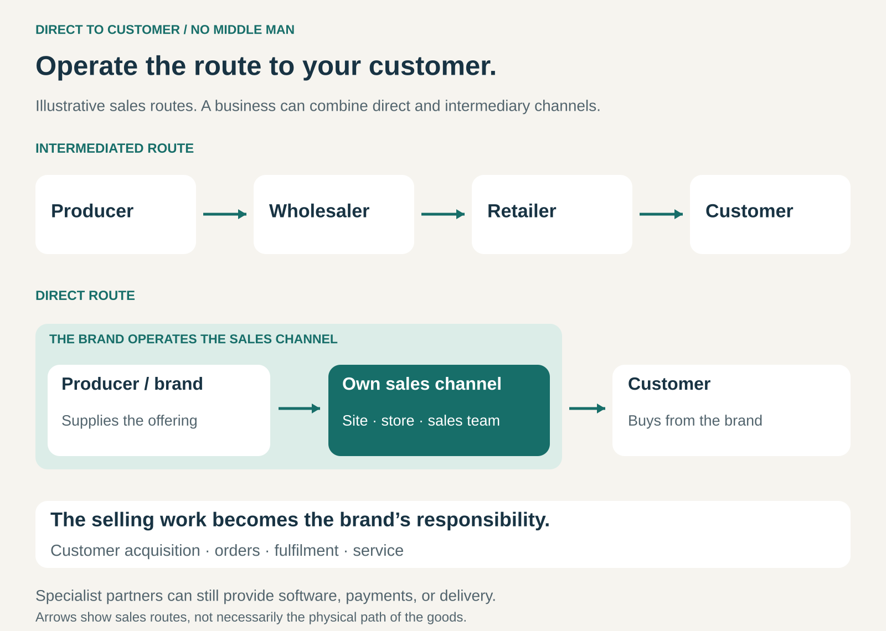

## What it is for

A producer makes a distinctive product, but another business controls how customers encounter it, what they learn about it, and what happens after the sale. Customer feedback arrives indirectly. Retail placement is difficult to secure. Each additional sales layer takes part of the final price.

Direct to Customer creates a route for the producer or brand to sell to the end customer itself.

It is useful when controlling the buying experience, building continuing customer relationships, or retaining more of the selling price justifies taking on the work of selling.

## The core idea

**Replace independent resale layers with a direct selling relationship between the brand and its customer.**

A conventional route might pass through a distributor, wholesaler, or retailer before reaching the buyer. A direct route uses the brand’s website, stores, sales team, catalogue, telephone ordering, or another channel it operates.

The customer can be an individual or an organization. Although “direct-to-consumer” is common terminology, the broader pattern also applies to manufacturers selling directly to businesses.

“No Middle Man” is shorthand for removing particular commercial intermediaries. Specialist partners can still provide payments, software, warehousing, delivery, or manufacturing.

The important change is responsibility for the sale and customer relationship. The brand now needs to attract buyers, explain the offering, take orders, arrange fulfilment, and handle service.

Direct selling can coexist with wholesale and retail partnerships. It need not be an exclusive choice.

## How it works

The pattern brings several activities closer to the producer.

**Create a reason to buy directly.** Customers need a useful route to the offering. This might provide better advice, a fuller assortment, customization, convenient replenishment, exclusive products, or attractive pricing.

**Operate the sales channel.** The brand provides the place or process through which customers evaluate and buy. Physical stores and sales representatives can perform this role just as websites can.

**Take responsibility for fulfilment and service.** Delivery, returns, product questions, repairs, and complaints become part of the direct proposition. Partners may perform these tasks, while the brand coordinates the customer experience.

**Learn from the relationship.** Orders, questions, returns, and feedback can reveal why customers buy and where products disappoint. Those insights become useful when they influence product development, communication, and service.

**Coordinate other channels.** When direct selling operates alongside resellers, differences in pricing, assortment, service, and customer coverage need a coherent rationale.

Opening a website addresses only one part of this system. A working direct channel connects discovery, purchase, delivery, and continued support.

## Why it works

Direct selling can improve the connection between a product and the people using it.

The brand can explain features that a general retailer may have little time or incentive to demonstrate. It can present its full range, support complex choices, and maintain a consistent service experience.

Direct contact can also improve learning. Repeated questions may expose unclear instructions. Returns may reveal a sizing problem. Reorders may show which products become part of customers’ routines.

Economically, the brand receives the customer’s selling price rather than a lower wholesale price. That creates room to fund its own selling activities, improve the offering, reduce prices, or retain additional contribution.

Those possibilities depend on costs. Intermediaries provide functions such as discovery, local availability, advice, inventory holding, and service. Removing a sales layer means arranging another way to perform the functions customers still need.

## Famous examples

### Dell: direct selling linked with configuration and ordering

Dell’s historical direct model combined selling to end customers with building computers to their specifications. Its 1998 annual report describes customers ordering by telephone or online and computers being manufactured as ordered. [Dell 1998 annual report](https://i.dell.com/sites/content/corporate/financials/en/Documents/ar_fy1998-YIR.pdf)

The direct relationship supported a more specific conversation about requirements and configuration. It also connected customer orders with production planning.

Dell illustrates how the pattern can serve businesses, public institutions, and individual consumers.

It is also a hybrid example today: Dell’s fiscal 2026 report describes both direct sales and channels including resellers, integrators, distributors, and retailers. [Dell fiscal 2026 annual report](https://investors.delltechnologies.com/sec-filings/all-sec-filings/content/0001571996-26-000008/dell-20260130.htm)

### Warby Parker: direct selling through digital and physical channels

Warby Parker designs glasses in-house and sells directly to customers through an integrated combination of e-commerce and retail stores. Its 2025 annual report describes customers moving between online discovery, virtual tools, stores, and subsequent online transactions. [Warby Parker 2025 annual report](https://www.sec.gov/Archives/edgar/data/1504776/000150477626000006/wrby-20251231.htm)

This shows that direct selling can include a substantial physical presence. A brand-operated store remains a direct channel.

The company also uses manufacturing partnerships, illustrating that a direct customer relationship does not require owning every production activity. The pattern concerns the route to the buyer, while production ownership is a separate decision.

### Nespresso: direct ordering and continuing replenishment

Nespresso lets customers interact through its website, app, boutiques, and customer relationship centres. These channels support ordering coffee, machines, and accessories, as well as product guidance. [Nespresso services](https://nestle-nespresso.com/our_products/services)

Coffee replenishment gives the relationship a continuing purpose. Customers can return to the brand for further purchases, while the brand can explain its range and support their choices.

Nespresso also demonstrates coexistence with other routes: its German ordering guidance lists selected retail partners alongside its direct options. [Nespresso ordering options in Germany](https://www.contact.nespresso.com/faq-3/de/en)

The direct relationship is valuable without requiring every purchase to pass through the same channel.

## The economics

A higher receipt per unit does not automatically mean higher profit.

Consider a hypothetical product sold to the end customer for $100 in either channel:

| Per unit, from the producer’s perspective | Through a reseller | Direct |
| ----------------------------------------- | -----------------: | -----: |
| Revenue received                          |                $70 |   $100 |
| Product cost                              |                $40 |    $40 |
| Additional selling and distribution costs |                 $5 |    $35 |
| Contribution before fixed overhead        |                $25 |    $25 |

The direct route brings in $30 more revenue, but in this example it also costs $30 more to acquire, fulfil, and serve the sale.

The reseller’s spread likewise funds its activities before producing any profit.

Direct economics can improve when customers return without requiring expensive reacquisition, order several products together, or need less support over time. They can deteriorate when advertising, individual deliveries, returns, and store costs are high.

Inventory and cash flow also matter. A reseller may purchase stock before selling it onward. A direct brand may need to finance that stock until individual customers buy it. Building to order can change this arrangement, but direct selling alone does not eliminate inventory.

## Useful when

- **The offering needs explanation or advice.** A general intermediary struggles to communicate its value.
- **Repeat purchasing matters.** Replenishment, accessories, or continuing service can support an ongoing relationship.
- **Customer feedback can improve the product.** Direct contact provides information the business can act on.
- **The brand can attract demand efficiently.** It has an audience, distinctive proposition, trusted reputation, or effective sales capability.
- **Greater channel control is worth the operating responsibility.** The business can deliver a dependable buying and service experience.

## Common mistakes and limits

**Treating the intermediary’s margin as available profit.** Much of it pays for work that still needs doing.

**Assuming direct means online-only.** Stores, telephone sales, field representatives, and demonstrations can all support direct relationships.

**Underestimating customer acquisition.** Retailers often aggregate demand across many brands. A direct seller must give customers a reason to find and choose its own channel.

**Focusing on the first order.** The cost of winning a customer may only make sense if subsequent purchases contribute enough. Expected repeat behaviour needs evidence.

**Taking on service without sufficient capacity.** A product problem becomes a direct relationship problem when questions go unanswered or returns are difficult.

**Creating avoidable channel conflict.** Resellers may reduce support if the brand competes for the same customers without a clear channel strategy.

**Removing useful convenience.** Some customers value comparing brands, buying several categories together, receiving local advice, or collecting a product immediately. A direct route must offer enough value to earn their choice.

## Related patterns

[[demand-driven-production|Demand-Driven Production / From Push to Pull]] can connect direct orders with production decisions. Direct selling can also use finished inventory.

[[mass-customization|Mass Customization]] benefits from a direct way to capture requirements and explain configuration choices.

[[subscription|Subscription]] can organize recurring direct purchases, although direct selling also supports individual transactions.

[[razor-and-blade|Razor and Blade / Bait and Hook]] can combine third-party distribution of an initial product with direct replenishment of associated consumables.
