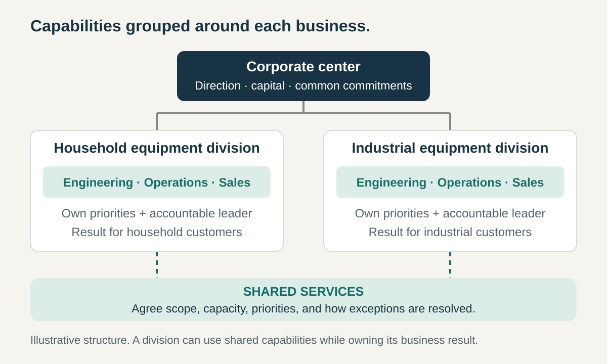

**Core question:** How can different businesses pursue their own priorities with the capabilities and authority needed to deliver results?

## What it is for

A hypothetical equipment maker sells household appliances and industrial machinery. Household buyers need accessible prices and dependable retail availability. Factory customers need installation, technical support, and equipment that fits existing production lines.

Both businesses require engineering, operations, and sales. Yet a common departmental priority list repeatedly forces their leaders to negotiate whose needs come first.

Divisional Organization creates an organizational home for each business. A division brings together enough of the required capabilities to take responsibility for its offering, customer group, or territory.

It can structure an entire enterprise or one level within a larger organization. The reason to divide is a meaningful difference in how the businesses need to operate.

## The core idea

**Organize around a product, market, or region, and give its leader authority over the capabilities needed to achieve that division’s results.**

The division combines several functions around a common business purpose. Its leader reconciles priorities across those functions and accounts for the unit’s performance. Commercial divisions often carry profit-and-loss responsibility, although the principle also applies to units measured through service outcomes.

A division can retain functional departments internally. The change concerns where those functions come together under a leader responsible for their combined result. Galbraith’s account of the multidivisional form describes this nesting of business units and functions, together with corporate coordination above them. [Galbraith, _The Evolution of Enterprise Organization Designs_, 2012](https://jaygalbraith.com/wp-content/uploads/2024/03/EvolEnterpriseOrgDesign.pdf)

Divisions need not own every capability or be separate legal companies. Some services remain shared. The design must make clear which decisions belong to the division and which depend on the wider organization.

## How it works

**Choose a coherent boundary.** Products, customer groups, or regions should have sufficiently distinct needs to justify different priorities. Splitting every product into a division can fragment capabilities without creating useful independence.

**Bring necessary capabilities together.** In the equipment-maker illustration, each division has engineering, operations, and sales responsibilities appropriate to its business. Its leader can trade off a design change against production cost and customer requirements within an agreed budget.

**Define what the center retains.** Corporate leadership may determine enterprise strategy, allocate capital, set common standards, or provide shared services. A division’s local choices remain bounded by those commitments. A shared laboratory needs explicit capacity and priority arrangements if both divisions depend on it.

**Review results and manage connections.** Divisions report performance and emerging needs. The center considers the portfolio as a whole and resolves conflicts involving common resources or commitments. Divisional leaders still coordinate when customers, technologies, suppliers, or infrastructure cross their boundaries.

Dividing responsibility relocates some coordination inside each unit. It also creates new interfaces between divisions and the center.

## Why it works

People making a business decision need several kinds of information at once: customer needs, technical possibilities, delivery constraints, and cost. Bringing relevant capabilities under a divisional leader can shorten the route between that information and a decision.

The arrangement also gives responsibility a clearer boundary. Instead of separate departments explaining why each completed its part, a division must account for the combined offering and its results.

This works best when most important tradeoffs can be settled within the division. If every release requires permission or scarce capacity from elsewhere, its apparent independence exceeds its practical authority. The useful design question is which dependencies become easier to manage, and which new ones the division creates.

## Examples

### P&G: category responsibility with shared market capabilities

P&G’s corporate-structure description, consulted in October 2026, groups its product categories into industry-based Sector Business Units, including Beauty and Fabric and Home Care. These units have responsibility for sales, profit, cash, and value creation in the company’s Focus Markets.

The arrangement also preserves shared capabilities. Market Operations serves multiple sector units through activities including customer teams, transportation, and warehousing. Enterprise Markets forms a separate unit, working with the sector units’ innovation plans, supply plans, and operating frameworks. [P&G, _Corporate Structure_](https://us.pg.com/structure-and-governance/corporate-structure/)

This illustrates both the grouping and its limits. Business responsibility follows categories in some markets, while market operations and corporate resources connect activities across them. The transferable idea is to specify where the business result belongs and how shared contributions support it. Calling a unit a division does not establish complete self-sufficiency.

### Toyota: bringing product planning and manufacturing closer together

In March 2016, Toyota announced a shift toward product-based in-house companies, citing the effort consumed by coordination across functions. Its planned allocation brought research and development, production engineering, and manufacturing into those companies, with presidents responsible for operations from planning through manufacturing. Regional units and a head office continued alongside them. [Toyota’s March 2016 organizational announcement](https://global.toyota/en/detail/11234406)

A December 2016 briefing confirmed that seven product-oriented in-house companies had been established that April. The CV Company focused mainly on commercial vehicles. [Toyota, _CV Company Briefing_, December 2016](https://global.toyota/en/download/14788197/)

The structural move put more of a product’s interdependent work within one management boundary. It also left regional and corporate relationships to manage. Toyota’s stated objectives explain the reasoning; these announcements alone do not establish the size of any resulting improvement. This is a historical example, not a description of Toyota’s current organization.

## Useful when

- **Businesses need different priorities.** Their customers, operating rhythms, or routes to market differ materially.
- **Coordination repeatedly crosses functions.** Decisions about one offering continually escalate between department heads.
- **The unit can influence its result.** Its leader can make meaningful choices about capabilities, commitments, and resources.
- **The scale supports the arrangement.** Dedicated capabilities are affordable, and shared services can meet explicit expectations.

## Common mistakes and limits

**Assigning results without authority.** A division held responsible for delivery cannot exercise that responsibility if essential staffing, spending, or scheduling choices remain elsewhere without workable agreements.

**Duplicating everything.** Separate laboratories, systems, or specialist teams may cost more than their local responsiveness justifies. Decide what benefits from proximity to the business and what benefits from shared scale.

**Turning divisions into competing islands.** Local targets can encourage units to withhold knowledge, pursue incompatible systems, or reject work valuable to the enterprise. Shared obligations and ways to settle conflicts belong in the design.

**Mistaking reported profit for independent value creation.** Allocated overhead, internal prices, and shared assets affect divisional results. Reviews need to examine those assumptions alongside customer outcomes, quality, and capability development.

**Keeping all important decisions at headquarters.** Local responsibility becomes difficult to sustain when every substantive choice requires central approval. Specify what the center reserves and what divisions can actually decide.

A functional arrangement may fit better when businesses share most capabilities and their priorities are similar. Where product and regional interests both need formal authority, a matrix or another hybrid may be more appropriate. Adding divisions inevitably involves judgments about the cost of duplication and the location of coordination.

## Related patterns

- [[functional-organization|Functional Organization]] concentrates expertise across offerings; functional departments can also sit inside divisions.
- [[teamwork-optimize-the-whole|Optimize the Whole]] helps evaluate local improvements against the wider organization’s result.
- [[teamwork-clarify-decision-rights|Clarify Decision Rights]] makes the boundary between divisional authority and corporate responsibilities usable.
