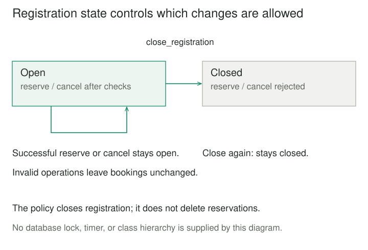

## Purpose and problem

A workshop has three seats. The website checks capacity before accepting a reservation, but a batch importer appends reservations directly. Cancellation code updates a separate remaining-seat counter. Soon, different entry points disagree about availability, and cancelling a reservation can leave the counter wrong.

The rules are small individually, but they interact: seats must be positive, references must be unique, reservations cannot exceed capacity, and registration eventually closes. Copying those checks into every workflow makes changes risky. A table of fields describes the situation without defining which changes are valid.

## Core idea

**Domain Model** organizes business behavior together with the state it governs. Objects represent meaningful concepts and collaborate through operations that express domain actions, rather than exposing fields for arbitrary updates.

The mental model is **ask the model to perform a valid business change**. Martin Fowler's [Domain Model catalog](https://martinfowler.com/eaaCatalog/domainModel.html) establishes the pattern as an object model containing both data and behavior. Calling it a **Rich Domain Model** emphasizes that behavior; merely adding classes around database rows does not establish it.

“Domain model” can also mean a conceptual description or diagram. Here it names the executable enterprise-application pattern. A database schema, transfer object, and ORM entity may represent related data, but none necessarily owns business rules. Domain-Driven Design is a wider modeling and collaboration approach, not another name for this single pattern.


## How it works

### Put rules beside the state they protect

A model exposes intentions such as `reserve` and `cancel`, with their preconditions and outcomes. An invariant is a condition that must hold across valid states: for this workshop, total reserved seats never exceeds fixed capacity.

Choose useful concepts and responsibilities rather than a class for every noun. Eric Evans's [DDD Reference](https://www.domainlanguage.com/wp-content/uploads/2016/05/DDD_Reference_2015-03.pdf), particularly Model-Driven Design, connects the implemented model with the language used to understand the domain. The model should evolve as that understanding improves.

Not every useful behavior belongs to one entity. Calculations may involve value objects or a focused domain service. The important distinction is between expressing domain rules and merely moving records through generic setters.

### Coordinate a use case outside the model

An application operation can authenticate a caller, load a workshop, invoke its method, and save it. The model decides whether the reservation fits; the surrounding application owns orchestration and persistence boundaries. Fowler's [Service Layer catalog](https://martinfowler.com/eaaCatalog/serviceLayer.html) describes that application boundary and coordination role.

A [Data Mapper](https://martinfowler.com/eaaCatalog/dataMapper.html) can keep database representation separate from model objects. This article does not require that persistence pattern or a particular ORM. Whatever mechanism is chosen must restore valid objects and preserve their business meaning.

### Define what consistency covers

In richer models, related objects may form an aggregate with one entry point for changes. Microsoft's [domain-model guidance](https://learn.microsoft.com/en-us/dotnet/architecture/microservices/microservice-ddd-cqrs-patterns/microservice-domain-model) explains aggregate ownership and invariant protection. This is a useful refinement, not a requirement to apply every DDD building block to every model.

An in-memory method is not a database transaction or a distributed lock. Two processes can load the same workshop, each accept a reservation, and overwrite one another unless persistence detects the conflict or serializes the changes. Authorization, transaction scope, and message publication also need explicit policies.



## Worked example

### Let Workshop own reservation changes

Before the change, callers append records and adjust a counter. Afterward, Workshop owns its records and derives remaining capacity from them. Reservation validates its own fields; Workshop checks uniqueness, capacity, and registration state before accepting it.

Save these two files together and run `python3 demo.py` with Python 3.10 or later. Only the standard library is required. Counts are whole seats for one workshop.

**model.py — business values, state, and operations**

```python
from dataclasses import dataclass


@dataclass(frozen=True)
class Reservation:
    reference: str
    seats: int

    def __post_init__(self):
        if not isinstance(self.reference, str) or not self.reference.strip():
            raise ValueError("Reference must be nonblank text")
        if type(self.seats) is not int or self.seats <= 0:
            raise ValueError("Seats must be a positive integer")


class Workshop:
    def __init__(self, capacity: int):
        if type(capacity) is not int or capacity <= 0:
            raise ValueError("Capacity must be a positive integer")
        self._capacity = capacity
        self._reservations = {}
        self._registration_open = True

    @property
    def remaining(self):
        return self._capacity - sum(r.seats for r in self._reservations.values())

    @property
    def bookings(self):
        return tuple(self._reservations.values())

    @property
    def registration_open(self):
        return self._registration_open

    def _require_open(self):
        if not self._registration_open:
            raise ValueError("Registration is closed")

    def reserve(self, reference, seats):
        self._require_open()
        reservation = Reservation(reference, seats)
        if reference in self._reservations:
            raise ValueError("Reference already reserved")
        if seats > self.remaining:
            raise ValueError("Not enough seats")
        self._reservations[reference] = reservation
        return reservation

    def cancel(self, reference):
        self._require_open()
        return self._reservations.pop(reference)

    def close_registration(self):
        self._registration_open = False
```

**demo.py — a caller uses domain operations**

```python
from model import Workshop


workshop = Workshop(3)
workshop.reserve("a", 2)
print("remaining", workshop.remaining)
try:
    workshop.reserve("b", 2)
except ValueError as error:
    print(error)
workshop.cancel("a")
workshop.reserve("b", 3)
workshop.close_registration()
print("booked", workshop.bookings[0].reference, "remaining", workshop.remaining)
# remaining 1
# Not enough seats
# booked b remaining 0
```

The first reservation leaves one seat. The attempted two-seat reservation fails without adding a record. Cancelling `a` restores three available seats; `b` then takes exactly three. There is no separately maintained available-seat counter to drift away from the records.

Duplicate references and invalid quantities fail before mutation. Cancelling an unknown reference raises `KeyError`. Closing registration prevents both reservations and cancellations in this invented policy, while repeated closure leaves the state unchanged. A real organization may permit later cancellation; that would be a different rule to model explicitly.

The exposed bookings are a tuple of frozen records containing only strings and integers. A previously returned tuple is a snapshot, not a live mutable collection. Python's [dataclass documentation](https://docs.python.org/3/library/dataclasses.html#frozen-instances) explains the limits of frozen fields; [underscore names](https://docs.python.org/3/tutorial/classes.html#private-variables) express intent rather than enforcing access control.

This example relies on callers using public operations. It is single-threaded and in memory: object mutation supplies no durability, concurrent capacity guarantee, or automatic rollback of other effects. No file, database connection, or clock is owned by these model objects.

## When to use it

Use a Domain Model when rules interact across several operations, repeated checks appear in multiple entry points, and the business vocabulary helps explain valid changes. A lending model, for example, might coordinate a loan's return and renewal eligibility rather than letting every screen edit a due date freely.

For straightforward record entry with little interacting behavior, a procedure may be clearer. Fowler's [Transaction Script](https://martinfowler.com/eaaCatalog/transactionScript.html) organizes logic around individual requests. Domain Model earns its extra object and persistence complexity when it makes substantial rules easier to express and change.

## Tradeoffs and common mistakes

**Classes without behavior.** Fowler's [Anemic Domain Model](https://martinfowler.com/bliki/AnemicDomainModel.html) critiques paying for a domain-object structure while keeping its rules elsewhere. Plain records and procedural code can still be deliberate choices; they should not be confused with this pattern.

**One giant business object.** Putting every policy into Workshop would simply relocate the tangle. Separate responsibilities where concepts and rules justify it, without creating a framework for trivial CRUD operations.

**Persistence dictates every concept.** A table layout is useful for storage, but it may not express the domain's identities, relationships, and lifecycle. Mapping and rehydration introduce costs and must not bypass invariants silently.

**Encapsulation mistaken for isolation.** Model methods guard their own operations, not every concurrent copy or direct database write. Integration tests, constraints, conflict handling, and transaction design still matter. Domain methods should not unexpectedly send messages or hold external resources whose failure would leave an unclear partially completed workflow.

## Related patterns

[[data-bounded-contexts|Bounded Contexts]] defines where terms and rules have a coherent meaning. A domain model belongs within such a scope rather than imposing one universal model on every team.

[[ports-and-adapters|Ports and Adapters]] separates application behavior from external technologies. Domain objects can sit inside that application boundary.

[[state|State]] delegates behavior that varies with lifecycle state. A complex domain lifecycle may benefit from it; this workshop needs only a simple registration flag.

[[functional-core-imperative-shell|Functional Core, Imperative Shell]] separates pure decisions from effects. Domain behavior can use pure calculations, but these Workshop methods deliberately mutate owned in-memory state.

## Sources

Fowler's [Domain Model](https://martinfowler.com/eaaCatalog/domainModel.html), [Transaction Script](https://martinfowler.com/eaaCatalog/transactionScript.html), [Data Mapper](https://martinfowler.com/eaaCatalog/dataMapper.html), and [Anemic Domain Model](https://martinfowler.com/bliki/AnemicDomainModel.html) establish the main distinctions. The [Service Layer catalog entry](https://martinfowler.com/eaaCatalog/serviceLayer.html), attributed to Randy Stafford, supports use-case coordination. Evans's [DDD Reference](https://www.domainlanguage.com/wp-content/uploads/2016/05/DDD_Reference_2015-03.pdf) and [Microsoft's guidance](https://learn.microsoft.com/en-us/dotnet/architecture/microservices/microservice-ddd-cqrs-patterns/microservice-domain-model) provide related modeling context.

The workshop rules, Python code, and diagrams are original teaching material. The public catalog entries and reference materials were consulted; no inaccessible book chapter is claimed as read.
