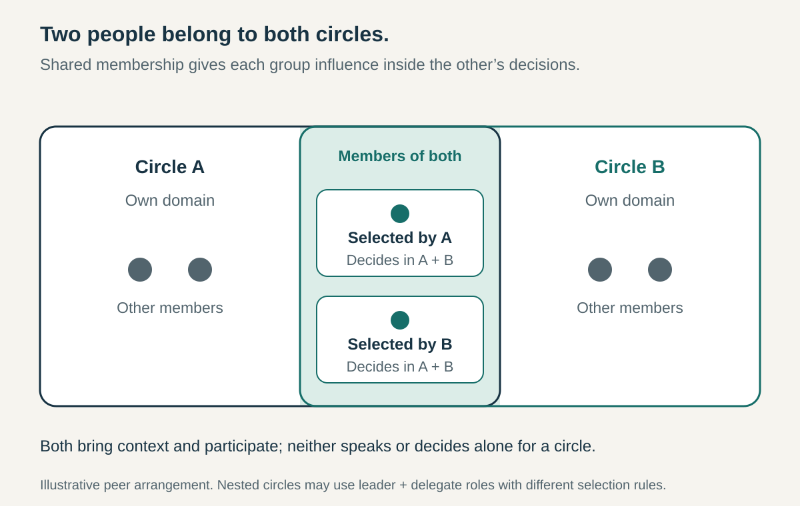

**Core question:** How can connected groups influence each other’s decisions without depending on one person to speak for both?

## What it is for

Imagine a hypothetical cooperative with a central coordination group and several local service groups. Each local leader attends the central meeting, then reports back. Information moves, but the same person interprets local concerns, negotiates resources, and explains the resulting decisions. Colleagues have little direct influence on choices made elsewhere.

Double Linking adds a second, independently selected connection with real participation rights. It applies between groups that retain their own responsibilities but regularly make decisions affecting one another: departments and coordinating bodies, local units and a federation, or interdependent peer teams.

The difficulty is representation in continuing governance, beyond keeping everyone informed.

## The core idea

**Connect two groups through two distinct people who are members of both, giving each group a voice inside the other’s governance decisions.**

A circle is a group with an agreed purpose and area of authority. In a common sociocratic arrangement, a broader circle and a more focused circle share a leader and a delegate. The delegate provides representation separate from the leader’s responsibilities.

The pattern can also connect peers. Sociocracy 3.0 describes two interdependent teams each selecting a member to represent their interests in the other team’s governance. A reporting hierarchy is therefore one possible setting, rather than a requirement. [Sociocracy 3.0: Double Linking](https://patterns.sociocracy30.org/double-linking.html)

Two people exchanging updates is insufficient. The defining feature is overlapping membership with recognized influence on decisions. Double Linking connects authority across a boundary while leaving the groups’ domains distinct.

## How it works

**Establish the domains first.** Specify what each group may decide and which matters require coordination. A local service circle might own scheduling within an agreed budget; a broader circle might allocate that budget across locations. Shared members do not automatically transfer either responsibility.

**Select two distinct people.** Give each connection a clear source of legitimacy. Between peers, each group can select its representative. In a nested structure, define how the leader is appointed or confirmed and how the focused circle selects its delegate. Publish responsibilities, terms, replacement arrangements, and expected time commitments. One person wearing both titles removes the independent connection.

**Give both usable membership rights.** Provide access to agendas, relevant records, deliberation, and the applicable decision process. In a consent-based arrangement, this includes the ability to raise reasoned objections within each circle’s domain. An observer invited to report and then leave does not have the same influence. Neither link becomes the sole decision-maker for either group.

**Carry context into decisions.** Representatives bring needs, constraints, proposals, and consequences from the other group before choices are settled. Both should communicate in both directions. Describing one as carrying information down and the other as carrying it up expresses their emphasis, but should not prohibit either from asking questions or correcting misunderstandings.

**Keep the connection accountable.** Make decisions, reasons, unresolved concerns, and follow-up commitments accessible. Representatives need enough discretion to deliberate without seeking instructions on every sentence, alongside a responsibility to understand the people they represent. Clarify when a proposal must return for consultation because it exceeds that discretion.

**Handle exceptions explicitly.** Define cover for absence, replacement when trust breaks down, and a route for disputes about domains. A shared member cannot promise another group’s resources without authority. Urgent operational decisions should follow an agreed delegation or emergency arrangement; double membership alone supplies neither.

## Why it works

A single link concentrates interpretation and representation. Adding another participant creates a second route for concerns to enter deliberation and for misunderstandings to be challenged. People affected by a decision gain representation while it is being formed, rather than receiving its explanation afterward.

Overlapping membership also gives representatives continuing exposure to both groups’ constraints. They can recognize how a reasonable local choice affects the wider organization and explain wider commitments in a locally meaningful way.

These are plausible mechanisms, not guarantees. Benefits depend on clear domains, accessible information, genuine participation rights, and representatives able to disagree safely. Two silent attendees reproduce a single channel at twice the meeting cost.

## Examples

### SCCAN — working circles connected to a coordinating circle, December 2022

The Scottish Communities Climate Action Network’s December 2022 _How We Work_ document describes working circles with defined aims and domains. Its General Circle coordinates the whole and takes decisions not assigned elsewhere. Each working circle has a Lead Link and a Delegate connecting it to its parent circle. Both contribute to decisions in both circles and hold consent rights in each. [SCCAN’s December 2022 governance document, pages 2–3](https://sccan.scot/wp-content/uploads/2024/03/for-website-SCCAN-How-we-Work-v5-Dec-2022.pdf)

The structural consequence is that the working circle’s connection to wider decisions does not depend entirely on its Lead Link. The Delegate has a seat in the decision process, rather than merely sending feedback through the leader. Meanwhile, the working circle keeps authority within its defined domain. This describes SCCAN’s published arrangement at that date; it does not establish consistent implementation or its present structure.

### Sociocracy For All — two links with explicit selection rules, July 2021

Sociocracy For All’s governance agreement published on 28 July 2021 generally connects parent circles and subcircles through a Leader and Delegate. A subcircle can propose a leader for parent-circle confirmation, or the parent can select a leader for subcircle confirmation. The subcircle selects its delegate, whom the parent confirms. Both serve as full members of both circles. [Sociocracy For All’s governance agreement, section B](https://www.sociocracyforall.org/sociocracy-for-all-governance-agreement/)

The agreement also permits more focused circles to use a single link with a delegate available on call, reducing meeting demands. This makes the design choice visible: standing double membership provides continuing representation, while the lighter exception accepts less routine participation. These are documented governance provisions from the dated publication, not independent evidence that either arrangement improved performance.

## Useful when

- A leader represents a group elsewhere, but members struggle to get concerns considered before decisions are made.
- Autonomous units need continuing influence on the coordinating body that shapes their domains or resources.
- Peer groups repeatedly make policies affecting one another and need more than occasional consultation.
- One person has become the sole interpreter of commitments and disagreements across an important boundary.

## Common mistakes and limits

**Creating two messengers without decision rights.** More reporting does not provide representation in governance.

**Making the delegate the leader’s assistant.** Selection and participation must allow a distinct perspective, including disagreement with the leader.

**Confusing representation with personal authority.** Shared membership does not authorize either person to overrule a circle or silently expand its domain.

**Adding links everywhere.** Representatives attend two sets of meetings. Linking every pair of teams can overwhelm people and enlarge coordinating groups. Use the arrangement where continuing governance interdependence justifies that cost.

**Assuming structure removes unequal power.** Employment relationships, expertise, confidence, and access to information still influence whose views prevail. Review whether members can actually challenge decisions.

For occasional information exchange, a liaison or direct conversation may suffice. Where the real problem is unclear ownership or tightly tangled work, redesigning domains may help more than adding representatives.

## Related patterns

- [[delegated-domains|Delegated Domains]] establishes the areas of responsibility and authority that Double Linking connects without merging.
- [[consent-decision-making|Consent Decision-Making]] supplies one decision rule through which shared members can raise objections; membership and decision procedure remain separate design choices.
- [[integrator-roles|Integrator Roles]] assigns responsibility for making separate contributions fit together. Double Linking instead distributes representation through overlapping membership; the two can complement each other.
