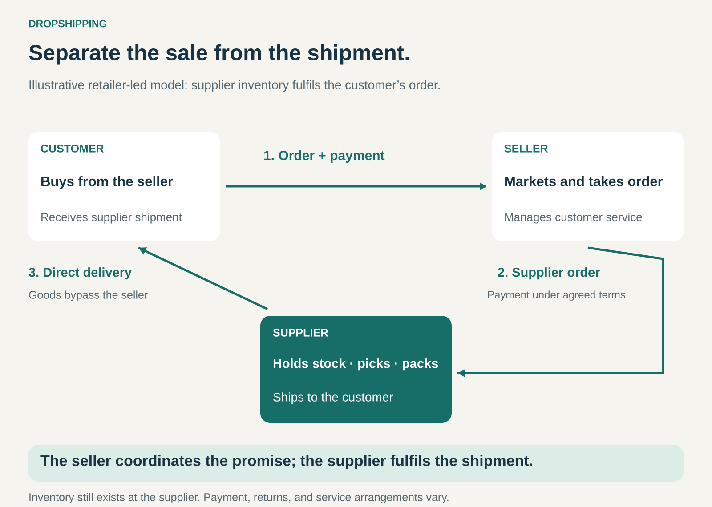

## What it is for

A retailer wants to offer more products without purchasing and storing every item in advance. A supplier already holds those products and can send individual orders to customers.

Dropshipping connects the retailer’s ability to attract and serve buyers with the supplier’s ability to hold stock and fulfil orders.

It is useful when broader selection, lower inventory commitments, or access to specialist products outweigh the disadvantages of relying on another business for delivery.

## The core idea

**Make the sale through one business and fulfil it directly from the supplier to the customer.**

In a typical arrangement, the customer buys from a retailer. The retailer sends the order to a supplier, which picks, packs, and ships the product directly to the customer.

The goods bypass the retailer’s own premises.

The retailer contributes discovery, product selection, merchandising, ordering, and customer service. The supplier contributes stock and fulfilment capability. Their agreement determines payment, shipping charges, packaging, returns, and other responsibilities.

Dropshipping is a fulfilment pattern. It can support a specialist online shop or form one part of a large retailer’s operation alongside stocked products.

It also differs from placing the retailer’s own inventory in an outsourced warehouse. Using a logistics provider to store and dispatch purchased stock does not, by itself, make an operation dropshipping.

## How it works

The arrangement connects several activities.

**Agree the offer.** The retailer and supplier establish which products can be sold, their commercial terms, and the information needed to describe them accurately.

**Maintain availability information.** The retailer needs to know what the supplier can actually provide. Shared stock, changing lead times, and delayed updates can otherwise produce orders that cannot be fulfilled.

**Take the customer’s order.** The retailer records the product, delivery details, and relevant requirements. Payment and supplier settlement follow the agreed arrangements.

**Send a fulfilment request.** The supplier receives the order and prepares the correct item for direct delivery. Shipment confirmation and tracking information return to the retailer.

**Coordinate exceptions.** Missing items, damage, delays, cancellations, and returns need workable procedures between the two businesses.

The retailer generally avoids receiving and storing the product itself. Inventory still exists elsewhere, and the customer-facing promise still needs someone to coordinate it.

## Why it works

Dropshipping can extend an assortment without requiring the retailer to hold every variant.

A store might stock popular sizes and colours while offering less frequently purchased versions through suppliers. It can provide more choice without distributing small quantities of every item across its own warehouses or branches.

Supplier-held stock may also serve several retailers. That can make an individual retailer’s expanded assortment more practical than maintaining a separate stockholding for each outlet.

For suppliers, the arrangement opens additional routes to customers. They can reach buyers through retailers that contribute an audience, category expertise, or a trusted purchasing relationship.

The tradeoff is control. The retailer depends on the supplier’s stock accuracy, packing, dispatch, and product quality. A broader catalogue becomes valuable only when those capabilities support reliable customer promises.

## Famous examples

### Wayfair: connecting online demand with supplier fulfilment

Wayfair’s supplier materials describe a dropshipping process in which a customer order generates a purchase order for the supplier. The supplier picks, packs, and prepares the product for shipment directly to the customer.

Its onboarding requirements include dropship capability from a warehouse or logistics partner in the relevant selling region, alongside product information and inventory-management capabilities. [Dropshipping with Wayfair](https://assets.wfcdn.com/dm/document/041c2d14-ae16-4eaa-869b-b03f1953e7bc/dropshipping%20with%20wayfair%20-%20na%20version.pdf), [Wayfair supplier onboarding](https://sell.wayfair.com/onboarding-checklist)

This illustrates how a retailer can coordinate a broad assortment through suppliers’ existing stock and facilities.

It describes Wayfair’s dropship arrangement; it does not imply that every Wayfair order uses the same fulfilment method.

### Nordstrom: extending selection beyond locally held stock

Nordstrom describes dropshipping as working with suppliers to send items ordered online or in stores directly to customers.

Its programme supports additional styles, sizes, and colours, and uses a platform to exchange inventory and order information with participating suppliers. [Nordstrom Drop Ship Program](https://www.nordstrom.com/browse/about/drop-ship-program)

The example shows that dropshipping can complement physical retail. A customer can encounter the retailer in a store while receiving an item from a supplier.

The expanded assortment depends on coordination: the retailer needs reliable availability information, and the supplier needs accurate instructions for the customer’s order.

### Macy’s: vendor-direct fulfilment alongside other selling arrangements

Macy’s documented Vendor Direct-to-Consumer programme explicitly describes a dropship arrangement. The retailer sends a purchase order to the vendor, which ships to the customer and invoices the retailer.

The programme was designed to extend the available assortment, including additional sizes, colours, and products beyond those normally carried. [Macy’s vendor-direct standards](https://www.macysnet.com/mdocweb/documents.aspx?document=VENDOR+DIRECT+STANDARDS)

Macy’s also operates a third-party marketplace, with separate terms identifying independent sellers. [Macy’s terms](https://www.macys.com/customer-service/articles/legal-notice)

The distinction matters: supplier fulfilment of a retailer’s sale and a marketplace seller fulfilling its own sale can produce similar parcel journeys while involving different commercial relationships.

## The economics

Dropshipping can reduce money tied up in advance stock purchases and avoid some storage and handling activities.

Those savings must be assessed alongside supplier prices, individual shipment costs, customer acquisition, service, and returns.

Consider a hypothetical $100 order, excluding tax:

| Item                                 | Amount |
| ------------------------------------ | -----: |
| Customer payment                     |   $100 |
| Supplier product and handling charge |   −$64 |
| Shipping                             |    −$8 |
| Payment processing                   |    −$3 |
| Expected returns and service costs   |    −$5 |
| Customer acquisition                 |   −$15 |
| Contribution before fixed overhead   | **$5** |

The figures are illustrative. A $36 difference between the selling price and supplier charge becomes $5 after the other listed costs.

Supplier pricing may include the cost of holding inventory and handling individual orders. A retailer purchasing larger quantities for its own stock may obtain different terms.

Cash timing also matters. Supplier payments, customer-payment settlement, refunds, and supplier credits do not necessarily occur together.

Dropshipping can lower inventory commitments while still requiring operating funds and careful cost control.

## Useful when

- **A broader assortment serves a clear customer need.** Additional variants or specialist products improve the offer.
- **Demand for individual items is uncertain or infrequent.** Holding every item locally would be difficult to justify.
- **Suppliers can fulfil individual orders reliably.** Their stock, packing, dispatch, and tracking capabilities meet the retailer’s promises.
- **The retailer adds value to the purchase.** Its audience, advice, curation, or service gives customers a reason to choose it.
- **The commercial terms support the full cost of a sale.** Delivery, acquisition, returns, and support leave adequate contribution.

## Common mistakes and limits

**Confusing reduced inventory with reduced responsibility.** The retailer still needs to coordinate the experience it promises customers.

**Listing products without dependable stock information.** A large catalogue can create cancellations and disappointed buyers when availability is inaccurate.

**Ignoring the cost of separate parcels.** A basket involving several suppliers may incur several shipping charges and arrive at different times.

**Assuming the supplier price leaves enough margin.** Advertising, delivery, payment fees, and service can consume the apparent spread.

**Having no workable returns process.** Return destinations, authorizations, damaged goods, refunds, and supplier credits need clear arrangements.

**Depending entirely on an interchangeable catalogue.** If many sellers offer the same products, the retailer needs a meaningful reason for customers to buy from it.

**Using one fulfilment method for every product.** Frequently ordered items may justify stocking, while slower or specialist items remain supplier-fulfilled.

## Related patterns

[[e-commerce|E-Commerce]] provides an electronic ordering channel. Dropshipping determines how particular physical orders are fulfilled.

[[long-tail|Long Tail]] can use supplier fulfilment to support a broad assortment with individually infrequent demand.

[[marketplace|Marketplace]] connects independent sellers and buyers. Dropshipping commonly fulfils a retailer’s own sale, although a marketplace seller can also use it.

[[direct-to-customer|Direct to Customer / No Middle Man]] concerns the commercial route to the buyer. A supplier shipping directly to the customer can still be fulfilling a sale made through a retailer.
