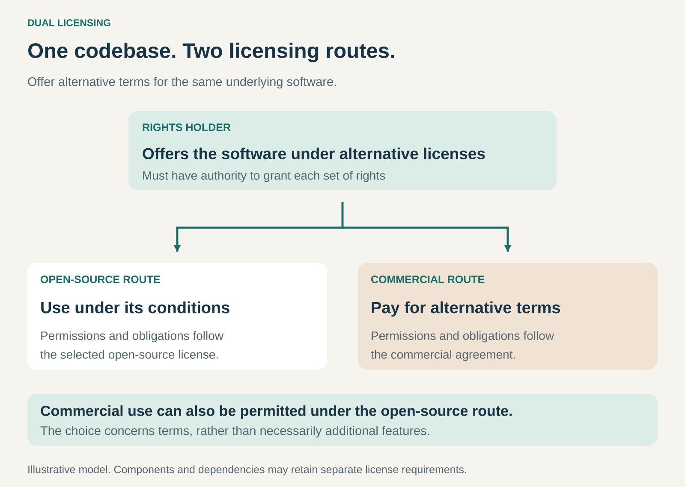

## What it is for

Earning revenue by offering alternative licensing terms for software that is also available under an open-source license.

A developer may be comfortable using a component under its open-source terms. Another company may want to incorporate the same component into a product distributed under different terms.

Dual Licensing gives those customers different routes to the underlying software.

The open-source route supports adoption and reuse. The commercial route supplies alternative permissions and contractual terms for customers who need them.

## The core idea

**Offer the same underlying software under alternative licenses, and charge for the commercial option.**

The customer selects an applicable licensing route and follows its conditions.

In the common business model covered here, one route uses an open-source license, often with copyleft obligations. The other uses a commercial agreement that permits specified activities under different conditions.

The rights holder can make this choice because it has authority to license the relevant code in more than one way. The GNU project’s licensing guidance explicitly recognizes that a copyright holder can release its code under multiple licenses. [GNU: offering code under different licenses](https://www.gnu.org/licenses/gpl-faq.en.html#ReleaseUnderGPLAndNF)

“Dual licensing” can also describe a choice between two open-source licenses. This article focuses on the revenue-generating combination of open-source and commercial terms.

Crucially, **commercial use is already permitted by open-source licenses**. A business does not automatically need a paid license simply because it makes money. [Open Source Initiative: commercial use](https://opensource.org/faq)

## How it works

The pattern connects three elements.

**Software worth adopting.** The component needs to solve a meaningful problem. A database, application framework, or document-processing library can become valuable inside many other products.

**An open-source route with defined conditions.** Users receive the rights granted by that license and must comply with its applicable obligations.

Those obligations depend on the license and how the software is used, modified, combined, or distributed. Copyleft does not mean that merely running a program requires publishing everything a business owns.

**A commercial alternative that addresses a real need.** The customer pays for specified rights or terms that better fit its intended deployment or distribution.

The agreement might also include support, maintenance, warranties, or other commitments. These additions can strengthen the offer, but the defining mechanism is the alternative license.

Unlike **Open Core**, Dual Licensing does not require dividing functionality into an open foundation and proprietary extensions. The licensing choice can concern the same underlying code.

A business can combine both patterns, so actual product packages may contain additional differences.

## Why it works

An open-source release allows people to evaluate and adopt useful software without first negotiating an individual contract.

Some users can meet their needs entirely through that route. Others encounter requirements that make alternative terms valuable.

For example, a manufacturer may want to distribute a product incorporating a software component while maintaining a licensing arrangement that differs from the available copyleft route.

A commercial agreement can address that requirement.

For the supplier, the model creates a way to fund development while continuing to offer an open-source option. For the customer, paying can be more economical than replacing the component, redesigning the product, or choosing another licensing approach.

Demand depends on the actual difference between the routes. Customers who can comfortably comply with the open-source license may have no reason to purchase an alternative.

## Famous examples

### MySQL: alternative terms for embedding and distribution

Oracle describes MySQL database software as available under both the GPL and a commercial license. Its commercial licensing materials specifically address manufacturers, software vendors, and distributors incorporating MySQL into other offerings. [MySQL’s dual-licensing model](https://www.mysql.com/de/about/legal/licensing/oem/)

The example illustrates a component becoming part of another company’s product.

A customer can use the relevant open-source licensing route where its conditions fit. A distributor needing alternative terms can obtain a commercial agreement.

MySQL’s documentation also identifies exceptions and component-specific licensing details. Its model should therefore be understood through the particular software and distribution arrangement, rather than a blanket rule that every commercial MySQL user must pay.

### Qt: a choice that depends on components and intended use

Qt offers its framework under commercial and open-source licenses. Its documentation distinguishes LGPL-licensed components from components available under the GPL for open-source use. [Qt’s licensing options](https://doc.qt.io/qt-6/licensing.html)

The LGPL route can allow closed-source applications when its requirements are met. A commercial license provides another route for customers whose needs do not fit the available open-source terms. [Qt’s explanation of LGPL obligations](https://www.qt.io/development/open-source-lgpl-obligations)

This makes Qt an instructive example: the decision is more precise than “open-source application or paid license.”

The selected modules, distribution method, and applicable conditions matter. Qt also includes third-party components, whose requirements need separate consideration.

### iText: alternative licenses for a document-processing library

iText offers its PDF SDK through an AGPL route and commercial licensing. Its purchasing information describes commercial options for different deployment and distribution needs, including OEM distribution and volume-based subscriptions. [iText’s licensing options](https://itextpdf.com/how-buy)

A developer can build around the library using the applicable AGPL terms. An organization needing different permissions can purchase a commercial license.

The underlying capability—processing PDF documents—remains the reason to adopt the software. The commercial purchase addresses how that capability can be incorporated into the customer’s offering.

It demonstrates Dual Licensing at the level of an embedded software component, rather than an entire standalone application.

## The economics

Consider a hypothetical software company with **20 commercial customers**, each paying **$10,000 annually**.

Annual commercial-license revenue is:

**20 × $10,000 = $200,000.**

Assume annual costs are:

| Annual item                                             |       Amount |
| ------------------------------------------------------- | -----------: |
| Commercial customer support and delivery                |      $30,000 |
| Shared software development and maintenance             |     $120,000 |
| Sales, licensing administration, and general operations |      $30,000 |
| Total                                                   | **$180,000** |

The remaining amount is **$20,000 before tax and recovery of earlier investment**.

Open-source adoption may help people discover and evaluate the software, but downloads are not commercial-license revenue.

The model needs enough customers who value alternative terms, at prices that cover development and the costs of serving them.

These figures are illustrative. Actual agreements may charge per developer, product, deployment, distribution volume, or subscription period.

## Useful when

- Software is valuable as a component inside other products.
- Different customers have genuinely different licensing requirements.
- The supplier has sufficient rights to offer the relevant alternatives.
- An open-source route can support adoption without removing all demand for commercial terms.
- Customers can understand what the commercial agreement changes.
- Commercial revenue can sustain ongoing development and maintenance.

It is less attractive when most prospective customers can easily meet their needs under the open-source terms and see little additional value in the commercial option.

## Common mistakes and limits

**Treating commercial use as prohibited under open source.** Charging money for a product does not, by itself, establish a need for an alternative license.

**Overstating copyleft obligations.** GPL, LGPL, and AGPL have different conditions. Merely using software, distributing it, and incorporating it into another program are different situations.

**Assuming a public repository gives authority to relicense everything.** Contributions and dependencies may have different rights holders. The supplier needs appropriate authority for the terms it offers.

**Promising that a commercial license removes every obligation.** Third-party components can retain separate requirements. An agreement covers the rights it actually grants.

**Confusing alternative terms with additional features.** Dual Licensing concerns licensing choices. Open Core concerns the boundary between an open foundation and additional commercial capabilities.

**Relying on confusion to generate sales.** Clear explanations help customers choose an appropriate route. A business needs a credible commercial proposition that customers can assess.

**Ignoring governance and trust.** Contribution terms and licensing plans affect whether developers want to participate. Those expectations deserve clarity from the beginning.

## Related patterns

- [[licensing|Licensing:]] The broader mechanism of granting defined rights while retaining ownership.
- [[open-source|Open Source:]] Supplies the software freedoms associated with the open licensing route.
- [[open-core|Open Core:]] Monetizes additional capabilities; it can coexist with alternative licensing terms.
- [[open-source-with-paid-services|Open Source with Paid Services:]] Earns from support, hosting, and implementation, which can accompany a commercial license.
