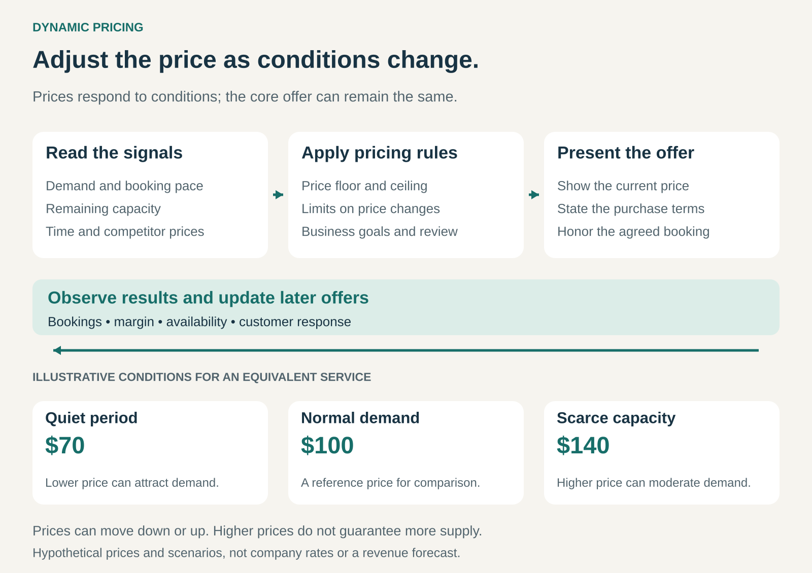

## What it is for

Adjust prices as demand, availability, competition, or other market conditions change. Dynamic Pricing helps businesses make better use of limited capacity, attract customers during quieter periods, and protect margins when conditions shift.

A hotel room can remain empty on Tuesday and attract several competing buyers on Saturday. A flight can sell slowly for weeks, then fill rapidly after an event is announced. A retailer can lose orders when competitors reduce their prices.

One fixed price may fit these different situations poorly.

Dynamic Pricing makes the price responsive to changing conditions. The underlying offer can remain the same while the amount charged for a new purchase changes.

## The core idea

Treat price as a decision that is revisited as relevant information changes.

A business observes signals, applies pricing rules, presents a price, and learns from the response. Those signals might include:

- **Demand:** booking pace, purchase requests, or conversion rates.
- **Availability:** remaining inventory, seats, rooms, or service capacity.
- **Time:** how long remains before departure, an appointment, or product expiry.
- **Competition:** prices and availability of comparable offers.

The process can be manual, rule-based, or supported by predictive models. A small accommodation business reviewing rates each week and a platform updating prices within minutes use different implementations of the same principle.

The defining feature is responsiveness. Prices can move down as well as up.

## How the mechanism works

The graphic shows three hypothetical prices for an equivalent service under different conditions.

A quieter period may justify a lower price to attract additional demand. Scarce capacity may justify a higher price, encouraging some customers to choose another time or option.

These responses are possibilities, rather than guaranteed effects. A discount cannot create customers who have no reason to buy. A higher price cannot immediately create another aircraft or expand a fully booked hotel.

The pricing policy therefore needs boundaries: minimum acceptable prices, maximum prices, limits on how quickly prices change, and circumstances requiring human review.

## Why it works

Dynamic Pricing addresses a mismatch between relatively stable capacity and changing demand.

Many businesses commit substantial resources before knowing exactly how much customers will buy. An airline schedules an aircraft. A hotel maintains rooms. A service business reserves staff time.

When that capacity expires unused, the opportunity to sell it disappears. A lower price can sometimes bring in customers whose purchases would otherwise never happen.

When demand exceeds capacity, a higher price can increase the return from the remaining availability and encourage flexible customers to move elsewhere or buy later.

In marketplaces, price can also influence supply. Higher potential earnings may encourage additional providers to participate. This depends on whether they can respond quickly enough.

The business must choose what it is trying to improve: revenue, contribution margin, utilization, availability, or some combination. Maximizing today’s price is rarely a sufficient objective.

## Famous examples

### Uber: responding to local supply and demand

Uber describes surge pricing as a response to an imbalance between ride requests and available drivers in a particular area. Its systems update prices as conditions change. Higher prices are intended to encourage drivers toward busy areas and prompt some riders to wait, helping rebalance the marketplace. [Uber’s explanation of surge pricing](https://www.uber.com/us/en/marketplace/pricing/surge-pricing/).

The price has two potential effects: influencing demand and encouraging supply.

This makes Uber a distinctive example. A hotel cannot quickly add rooms when demand rises, while a ride marketplace may attract drivers who were offline or serving another area.

The limitation is responsiveness. If few additional drivers can arrive, a higher price may primarily ration the existing supply. Uber’s explanation describes the intended mechanism; it does not establish that every price increase produces additional availability.

### easyJet: managing seats as bookings develop

easyJet says its demand-led pricing uses historical information and current booking trends. Fares typically begin lower and increase as seats sell. Its customer guidance also notes that fares can occasionally fall when demand is weaker than expected. [easyJet’s pricing explanation](https://www.easyjet.com/en/news/airline/story/how-easyjet-pricing-works-a-simple-guide), [easyJet’s fare guidance](https://www.easyjet.com/en/help/booking-and-check-in/our-routes-fares-and-products).

An unsold seat loses its sales value when the flight departs. Selling every seat very cheaply months ahead can also sacrifice revenue if demand later proves strong.

Dynamic Pricing helps manage that uncertainty as bookings arrive.

This mechanism operates alongside easyJet’s separate charges for optional extras. Adjusting the fare over time and charging for luggage or seat selection are distinct pricing choices that can coexist.

### Amazon: automated repricing for marketplace sellers

Amazon’s Automate Pricing tool lets participating sellers set rules that adjust selected product prices in response to events such as changes in competing offers. Sellers establish a minimum price and can add a maximum. Rules can respond to competitive prices or sales performance. [Amazon’s guide to automated pricing rules](https://sell.amazon.com/blog/automate-pricing-rules).

This illustrates competitive repricing. A seller can respond to changing offers without manually reviewing every product.

The seller still needs a commercial policy. Automatically matching a competitor may produce more orders while reducing profit. A competitor may have different costs, excess inventory, or a mistaken price.

The example concerns Amazon’s tools for marketplace sellers; individual sellers decide which eligible products and rules to use.

## The economics

A price change affects both the amount earned per sale and the number of sales.

Suppose a service has a hypothetical variable cost of $40. At a $100 price, each sale contributes $60 toward fixed costs and profit. At $70, it contributes $30.

The lower price therefore requires twice as many sales to produce the same total contribution, assuming those costs remain unchanged.

However, if the alternative is unused capacity and no sale, an additional $70 booking may still be attractive. The relevant comparison depends on what would happen without the price change.

This is why occupancy or conversion alone can mislead. A pricing system should account for contribution, displaced higher-paying demand, cancellations, and the customer’s likelihood of returning.

## Useful when

This pattern is especially useful when:

- **Demand varies substantially:** quiet and busy periods create different commercial conditions.
- **Capacity expires:** unsold seats, rooms, appointments, or delivery slots cannot be stored for later.
- **Signals arrive in time to act:** booking pace or inventory changes provide useful information before the sales opportunity closes.
- **Customers have some flexibility:** price differences can influence when or what they purchase.
- **The business can measure the effects:** it can assess margin and customer response, rather than merely observe price changes.

It is less attractive when stable prices are a major part of the customer promise, demand barely responds, or the complexity costs more than the improvement it produces.

## Common mistakes and limits

**Treating every busy period as an opportunity for unlimited increases.** Customers judge fairness as well as availability. Extreme prices can damage trust, particularly when customers have few alternatives.

**Confusing dynamic and personalized pricing.** Dynamic Pricing can respond to shared market conditions without using an individual customer’s characteristics or inferred willingness to pay. Personalization is a separate design choice.

**Assuming automation finds the best price.** A system follows its rules and learns from imperfect information. Poor objectives, unusual events, or misleading competitor prices can produce poor decisions faster.

**Teaching customers to wait.** Predictable late discounts can encourage buyers to delay purchases. The resulting booking pattern may undermine the original pricing strategy.

**Creating uncertainty during purchase.** A displayed price needs clear validity and purchase terms. Adjusting future offers is easier for customers to understand when agreed bookings are honored.

**Optimizing a short horizon.** A price that increases today’s revenue can reduce repeat business. Customer retention and complaints belong alongside immediate sales results.

## Related patterns

- [[pay-per-use|Pay per Use:]] determines what is billed. Dynamic Pricing can change the rate charged for each unit.
- [[good-better-best|Good-Better-Best:]] creates different offer tiers. Each tier can also have a price that changes with conditions.
- [[core-plus-add-ons|Core plus Add-Ons:]] separates a core purchase from optional extras. Dynamic Pricing can apply independently to either.
- **Value-Based Pricing:** uses customer value to inform the price. Dynamic Pricing adds a mechanism for revisiting prices as relevant conditions change.
