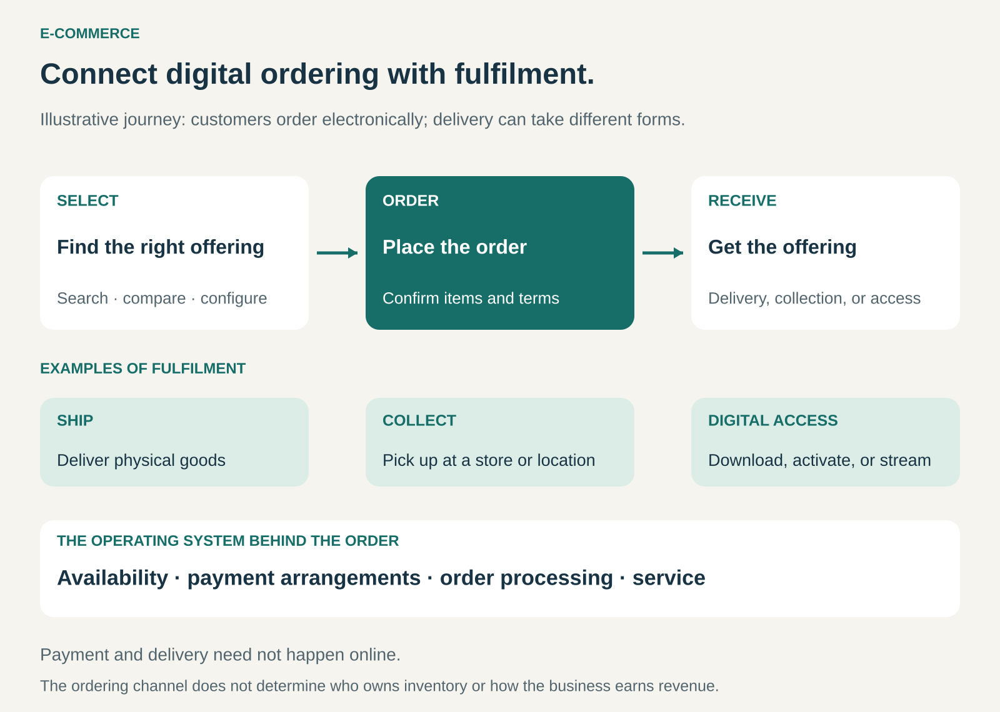

## What it is for

Customers want to compare products, check availability, and place an order without visiting a shop or waiting for a salesperson. A business wants to serve buyers beyond its immediate location and make routine purchasing easier.

E-Commerce creates an electronic route from choosing an offering to submitting an order.

It is useful when a business can describe its products or services clearly enough for customers to buy through a website, app, or connected purchasing system—and reliably fulfil the resulting orders.

## The core idea

**Make ordering electronic, and connect it to the operations that deliver the purchase.**

Customers can search an assortment, evaluate options, select quantities or configurations, and submit an order. The business then processes the transaction and provides the offering.

Payment might happen immediately, through an invoice, or at collection. Delivery might involve a parcel, store pickup, digital access, or a service performed later. The OECD’s definition centres on the ordering method; payment and delivery need not happen online. [OECD definition of e-commerce](https://www.oecd.org/en/publications/the-2025-oecd-definition-of-e-commerce-and-guidelines-for-interpretation_2254f1de-en.html)

E-Commerce describes a channel and an operating pattern. It can support a retailer selling purchased inventory, a manufacturer selling directly, or a marketplace connecting independent sellers and buyers.

It also supports different revenue models: individual purchases, subscriptions, rentals, and other arrangements.

The central change is that customers can place orders electronically. A website that only displays products or invites enquiries provides part of the journey; ordering adds another capability.

## How it works

A working E-Commerce operation connects five elements.

**Present the offering.** Product information must answer the questions customers need resolved before buying. Clothing needs useful sizing information; replacement parts need compatibility details; services need a clear scope and booking conditions.

**Make selection manageable.** Search, categories, filters, comparisons, and configuration tools help customers find suitable options. A large catalogue becomes useful when people can navigate it.

**Capture a usable order.** The system records the selected offering, quantity, customer details, delivery or access requirements, and agreed terms. Business purchases may also require purchase-order references or internal approval.

**Coordinate payment and fulfilment.** The order must connect with available stock, production capacity, service schedules, or digital permissions. Customers need a realistic understanding of what will happen next.

**Support the purchase afterward.** Confirmation, tracking, invoices, returns, cancellations, and assistance complete the experience. These activities can involve people, software, partners, or a combination.

The storefront is the visible part. Availability information, order processing, fulfilment, and service determine whether its promises can be kept.

## Why it works

E-Commerce can reduce the effort involved in both buying and processing an order.

Customers can compare specifications, revisit a selection, and purchase outside staffed opening hours. Repeat buyers can use order histories and saved lists instead of reconstructing familiar purchases.

Businesses can make a broad assortment accessible without displaying every item in a local showroom. Structured orders can also reduce repeated data entry and make routine transactions easier to process.

The channel can connect purchasing with useful information. A customer selecting a component can see compatibility guidance before ordering; a business buyer can supply the reference needed for invoice reconciliation.

These benefits depend on the quality of the underlying operation. Incorrect availability or incomplete descriptions can make electronic ordering faster while making the resulting mistakes more frequent.

## Famous examples

### Amazon: one ordering channel, several commercial arrangements

Amazon combines its own retail offering with products sold by independent third-party sellers. Customers can encounter both through the same online shopping environment. [Amazon’s description of its retail model](https://www.aboutamazon.com/about-us/public-policy/competition)

Fulfilment is another choice. Through Fulfilment by Amazon, participating sellers can outsource activities including storage, packing, shipping, customer service, and returns. [Amazon e-commerce fulfilment](https://sell.amazon.com/learn/ecommerce-fulfillment)

This shows why E-Commerce should be separated from inventory ownership and marketplace participation. An online order can involve a retailer’s stock or an independent seller’s offering, with fulfilment performed by another organization.

The customer-facing ordering process connects those arrangements.

### Zara: online orders connected with physical collection

Zara’s UK online service offers fulfilment options including home delivery, delivery to a Zara store, and collection from a drop point, subject to availability and the order’s circumstances.

During ordering, customers see the available methods, costs, and estimated dates. They can subsequently track the order through their account or purchase communications. [Zara UK delivery options](https://www.zara.com/uk/en/help-center/DeliveryMethods)

The example demonstrates how digital ordering and physical stores can form one purchasing journey. Choosing and ordering happen online; receiving the goods can happen in person.

E-Commerce therefore need not replace the store. It can change the store’s role within a broader service.

### Grainger: electronic ordering for organizational purchasing

Grainger’s online account tools let organizations manage users, access to purchasing features, and order information.

Administrators can control access to functions such as approvals, shared lists, automatic reordering, and order history. They can also configure fields for information required during checkout, including purchase-order details and receiving instructions. [Grainger account settings](https://www.grainger.com/content/mc/help/account-customization)

Here, convenience includes fitting the customer’s internal workflow. The buyer may need to satisfy approval, receiving, and invoicing requirements as well as select the correct product.

This illustrates E-Commerce as business purchasing infrastructure, extending beyond the familiar consumer shopping basket.

## The economics

E-Commerce can reduce some selling and order-processing costs while introducing others.

A hypothetical $100 physical-product order, excluding tax, might have these economics:

| Item                               |  Amount |
| ---------------------------------- | ------: |
| Sales revenue                      |    $100 |
| Product cost                       |    −$55 |
| Picking, packing, and delivery     |    −$13 |
| Payment processing                 |     −$3 |
| Expected additional returns costs  |     −$4 |
| Customer acquisition               |    −$15 |
| Contribution before fixed overhead | **$10** |

These figures are illustrative. The remaining $10 still needs to help cover expenses such as staff, systems, facilities, and general overhead.

Digital delivery changes the cost structure but does not eliminate costs. Content development, hosting, support, payment processing, and customer acquisition can remain substantial.

For a marketplace operator, the transaction value passing through the site is also different from the fees it earns.

Repeat purchases, larger baskets, and efficient fulfilment can improve the economics. Expensive traffic, low-value orders, returns, and failed deliveries can erode them.

## Useful when

- **Customers can evaluate the offering remotely.** Information, images, demonstrations, or specifications support a confident choice.
- **Routine purchasing creates avoidable effort.** Saved details, lists, and order histories make repeat transactions easier.
- **Buyers are geographically dispersed.** A digital channel can serve them within practical delivery or service limits.
- **The assortment benefits from search and filtering.** Customers need access to more options than a local display can accommodate.
- **The business can connect orders with reliable fulfilment.** Availability and delivery promises reflect operational capacity.

## Common mistakes and limits

**Treating the website as the whole business.** A polished checkout cannot compensate for missing stock, late deliveries, or unresolved problems.

**Increasing conversion without checking contribution.** Discounts and subsidized delivery may generate more orders while reducing the money available to cover overhead.

**Publishing an assortment customers cannot navigate.** More listings increase choice and can also increase confusion. Search, product information, and meaningful filters matter.

**Making payment the only focus.** Some customers need invoices, purchasing approvals, configuration, or collection options before an order becomes practical.

**Assuming online reach creates demand.** A store still needs customers who can find it, trust it, and see a reason to buy.

**Underestimating returns and exceptions.** Incorrect items, damaged parcels, failed payments, cancellations, and exchanges require workable processes.

**Forcing every purchase into self-service.** Complex or unfamiliar offerings may benefit from human advice. Assisted selling can remain part of an electronic ordering journey.

## Related patterns

[[direct-to-customer|Direct to Customer / No Middle Man]] concerns the relationship between producer and end buyer. E-Commerce can support that relationship or operate through intermediaries.

[[marketplace|Marketplace]] connects independent buyers and sellers. E-Commerce provides an electronic ordering channel through which their transactions can occur.

[[long-tail|Long Tail]] benefits from searchable access to a broad assortment, provided stocking and fulfilment remain economical.

[[subscription|Subscription]] organizes recurring purchases or access. E-Commerce can support enrolment, renewal, and account management.
