A shaded building looked important when you photographed it, but its facade feels muted beside
a bright sky. A small lift to the middle tones makes its structure easier to read. Push
the adjustment much further and the scene begins to look flattened, with every region competing
at similar brightness. The useful edit is the one that serves the photograph's intention,
not the strongest effect the software can produce.

Choose what the viewer should notice before moving sliders. Brightness, contrast, and color
can clarify a relationship, retain atmosphere, or make an overlooked subject readable. They
can also exaggerate, conceal, or change how a scene is understood. Judge the adjustment in
the context of what the photograph claims to represent.

[Original photograph and credit](https://commons.wikimedia.org/wiki/File:Chicago_Theatre_raw_frames.jpg)
· [CC BY-SA 4.0](https://creativecommons.org/licenses/by-sa/4.0/). Crop and illustrative edit made for this guide.

## Establish the intention in ordinary words

Think of editing as directing emphasis among information you actually recorded. “Make the face
more readable while retaining the dim room” is more useful than “make it pop.” The first
statement names both a goal and a limit. It lets you recognize when an adjustment begins
to work against the image.

Brightness changes the rendering of tones. Contrast changes differences between tones; color
controls can change saturation, hue, and balance. These interact. A darker background may
make a subject appear more prominent without changing the subject itself. Reduced saturation
in one area may quiet it, but can also make it look unnaturally detached from the rest.

[[expose-for-what-matters|Expose for What Matters]] concerns capture priorities. Editing works
with the data that survived those choices. If highlights were fully clipped, darkening them
cannot restore the missing distinctions. If deep shadows contain little useful signal, a
large lift may reveal noise and artifacts rather than clean detail.

## A shaded building and a bright sky

In the theatre example, the middle source exposure already contains useful facade and sky
information. A restrained midtone lift can make the building easier to inspect while keeping
the brighter areas close to their existing values. A small reduction in saturation can
keep the colored sign from dominating every other surface.

Another intention might favor the sign's energy and the facade's shadow. In that case, the
original rendering or a more saturated interpretation could be appropriate. Compare at an
ordinary viewing size and ask which relationship becomes clearer. The demonstration is an
alternative interpretation, not a correction that proves the original photograph wrong.

If you combine the separate bracket exposures to preserve more brightness range, that is
another method. Keep it distinct from a small edit to one frame. Movement between exposures
can introduce inconsistent people, vehicles, or edges, so inspect the result carefully rather
than treating a blend as automatically more accurate.

## A portrait in a dim room

A gentle lift around a face can preserve the sense of a dark room while making an expression
readable. Lifting the entire image equally may make the room feel brightly lit instead.
Local tools can target a region, but a visible halo around hair or shoulders may reveal
an adjustment that is too abrupt.

Keep the person's skin and preferences in mind. Smoothing texture, changing facial shape,
or brightening eyes independently can alter how they appear. Those choices go beyond ordinary
attention guidance and deserve explicit collaboration in a personal portrait. A person may
prefer visible texture or a quieter rendering to a polished interpretation you assumed they wanted.

[[give-people-something-to-do|Give People Something to Do]] considers that collaboration at capture.
[[focus-on-what-matters|Focus on What Matters]] explains why sharpening tools cannot replace
having focused on the intended detail. Sharpening may increase edge contrast; it does not
turn a different focus distance into the one you meant to select.

## Color can support or contradict the scene

A warm room can remain warm rather than being neutralized to a theoretical white. If the
warmth describes the experience, a fully neutral rendering may lose it. On the other hand,
an unintended color cast can distract from a product's material or a person's skin. [[photography-foundations|Photography Foundations]] explains white balance and mixed illumination.

Reducing one competing color can simplify a composition, but watch relationships across the
whole frame. A selective color edit that leaves one object vivid and everything else gray
creates an obvious expressive effect. That may be welcome in art and misleading in a context
where viewers expect an ordinary record. [[limit-the-color-palette|Limit the Color Palette]]
offers ways to organize color before capture as well.

## Let the context set the boundary

Personal expressive photography permits many transformations when they are presented honestly.
Documentary, news, scientific, legal, and competition contexts can impose stricter standards.
Check the applicable expectations. Even adjustments that add no objects can materially change
a scene's apparent mood or evidence if they hide important detail.

Keep an original and make reversible versions when possible. Compare the edit with the
starting image after a short break; adaptation to a strong effect can make further increases
seem necessary. This pattern helps when attention feels diffuse or a rendering does not match
the intended emphasis. Stop when the important relationship is clear enough, and retain
the texture, uncertainty, and tonal variation that give the photograph its particular character.
