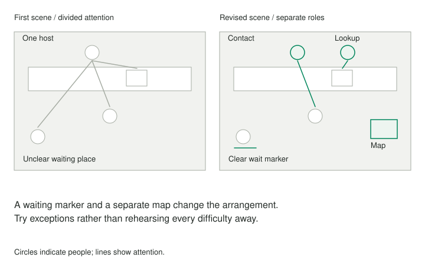

The organizers agree that a welcome desk will make an event easier to enter. On paper, the plan looks complete: greet the visitor, check their booking, explain the rooms, and direct them onward. When two volunteers act it out, a small difficulty appears. One person must keep looking away from the visitor to read the booking list, while another visitor waits with no idea where the queue begins.

## Core idea

The scene has not proven how the event will work. It has made parts of the proposal available to observation. Timing, attention, movement, and the order of information are difficult to inspect in a general description. A short enactment creates material that can be changed and tried again.

## When to use it

Use enactment when a proposal depends on interaction, sequence, timing, or physical arrangement, and when people can voluntarily try a short scene before making a larger commitment.

## How it works

A whole service is too large to prototype in one scene. Select an encounter where something important happens: a person arrives, requests help, transfers responsibility, or encounters an exception. Specify a useful result and enough context that participants understand the situation without requiring them to memorize a script.

The **Improv Prototyping** Liberating Structure uses enacted scenes, observers' identification of effective and ineffective chunks, and recombination into improved scenes. Its group form involves observers in developing alternatives. This guide supports activity performed with people outside the app; text entered afterward is reflection, not evidence that the software witnessed the performance.

An observer's account should identify what happened and its effect. The host explained three locations before finding out which session the visitor wanted. The visitor looked toward an unmarked corridor. A second host acknowledged the waiting person and reduced visible uncertainty. These are particulars the next scene can change.

Calling the host awkward or the visitor difficult is less useful. Participants may be revealing a problem in the arrangement rather than a lack of skill. A task that requires simultaneous attention to a screen, a queue, and a detailed explanation may be poorly designed even when an experienced person manages to perform it.

Useful chunks can be small: asking one orienting question first, turning a map toward the visitor, naming the next action, or explicitly handing responsibility to a colleague. Retaining a helpful move while changing another part makes the iteration easier to understand. Replacing everything at once can produce a better scene without showing what improved it.

## Worked examples



### The welcome desk

The welcome-desk scene can begin when a visitor enters and end when they know their next step. One person plays the visitor, another the host, and others observe. A third person can introduce a realistic complication, such as an absent booking. The purpose is to test the arrangement, not to reward convincing acting or embarrass someone responsible for the original idea.

The welcome team gives one person responsibility for initial contact and another for booking lookup. They move the explanatory map away from the queue and place a clear waiting marker near the entrance. In the second scene, they test an unregistered visitor and someone arriving late. The revised arrangement works better in one case and exposes a new ambiguity in the other.

That mixed result is valuable. The organizers can keep the orientation move while investigating the exception process. The objective is a sufficiently informative prototype, not a performance in which every difficulty has been rehearsed away. An observer can deliberately introduce a reasonable variation to check whether the arrangement is robust or merely scripted.

### A shared task

Two colleagues want a smoother end-of-day transfer. Their proposed checklist contains all the relevant facts, but an enactment shows that the receiving person does not know which unfinished item is urgent. Another iteration begins with the immediate risk, then transfers ownership and points to supporting detail.

The checklist still matters. The scene reveals how it is used during an interaction. A useful next step could be trying the revised handoff for a few days and asking recipients whether they can identify the next owner and first action. The prototype has connected a document change to actual behavior.

## Pitfalls and limits

Record what remains uncertain. Real visitors may have access needs, language preferences, or questions the participants did not imagine. A scene performed by organizers cannot represent all those experiences. Its result should lead to a next test or conversation rather than a claim that the service has been validated.

Choose situations people can explore voluntarily and without unnecessary exposure. A role that resembles an upsetting personal experience may not be appropriate. Participants can pass, change roles, or choose a less charged example. An enactment should not become a disguised assessment of staff performance or a compulsory exercise in vulnerability.

Use enactment when a proposal depends on interaction, sequence, or physical arrangement. It is less useful when the central uncertainty concerns a fact that requires measurement, an obligation that needs clarification, or a decision already constrained beyond the scene's scope. A lively prototype can distract from those missing inquiries.

## Related patterns

[[practice-the-real-thing]] explains the value of practicing actual performance. [[separate-observation-meaning-and-action]] sharpens the debrief, and [[prefer-the-smallest-useful-experiment]] helps connect a promising scene to a limited real-world test. The meaningful output is an observed move, a revision, and a next question, rather than a declaration that acting out the plan made it correct.

## Sources and attribution

[Improv Prototyping](https://www.liberatingstructures.com/improv-prototyping), credited by the source to Henri Lipmanowicz and Keith McCandless. Source procedure reviewed 21 October 2026. This article and practice use independently written examples and are shared under [CC BY-SA 4.0](https://creativecommons.org/licenses/by-sa/4.0/), following the current [Liberating Structures license](https://www.liberatingstructures.com/cc-license). Personal worksheets and facilitator guides are labeled adaptations, not official implementations.

## Practice — Try a Scene and Revise One Move

**Format:** Real-world enactment guide. **Time:** About 30 minutes; external activities may take longer.

```patternverse-language
:language 1
:title "Try a Scene and Revise One Move"
:output result

!show {
Use willing people outside the app. A scene is a prototype, not an assessment of actors. People may pass or change roles; avoid personal material they do not want to enact.
}
scene = !form {
:title "Choose the scene"
moment = !ask {
What bounded interaction will you enact?
}
purpose = !ask {
What useful result would the interaction support?
}
roles = !ask {
Who has agreed to play and observe?
}
boundary = !ask {
What should not be enacted, and how can people stop?
}
}
!show {
Prepare a short scene, enact it, and have observers describe actual effective and ineffective moves. Recombine useful chunks into another scene. Change an identifiable element and try again. The guide records only what you report observing.
}
scene_cue = !timer {
:duration 300
:blocking false
:sticky false
Optional five-minute scene cue.
}
activity = !choose {
What are you recording?
- performed: "The activity happened; I can reflect on it"
- planned: "Preparation only; the activity has not happened"
- passed: "I chose not to carry out the activity"
}
?match activity {
:case performed {
reflection = !form {
:title "Compare actual attempts"
observed = !ask {
What specific move and effect did observers notice in the first scene?
}
revision = !ask {
What did you change or recombine?
}
second_attempt = !ask {
What happened in the next enactment?
}
uncertainty = !ask {
What remains untested outside the scene?
}
next_step = !ask {
What limited real-world test or inquiry follows?
}
}
}
:case planned {
reflection = {observed: "", revision: "", second_attempt: "", uncertainty: "", next_step: ""}
}
:case passed {
reflection = {observed: "", revision: "", second_attempt: "", uncertainty: "", next_step: ""}
}
}
result = {scene: scene, activity: activity, comparison: reflection}
!show {
Activity status: {{activity}}
Observed move: {{reflection.observed}}
Revision: {{reflection.revision}}
Next attempt: {{reflection.second_attempt}}
Further inquiry: {{reflection.next_step}}
}
-> end
```
