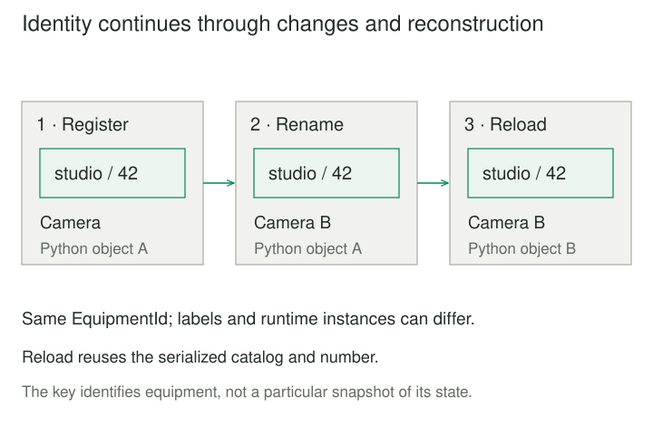

## Purpose and problem

A studio tracks two cameras with the same display label. One camera is renamed after a repair. A maintenance import must update that camera's history without creating a new asset or merging it with the other camera.

Comparing all current fields fails: a rename makes one asset look different from its earlier representation. Comparing the label alone also fails: two physical assets can have identical labels. Loading a saved record creates a new language-level object, so a memory address cannot carry identity across restarts.

## Core idea

An **Entity** represents something whose continuity matters independently of its current attributes. Give that thing an identity meaningful within the model, preserve it through changes and reconstruction, and use it when deciding whether two representations concern the same thing.

The mental model is **the same thing, possibly different facts about it**. Eric Evans's [DDD Reference, Entities](https://www.domainlanguage.com/wp-content/uploads/2016/05/DDD_Reference_2015-03.pdf) establishes identity across a lifecycle and different representations. Fowler's [Evans Classification](https://martinfowler.com/bliki/EvansClassification.html) also calls these **reference objects**.

Here, Entity means **Domain Entity**, not any database row, ORM-mapped class, entity in an ER diagram, or entity-component-system object. Those terms overlap in some implementations but have different design purposes. A Value Object instead matters through its attributes: two equivalent measurements can be interchangeable, while two equally labeled cameras remain distinct assets.



## How it works

### Decide what identity means

Identify the concept and the scope of its identifier. A catalog number may be unique only within one catalog; a tenant-local customer number needs its tenant context. A typed identity can include that scope rather than pretending the bare number is globally meaningful.

Choose how identifiers are assigned, preserved on reload, and protected from accidental reassignment or reuse. A database key or generated UUID can implement this policy, but neither proves that two records represent the same real-world thing. External identifiers may require explicit mappings.

The choice is contextual. Microsoft's [domain-model guidance](https://learn.microsoft.com/en-us/dotnet/architecture/microservices/microservice-ddd-cqrs-patterns/microservice-domain-model) explains that an identity can appear across bounded contexts without requiring the same attributes and behavior in each model.

### Separate comparison policies

Business identity, state equality, and runtime reference equality answer different questions. Specify which comparison your API exposes. A language's default equality may compare memory references or every dataclass field rather than the intended business key.

Identity-based `==` is an explicit choice in this example, not a requirement of every Entity implementation. Two equal entities may have different labels or versions. Equality does not refresh, merge, or validate their current state.

A persistence session may use an [Identity Map](https://martinfowler.com/eaaCatalog/identityMap.html) to avoid loading multiple mutable objects for one identity within a unit of work. That pattern addresses local object duplication; it does not prevent another process from holding an older copy.

### Keep behavior and lifecycle coherent

An entity can expose domain operations that change its descriptive state while preserving identity. Microsoft's guidance places relevant rules with that state. Persistence must save and reconstruct the assigned identity, not generate a new one each time it loads a record.

Concurrent copies still require conflict detection or serialization of updates. Knowing that two requests name the same entity supplies no lock, authorization, or ordering guarantee. If identifiers can be recycled, old references need an explicit policy so they do not silently identify a new lifecycle.


## Worked example

### Rename equipment without replacing its identity

Before the change, the catalog matches assets by display label. Afterward, an immutable `EquipmentId` carries the catalog and assigned number. `Equipment` owns its label and permits a validated rename without changing that identity.

Save these two files together and run `python3 demo.py` with Python 3.10 or later. Only the standard library is required. Identity fields are nonblank, trimmed, case-sensitive strings; the number is opaque text, not an arithmetic quantity.

**model.py — stable identity and entity behavior**

```python
from dataclasses import dataclass


@dataclass(frozen=True)
class EquipmentId:
    catalog: str
    number: str

    def __post_init__(self):
        for value in (self.catalog, self.number):
            if type(value) is not str or not value or value != value.strip():
                raise ValueError("Identity fields must be nonblank, trimmed text")


class Equipment:
    __hash__ = None

    def __init__(self, identity: EquipmentId, label: str):
        if type(identity) is not EquipmentId:
            raise TypeError("EquipmentId required")
        self._identity = identity
        self._label = self._checked_label(label)

    @staticmethod
    def _checked_label(label):
        if not isinstance(label, str) or not label.strip():
            raise ValueError("Label must be nonblank text")
        return label.strip()

    @property
    def identity(self):
        return self._identity

    @property
    def label(self):
        return self._label

    def rename(self, label):
        self._label = self._checked_label(label)

    def __eq__(self, other):
        if type(self) is not type(other):
            return NotImplemented
        return self.identity == other.identity
```

**demo.py — preserve the key across a JSON round trip**

```python
import json
from model import Equipment, EquipmentId


camera = Equipment(EquipmentId("studio", "42"), "Camera")
camera.rename("Camera B")
encoded = json.dumps({
    "catalog": camera.identity.catalog,
    "number": camera.identity.number,
    "label": camera.label,
})
record = json.loads(encoded)
restored = Equipment(
    EquipmentId(record["catalog"], record["number"]), record["label"]
)
print("recreated:", camera == restored, camera is restored)
restored.rename("Camera C")
print("identity equal, labels equal:", camera == restored, camera.label == restored.label)
lookalike = Equipment(EquipmentId("studio", "43"), "Camera B")
print("same label, same entity:", camera.label == lookalike.label, camera == lookalike)
other_catalog = Equipment(EquipmentId("rental", "42"), "Camera B")
print("other catalog:", camera == other_catalog)
# recreated: True False
# identity equal, labels equal: True False
# same label, same entity: True False
# other catalog: False
```

The first output means the reconstructed object represents the same equipment but is a different Python object. The second means identity still matches after the two objects' labels diverge. The remaining comparisons distinguish identical labels and catalog-local numbers from full identity.

A blank rename raises `ValueError` before changing the label. The identity property has no setter, and its string fields are frozen. This is a public-API convention, not security isolation: Python's [underscore names](https://docs.python.org/3/tutorial/classes.html#private-variables) do not enforce access control.

`EquipmentId` is a value used as an entity's key. Its generated comparison and hash depend on its immutable fields. `Equipment` is deliberately unhashable; collections should key by `EquipmentId`. Python's [data model](https://docs.python.org/3/reference/datamodel.html#object.__hash__) and [dataclass rules](https://docs.python.org/3/library/dataclasses.html) explain the equality/hash obligations and generated field comparisons.

The demo assumes catalog numbers were assigned uniquely at registration. It does not implement an allocator or uniqueness constraint. The JSON round trip demonstrates reconstruction, not a database or durable commit; the two objects deliberately remain independent and unsynchronized.

## When to use it

Use an Entity when history, references, or lifecycle belong to one continuing thing: an asset, order, agreement, or account. It is especially useful when descriptive attributes change and several representations must still refer to that thing.

Not every noun needs identity. A color or coordinate may need only value comparison. Nor must an entity be mutable: immutable revisions can represent one entity when they retain its identity and make version differences explicit.

## Tradeoffs and common mistakes

**Matching mutable attributes.** Names, labels, and email addresses may change or collide. Treating one as identity needs an explicit domain guarantee, not convenience.

**Making every ID universal.** Include scope and model meaning where needed. Adding a UUID to every data structure does not establish a useful lifecycle or reconciliation policy.

**Equality mistaken for current truth.** Equal identities can accompany conflicting state. Specify version checks, ownership, and reload behavior independently. A stable identifier is also not proof that a caller may read or change the entity.

**Mutable hash keys.** Changing fields used by hashing can break lookup behavior. Keep identity values stable and make the language-level equality and hashing policy deliberate. This example avoids hashing mutable entities altogether.

## Related patterns

[[domain-model|Domain Model]] organizes business behavior and state. Entities are one kind of object it can contain; the model can also contain values and services.

[[data-bounded-contexts|Bounded Contexts]] defines where an identity and its associated meanings apply. Sharing a number across contexts does not require sharing one object model.

[[data-entity-resolution|Entity Resolution]] decides which source records concern the same real-world thing. An Entity uses an established identity; it does not solve uncertain matching by itself.

[[data-identity-crosswalks|Identity Crosswalks]] maps identifiers assigned by different authorities. Such a mapping can connect representations without discarding their original scopes.

## Sources

Evans's [DDD Reference, Entities on printed page 11](https://www.domainlanguage.com/wp-content/uploads/2016/05/DDD_Reference_2015-03.pdf) establishes lifecycle identity. Fowler's [classification](https://martinfowler.com/bliki/EvansClassification.html) distinguishes entities, values, and services; his [Identity Map catalog](https://martinfowler.com/eaaCatalog/identityMap.html) addresses duplicate loaded objects. [Microsoft's domain-model guidance](https://learn.microsoft.com/en-us/dotnet/architecture/microservices/microservice-ddd-cqrs-patterns/microservice-domain-model) covers domain identity and behavior. Official Python references support the implementation choices linked above.

The equipment scenario, equality policy, Python code, and illustrations are original teaching material. They do not prescribe one universal equality policy or identifier-allocation scheme.
