You switch on the camera grid and move a harbor beacon toward an intersection. The picture
changes, but not because the grid has discovered the correct place for it. The beacon now
has more open sea on one side. That space becomes part of the image, and the relationship
between subject and surroundings changes with it.

Try dividing the frame into three equal columns and three equal rows. Placing a subject near
a dividing line, or a prominent point near an intersection, offers a practical alternative
to automatic central placement. Use it to explore the distribution of attention and space.
Then compare the result with other arrangements, including the center.

## A prompt for comparison

Think of the grid as a way to interrupt a habit. Many beginners put the thing they care
about in the middle because the camera initially focuses there or because it feels convenient.
A thirds line suggests another possibility without requiring you to invent an arrangement from
nothing. It makes the difference easy to compare.

Off-center placement can create a relationship between a concentrated subject and a larger area
of context. A low horizon can give sky greater emphasis; a high horizon can favor land.
These are consequences of the space allocated, not evidence that an exact one-third ratio
has a special power over viewers. A slightly different position may serve the scene better.

[[use-negative-space|Use Negative Space]] explains how quiet areas contribute. The thirds grid
does not tell you whether those areas are useful, or whether a bright sign at the edge
will compete with your subject. It cannot replace looking at the whole frame.

## A horizon that chooses a subject

At the coast, the horizon divides the image into sea and sky. If both occupy equal space,
the picture may communicate a balanced meeting of two surfaces. If the interesting event is
a bank of clouds, placing the horizon nearer the lower third gives those clouds more room.
The sea becomes supporting context rather than an equal partner.

If the water contains a strong pattern of foam and rocks, a higher horizon may serve the
opposite intention. Neither choice is an improvement simply because it approaches a grid line.
A reflection can make a central horizon particularly effective because the mirrored arrangement
is the subject. [[use-symmetry|Use Symmetry]] explains that balance. Keep the horizon level
unless a deliberate tilt contributes something clear; moving it up and down is a separate choice.

## A portrait with room for context

Suppose a friend stands in their workshop. Placing their face near an upper intersection may
leave useful room for a bench and tools beside them. The off-center position can connect
person and place. If you merely move the face to a grid point while cutting through an
important tool or leaving a distracting bright cupboard, the grid has not helped.

A centered portrait may communicate directness and engagement, especially when the person looks
straight at the camera. A symmetrical doorway behind them can strengthen that effect. Ask what
the portrait needs: a relationship with the workshop, a direct encounter, or perhaps the shape
of a gesture. [[choose-your-subject|Choose Your Subject]] helps establish that intention first.

On many phones, tapping to focus also influences exposure. Recheck brightness after tapping an
off-center face. On a camera, an adjustable focus area or subject detection can keep focus
on a person wherever you place them. Do not assume subject placement must follow a central
autofocus point. [[focus-on-what-matters|Focus on What Matters]] covers that decision separately.

## When the center is the stronger choice

A single flower seen directly from above can use the center to emphasize its radial structure.
Moving it to a corner may introduce empty space without any useful relationship. A long
straight corridor can use a centered vanishing point to communicate order and recession. A
small isolated object in a square frame may feel resolved precisely because its surrounding
space is balanced.

Central placement can also be unsettling rather than calm: a tiny figure exactly in the middle
of a very large empty scene may feel exposed. The effect comes from the whole arrangement,
including size, contrast, and context. Avoid reducing composition to “centered means boring” or
“off-center means dynamic.” Those labels often hide more than they explain.

## Let the grid disappear

This pattern is useful when every picture has the same centered arrangement, when a horizon
feels indecisive, or when a subject needs room for context. Most phones and cameras can display
a grid, but it is equally possible to imagine the divisions. There is no prerequisite beyond
being able to reframe the image.

Avoid nudging an important expression out of a good frame to satisfy an intersection. Avoid
cropping away meaningful details to make a proportion exact. Other relationships may matter more:
an open outline, a diagonal, a repeated shape, or the connection between two people. [[check-the-edges|Check the Edges]] is often more useful than another millimeter of grid alignment.

Once you have compared a few versions, turn the grid off if it dominates your attention.
The reusable skill is exploring placement and understanding what changes. Thirds provide a
starting arrangement, not a verdict about whether a photograph succeeds.
