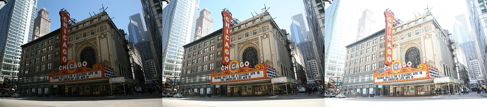
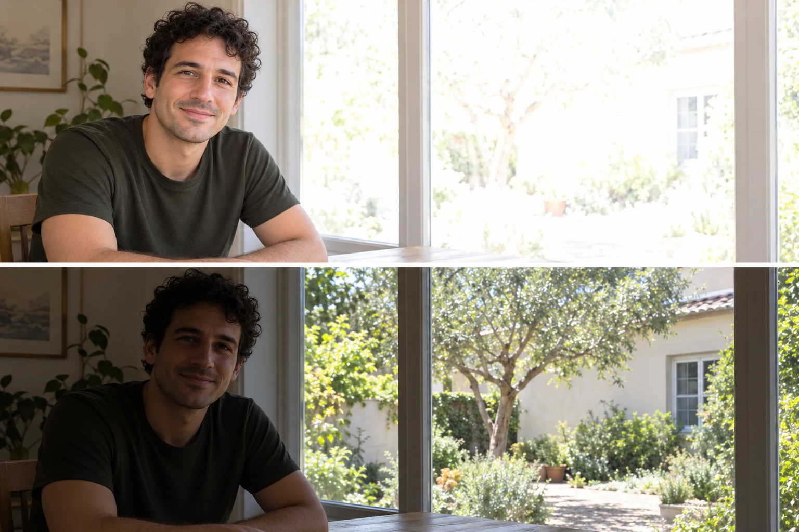

You photograph a shaded building beneath a bright sky. In one frame, the facade is readable
but the sky loses its cloud detail. In another, the sky looks rich while the facade becomes
dark. The camera has not necessarily made a mistake. The scene may contain a wider brightness
range than one capture can preserve in the way you want.

Decide which tones carry the photograph, then expose and evaluate for those priorities. You
may want detail in a face, texture in a pale wall, a luminous window, or an intentionally
dark silhouette. Brightness is a choice constrained by the scene, the capture, and processing.
Making the whole picture brighter is not the same as making it better.

[Source: Chicago Theatre raw frames](https://commons.wikimedia.org/wiki/File:Chicago_Theatre_raw_frames.jpg)
· [CC BY-SA 4.0](https://creativecommons.org/licenses/by-sa/4.0/). WebP conversion; source sequence preserved.

## Choose a priority before a setting

Think of exposure as allocating limited recording capacity to the tones that matter. In
a digital capture, aperture and exposure time control how much scene light reaches the sensor,
along with the scene's illumination and lens transmission. ISO influences signal handling
and output brightness; changing it alone does not increase the light captured at a fixed
aperture and time. [[photography-foundations|Photography Foundations]] separates these concepts.

The camera's meter suggests settings according to its mode and what it measures. It cannot
know whether you want a pale wall to stay pale, a black coat to remain dark, or a face
to dominate a bright-window scene. You can usually start with the camera's automatic choice
and adjust the target rather than switching immediately to manual control.

Exposure compensation asks automatic exposure to aim brighter or darker than its current
recommendation. Positive compensation generally produces a brighter rendering; negative generally
produces a darker one. Which physical setting changes depends on mode, limits, and Auto ISO.
In fully manual exposure with fixed ISO, compensation may only change the meter indication.
Check the device's behavior rather than assuming the dial always alters captured light.

## A face beside a bright window

Your friend sits inside with a sunlit window behind them. If their expression is the subject,
you may increase the exposure target until their face is readable, accepting that the window
becomes very bright. If the view through the window is essential, that tradeoff may be
unacceptable. Move them toward light from the window, change the camera direction, or choose
a location with a smaller brightness difference.

A silhouette is another valid intention. In that case, preserving the face's detail is no
longer the goal. [[use-backlight|Use Backlight]] explains how outline and background can carry
the picture. Do not automatically rescue every dark face if darkness is a deliberate part
of a collaborative portrait, and do not assume an accidental silhouette communicates your
original intention.

On a phone, tapping the subject often affects both focus and exposure. Some interfaces offer
a separate brightness slider or exposure compensation control. Automatic HDR can combine
captures to reduce the compromise, but moving subjects may produce artifacts and the result
may look different from one ordinary exposure.

## Snow, dark coats, and meter assumptions

A snow scene can look gray when the automatic choice is influenced by its broad bright
surface. A positive adjustment may restore a luminous appearance, provided important texture
does not clip. A black coat filling the frame may become paler than intended; a negative
adjustment may keep its dark character. Neither example requires making white perfectly white
or black completely featureless.

These are starting tendencies, not fixed compensation recipes. Metering systems differ and
may recognize the scene. Inspect the result rather than blindly applying a memorized number.
If the snow is in shade and the sky is sunlit, preserving both may still require a
compromise. [[follow-the-light|Follow the Light]] can help you change the underlying illumination
relationship instead of fighting it through settings alone.

## Understand clipping before relying on recovery

When a recorded channel reaches its upper limit, distinct brighter values may become indistinguishable.
Darkening that data afterward cannot recreate missing differences. Raw files can retain more
usable highlight information than the camera's JPEG preview suggests, but raw is not an
unlimited recovery system. A completely clipped area cannot be restored from that capture
merely by moving a slider.

Histograms and highlight warnings can help. Most camera warnings describe the processed preview,
so their relationship to raw headroom depends on settings and camera. Tiny specular reflections
or the sun itself may reasonably lack detail. A broad clipped forehead or cloud might matter
much more. Prioritize meaningful surfaces instead of treating every warning as a failure.

## Keep the compromise visible to yourself

This pattern helps with backlit portraits, bright skies above shade, pale objects, dark
subjects, and scenes where the meter's choice repeatedly disappoints. A short exposure bracket
can provide alternatives for a stationary scene, but moving elements may differ between frames.
Do not describe a later blend as one unaltered instant when documentary expectations require
that distinction.

[[edit-to-guide-attention|Edit to Guide Attention]] handles the later rendering of available
tones. [[select-the-strongest-frame|Select the Strongest Frame]] helps choose an exposure for
a specific purpose. The aim is a photograph whose important tones do their intended work,
even when less important regions must remain dark or bright.
