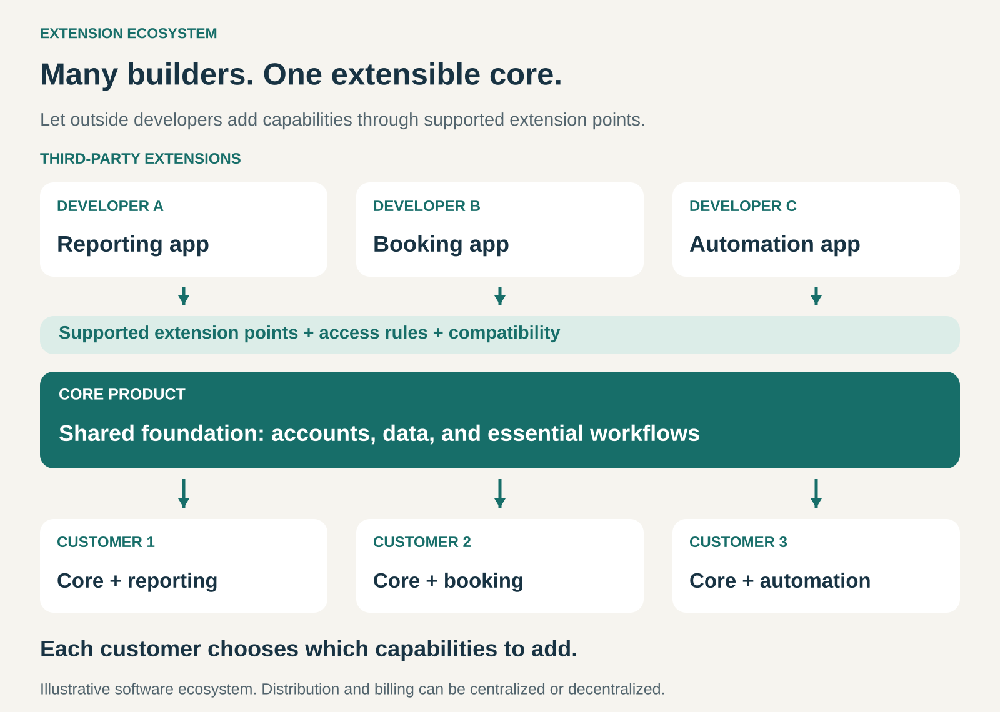

## What it is for

Meet more customer needs by letting other developers add capabilities to a core product.

A product can serve a broad audience while its customers need very different things. One needs advanced reporting, another needs appointment booking, and another needs a connection to an industry-specific system.

Building every feature internally can make development slow and the product complicated.

An Extension Ecosystem lets outside developers address those needs through apps, plugins, modules, or other compatible additions. Customers combine the core product with the capabilities relevant to them.

## The core idea

**Provide a reliable foundation that others can extend, together with workable ways to build, distribute, and maintain those extensions.**

The core product supplies shared capabilities. External developers build additions that work with it. Customers choose which additions to use.

The ecosystem includes more than the software connections. Documentation, discovery, compatibility, support responsibilities, and commercial arrangements all affect whether people can build useful businesses and dependable products around the core.

A centralized marketplace is one possible arrangement. Extensions can also be distributed and purchased elsewhere.

The pattern becomes an ecosystem when multiple participants can repeatedly build and maintain additions. A single custom integration demonstrates extensibility, but does not establish the wider network.

## How it works

**1. Define what others can extend.**

The platform establishes supported ways for additions to interact with the core.

Extensions might add interface elements, introduce workflows, exchange information, or respond to events. The boundaries determine which customer problems external developers can realistically solve.

Useful extension points expose meaningful capabilities while keeping the underlying product manageable.

**2. Make development practical.**

Developers need understandable documentation, testing tools, examples, and predictable behavior.

They also need notice when the platform changes. An extension that works today must have a credible path to working after the next update.

The effort required to build and maintain an addition affects how many developers can participate.

**3. Connect extensions with customers.**

Customers need ways to discover suitable additions, understand compatibility, assess costs, and install them.

A marketplace can provide listings, reviews, trials, and billing. Other ecosystems rely on directories, developer websites, specialist agencies, or community recommendations.

The discovery system needs to help customers find useful capabilities rather than simply display a large catalog.

**4. Sustain the relationship.**

The ecosystem needs arrangements for access permissions, updates, support, and abandoned extensions.

Developers also need a reason to keep investing. That may come from license income, subscriptions, associated services, distribution opportunities, or community goals.

Customers need clarity about which organization handles problems with the core, the extension, and their interaction.

## Why it works

**Specialists can serve needs the core team would not prioritize.** A developer can concentrate on a particular industry or workflow.

**Development can happen in parallel.** Several teams can address different requirements around a common foundation.

**Customers can configure their own offering.** They add relevant capabilities without requiring every feature to be included for everyone.

**The core product can become useful in more situations.** Extensions may help it serve additional markets and customer groups.

**Participation can reinforce itself.** More customers can attract developers; useful extensions can attract or retain customers.

That cycle requires actual value. A large extension count can coexist with poor discovery, inconsistent quality, or very little commercial activity.

## Famous examples

### Shopify — apps that extend a merchant’s store

Shopify supports apps that add functionality to areas including online stores, checkout, customer accounts, and point of sale. Extensions can add customer-facing elements, while functions can customize defined parts of store logic, such as discounts or delivery options. [Shopify app extensions and functions](https://help.shopify.com/en/manual/apps/extensions-and-functions)

Merchants can therefore adapt a common commerce platform to different operating needs.

Shopify’s developer documentation also defines where extensions can appear and how they interact with the platform. This illustrates the importance of supported connection points, rather than leaving every developer to modify the core product independently. [Shopify’s extension model](https://shopify.dev/docs/apps/build/app-extensions)

### Atlassian Marketplace — specialized capabilities around Jira and Confluence

Atlassian Marketplace lets developers sell or share apps that enhance products including Jira and Confluence. Examples include diagramming capabilities and workflow extensions. [Atlassian Marketplace for developers](https://developer.atlassian.com/platform/marketplace/introduction-to-marketplace/)

Customers use these additions to adapt the products to their teams’ requirements.

The marketplace includes both Atlassian and third-party apps. Availability can differ between deployment types, and third-party vendors generally provide their own technical support. [Atlassian Marketplace licensing and support](https://www.atlassian.com/licensing/marketplace)

The ecosystem therefore depends on clear compatibility and responsibility information alongside discovery and purchasing.

### WordPress — plugins extending an open-source core

WordPress plugins add functionality to the core publishing system. Its plugin directory includes categories such as e-commerce, search optimization, caching, and data import. Users can install additions through the administration interface or upload plugins obtained elsewhere. [WordPress plugin documentation](https://wordpress.org/documentation/article/manage-plugins/)

WooCommerce provides a substantial example: it adds commerce capabilities to WordPress and supports further extensions for functions such as bookings, memberships, and subscriptions. [WooCommerce on WordPress.org](https://wordpress.org/plugins/woocommerce/)

This shows how extensibility can develop in layers. An extension can become a foundation for another ecosystem, while distribution remains possible through several routes.

## The economics

An extension ecosystem can create several income streams.

The core provider may earn from subscriptions, hosting, licenses, or marketplace services. Developers may sell extensions, charge for ongoing services, or use free additions to support another business.

A platform commission is optional.

Consider a hypothetical paid extension where the platform retains 15% of eligible receipts:

| Monthly economics                                                    |     Amount |
| -------------------------------------------------------------------- | ---------: |
| Eligible extension receipts after agreed adjustments                 |    $20,000 |
| Platform share at 15%                                                |    −$3,000 |
| Developer receipts                                                   |    $17,000 |
| Developer maintenance, hosting, and support costs                    |   −$12,000 |
| Developer contribution before acquisition costs and general overhead | **$5,000** |

The platform’s $3,000 must also support its own ecosystem costs. It is not automatically profit.

An extension can also improve the economics of the core product by making it useful to more customers. That benefit needs to be assessed against documentation, developer support, compatibility work, and customer-service costs.

In an open ecosystem, economic value may be distributed across plugin vendors, hosting providers, agencies, and other participants rather than captured by one central operator.

## Useful when

- **Customers share a foundation but have varied needs.** Many useful capabilities matter to particular groups.
- **The product has meaningful extension points.** Outside developers can solve substantial problems through supported interfaces.
- **There is a reachable customer base.** Developers have a credible route to users.
- **Independent maintenance is practical.** Extensions can evolve without constant reconstruction.
- **The platform can support continuing participation.** Documentation, governance, and compatibility receive sustained attention.

## Common mistakes and limits

**Treating a marketplace launch as the ecosystem itself.** Developers still need useful capabilities, customers, and workable economics.

**Exposing connections that are too limited.** A developer cannot solve meaningful problems if essential functionality remains inaccessible.

**Changing the foundation unpredictably.** Repeated compatibility failures increase costs and weaken confidence.

**Leaving support ownership unclear.** Customers can become trapped between providers, each attributing the problem to another component.

**Allowing poor discovery and abandoned products to accumulate.** Catalog size can obscure whether customers can find dependable additions.

**Ignoring the combined customer experience.** Several extensions can create overlapping interfaces, conflicting behavior, and an unexpectedly high total bill.

**Undermining developer confidence.** Unpredictable access rules, commercial terms, or changes in platform direction can discourage investment.

**Expecting extensions to compensate for a weak core.** The foundation still needs to perform its essential job reliably.

The pattern is harder to sustain when demand is small, integration boundaries are unstable, or maintaining compatibility costs more than developers can recover.

## Related patterns

- [[open-business-model|Open Business Model:]] makes external contributions central to value creation. An extension ecosystem organizes those contributions around a shared product.
- [[multi-sided-platform|Multi-Sided Platform:]] connects interdependent groups. Customers and extension developers can form two such groups.
- [[marketplace|Marketplace:]] can support discovery, purchasing, and distribution. The extension ecosystem also includes development and ongoing operation.
- [[core-plus-add-ons|Core plus Add-Ons:]] describes the customer’s combined offering. Extension Ecosystem enables outside developers to supply some of those additions.
