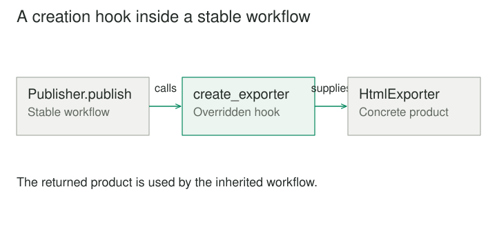

## Purpose and problem

A document service has a reliable publishing sequence: validate the document, create an exporter, render its content, upload the result, and record the publication. The first version produces PDF files. When HTML support arrives, somebody copies the sequence into another service and changes the exporter constructor. A month later, a validation fix lands in one copy and misses the other.

## Core idea

The design pressure is specific: the workflow is stable, while the concrete object used within it varies. Factory Method gives that variation an explicit location. The reusable workflow calls a creation method instead of directly constructing one fixed product. A specialized creator overrides that method to supply the appropriate implementation.



## How it works

Imagine a base Publisher with a publish operation and a create_exporter method. The publish operation works with the Exporter contract: render a document and return an artifact. PdfPublisher supplies PdfExporter; HtmlPublisher supplies HtmlExporter. Neither variant needs to duplicate validation, uploading, or audit recording.

The useful separation is between the code that needs an object and the code that selects its concrete type. The workflow still controls when creation happens. It simply delegates what gets created. That makes a framework extendable without requiring every extension to rewrite its internal sequence.

The canonical object-oriented form uses inheritance: a creator class declares a factory method and subclasses specialize it. In a language that accepts functions as arguments, a callback can sometimes provide the same extension point with less ceremony. That is a related implementation choice, rather than a reason to call every function that returns an object a Factory Method.

## Worked example

### A publishing system that changes in one place

Suppose the publishing sequence must now reject documents containing broken internal links. With the duplicated design, the team must remember every publishing variant. With the shared creator workflow, the validation changes once. PDF and HTML exporters both receive documents after the same checks.

An important boundary remains: Exporter should describe what the publisher actually needs. If it exposes PDF-specific page settings, the HTML implementation will either fake them or refuse them. The factory method cannot rescue an abstraction whose contract already assumes one concrete product.

Creation can also involve more than a constructor. The PDF variant might load a font bundle and initialize a renderer; the HTML variant might select a template engine. Both return ready-to-use exporters. Resource ownership still needs a clear rule: if the publisher creates the exporter, it may also need to close it after use.

### A small implementation

This Python example keeps the publishing sequence in Publisher. HtmlPublisher overrides only the creation hook. The exporters return text artifacts so the example stays independent of rendering libraries.

```python
from abc import ABC, abstractmethod
from html import escape


class TextExporter:
    def render(self, document):
        return document


class HtmlExporter:
    def render(self, document):
        return f"<p>{escape(document)}</p>"


class Publisher(ABC):
    def publish(self, document):
        if not document.strip():
            raise ValueError("A document needs content")
        exporter = self.create_exporter()
        return exporter.render(document)

    @abstractmethod
    def create_exporter(self):
        pass


class HtmlPublisher(Publisher):
    def create_exporter(self):
        return HtmlExporter()


print(HtmlPublisher().publish("Hello & welcome"))
# <p>Hello &amp; welcome</p>
```

The inherited publish operation owns validation and the point at which an exporter is needed. The subclass supplies the product. Calling HtmlExporter directly from each workflow would lose that extension point; a standalone make_exporter function would instead be a simple factory.

### A connection framework with controlled extension

A network client framework might implement reconnecting, backoff, and connection health checks in a common Session class. Its open_channel method supplies a channel that supports sending and receiving messages. A specialized session creates a local socket channel, while another creates a channel backed by a test transport.

The framework keeps responsibility for reconnect timing. Extensions choose the concrete channel and its initialization. The benefit is that a new transport can participate in the established lifecycle rather than reimplementing it.

There is also a cost. If choosing a transport requires a new subclass for every configuration combination, the hierarchy can become awkward. Passing a channel factory into the session might better fit a system where implementations change at runtime. The design problem is object creation; subclassing is one possible way to solve it.

## When to use it

- A shared workflow needs different concrete collaborators.
- A framework needs an extension point for creating a product.

Consider a simpler design when the only need is a small conditional constructor, or when runtime configuration would be clearer than subclassing.

## Tradeoffs and common mistakes

Factory Method is especially useful in frameworks and reusable workflows where subclass extension is already part of the architecture. It localizes a creation decision and reduces the workflow's dependence on concrete product classes. It also gives tests a place to provide a controlled collaborator, although ordinary dependency injection can often achieve that more directly.

It does not remove the need to select a creator somewhere. An application still decides whether to construct PdfPublisher or HtmlPublisher. Moving this selection to the composition boundary is useful; pretending it has disappeared is misleading.

The pattern is often over-applied to a simple function such as make_exporter(format). That function may be a perfectly good simple factory. Without an overridable creation operation inside a creator abstraction, it does not have the characteristic canonical structure described here.

## Related patterns

[[abstract-factory|Abstract Factory]] supplies a family of compatible products, while Factory Method typically provides a creation extension point for a product within a larger design. Abstract factories may themselves implement their creation operations using factory methods.

[[template-method|Template Method]] fixes a workflow and leaves selected steps customizable. A factory method is often one of those steps, but the patterns address different decisions: the overall algorithm versus the creation of an object. [[strategy|Strategy]] moves interchangeable behavior into a collaborator. When the variation is best selected dynamically rather than through a creator subclass, a strategy or injected factory function may make the relationship clearer.

## Sources

Factory Method is one of the 23 patterns in Gamma, Helm, Johnson, and Vlissides, [*Design Patterns: Elements of Reusable Object-Oriented Software*](https://www.informit.com/store/design-patterns-elements-of-reusable-object-oriented-9780201633610). The examples, code, and illustrations here are original educational explanations.
