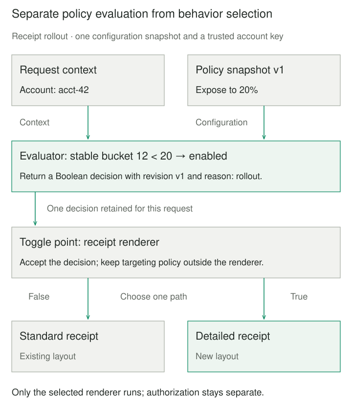
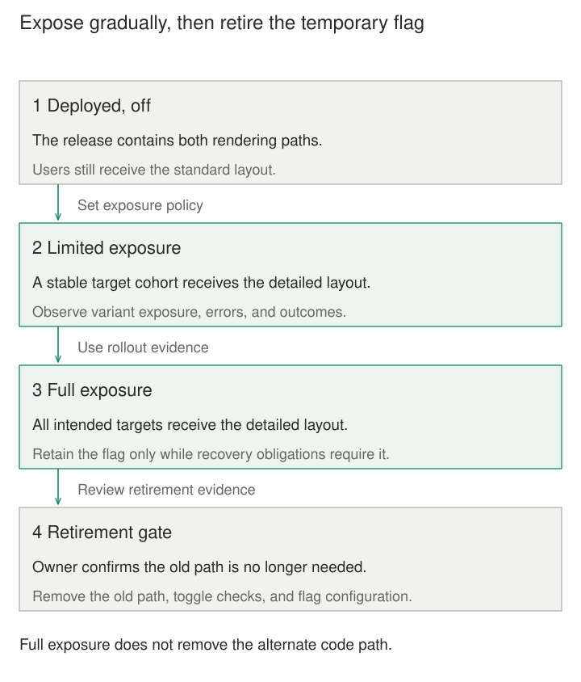

## Purpose and problem

A shop has deployed a redesigned receipt, but the product team wants to expose it to a small customer group before making it the default. Deployment includes unrelated fixes that everyone needs now. Requiring another application deployment for every exposure change couples software delivery to product timing and operational decisions.

The team needs the new behavior available in the running system while controlling who encounters it. Feature Toggle places a decision at the relevant behavior boundary. Deployment makes code available; a separate configuration determines whether that code participates in a particular execution.

## Core idea

**Deploy the alternatives; configure the choice.** A toggle point selects a behavior, while an evaluator applies the flag’s policy to the current context. A simple release flag can be one Boolean setting. More selective policies can consider a customer cohort, environment, or rollout percentage.

Feature Flag is the same established name in common usage. The distinguishing move is configurable exposure or selection of behavior, rather than a particular vendor service or every ordinary application setting. A flag may be evaluated at startup or per request; instant remote updates are an implementation choice.



## How it works

The **toggle point** is the small place where execution changes. The **evaluator** combines configuration and context into a decision. The **configuration owner** controls exposure and records why a setting changed. Keep policy out of scattered business conditionals so a new targeting rule does not require editing every caller.

Hodgson distinguishes release flags for controlled exposure, experiment flags for comparing variants, operations flags for operational controls, and permissioning flags for longer-lived availability rules. Their lifetimes differ: a temporary release gate needs a removal plan, while an enduring operational control needs maintained ownership and tests. Experiment assignment also needs valid measurement; switching a feature for some users does not itself establish a trustworthy experiment.

Choose the targeting unit deliberately. Account-based assignment keeps colleagues together; user-based assignment can separate them. A stable hash of a flag key and trusted subject identifier can preserve a cohort while a percentage increases. This provides repeatability for unchanged inputs, not an exact population percentage or authorization. Avoid fresh randomness on each request when users need a consistent experience.

OpenFeature specifies typed evaluation with an explicit default and contextual targeting information. In an implementation, decide how missing flags, stale snapshots, and provider failures affect the feature. For a receipt-layout release, the known standard layout is a reasonable fallback. A safety control may need a different default. Surface evaluation errors through bounded telemetry instead of making fallback indistinguishable from a deliberate setting.

Capture a coherent decision for the request or transaction. Independently refreshed services can observe different policy versions; a flag update is not a distributed atomic switch. Where consistency matters, propagate the selected variant or configuration revision through trusted application context. Disabling a flag generally changes future decisions, without stopping in-flight work or undoing stored effects.

## Worked example

### A stable receipt rollout

Originally, the shop needed a new build to change receipt exposure. The revised renderer accepts a decision and knows nothing about policy retrieval or cohort rules. This complete Python 3.9+ program uses only the standard library. It models one flag, `receipt-details`, and an immutable policy snapshot; it is not an OpenFeature SDK implementation.

`percent` is an integer from 0 to 100. A SHA-256 digest assigns each nonempty account identifier to a bucket from 0 to 99. A bucket below the configured percentage receives the detailed receipt. Identifiers come from the trusted account session, not a caller-selected query parameter.

```python
from dataclasses import dataclass
from hashlib import sha256


@dataclass(frozen=True)
class Policy:
    revision: str
    percent: int

    def __post_init__(self):
        if type(self.percent) is not int or not 0 <= self.percent <= 100:
            raise ValueError("percent must be an integer from 0 to 100")


@dataclass(frozen=True)
class Decision:
    enabled: bool
    revision: str
    reason: str


def evaluate(account_id, load_policy):
    try:
        policy = load_policy()
        if not isinstance(policy, Policy):
            raise ValueError("invalid policy snapshot")
    except (ConnectionError, ValueError):
        return Decision(False, "unavailable", "fallback")
    if not account_id:
        return Decision(False, policy.revision, "missing targeting key")
    digest = sha256(f"receipt-details:{account_id}".encode()).digest()
    bucket = int.from_bytes(digest[:8], "big") % 100
    return Decision(bucket < policy.percent, policy.revision, "rollout")


def render_receipt(order_id, decision):
    if decision.enabled:
        return f"{order_id}: detailed receipt"
    return f"{order_id}: standard receipt"


def unavailable():
    raise ConnectionError("configuration provider unavailable")


if __name__ == "__main__":
    policy = Policy("v1", 20)
    load = lambda: policy
    selected = evaluate("acct-42", load)
    assert selected == evaluate("acct-42", load)
    assert selected.enabled  # Stable bucket 12 is below 20.
    print(render_receipt("A-17", selected))
    policy = Policy("v2", 0)
    assert selected.enabled  # Existing request retains its decision.
    print(render_receipt("A-17", evaluate("acct-42", load)))
    fallback = evaluate("acct-42", unavailable)
    assert fallback.reason == "fallback" and not fallback.enabled
    print(f"provider failure: {fallback.reason}")
    assert not evaluate("", lambda: Policy("v3", 100)).enabled
```

The output is `A-17: detailed receipt`, `A-17: standard receipt`, then `provider failure: fallback`. Changing the policy affects the next evaluation; the earlier immutable decision stays enabled. Missing identity uses the standard receipt even at 100%, an explicit policy choice. Provider failure is reported in the decision rather than treated as a successful “off” lookup.

Nonempty string identifiers and a loader returning `Policy` or the declared failure types are preconditions. This bounded example omits remote propagation, persistence, identity verification, and telemetry export. It catches configuration failures, not failures in the selected renderer; an application error must not silently trigger another potentially effectful path.



## When to use it

Use a flag when deployment and exposure need different schedules, selected customers should receive a change first, or operators need a maintained control over an optional behavior. Keep the decision narrow enough to explain and observe.

If a useful feature slice can be safely released to everyone, shipping that slice may be simpler. A configuration constant can suffice when exposure changes only between process restarts. A remote flag platform earns its complexity when targeting, update speed, auditability, or shared operational controls require it.

## Tradeoffs and common mistakes

Every live alternative increases the behavior that must remain understood. Test both paths, the intended production configuration, fallback behavior, and consequential interactions with other flags. Independent Boolean settings have up to `2^n` combinations; focus additional combination checks on real dependencies rather than assuming isolated branch tests cover them.

A hidden button does not protect its backend endpoint. Authenticate and authorize operations independently, and restrict who can edit exposure policy. Client-visible flags and targeting attributes are observable; keep secrets out of them and minimize personal data sent to evaluators.

Changing configuration can have production impact comparable to releasing code. Record ownership, revisions, exposure, error rates, and the reason for changes. A kill switch cannot recover a schema change or reverse a payment. Temporary flags need an expiry review and explicit deletion of obsolete paths, tests, and configuration after recovery obligations close.

## Related patterns

[[branch-by-abstraction|Branch by Abstraction]] uses a seam to replace an implementation in releasable stages. A flag can select the active supplier, but does not perform that migration or its retirement.

[[strategy|Strategy]] isolates interchangeable behavior behind one contract. A toggle decision can choose a strategy while leaving the workflow independent of flag infrastructure.

[[dependency-injection|Dependency Injection]] supplies a selected implementation or request decision. It helps prevent business components from depending on a global flag client.

[[data-expand-migrate-contract|Expand–Migrate–Contract]] maintains compatibility while interfaces and data change. A flag may control exposure during that transition; it does not supply data compatibility or atomic cutover.

## Sources

- Martin Fowler, [Feature Flag](https://martinfowler.com/bliki/FeatureFlag.html): established naming, separating exposure from delivery, simpler release alternatives, and retirement of temporary flags.
- Pete Hodgson, [Feature Toggles (aka Feature Flags)](https://martinfowler.com/articles/feature-toggles.html): flag categories, decision-point separation, targeting, and lifecycle considerations. Hodgson is the article’s author.
- OpenFeature, [Flag Evaluation API](https://openfeature.dev/specification/sections/flag-evaluation/): typed evaluation, explicit defaults, and behavior on evaluation errors.
- OpenFeature, [Evaluation Context](https://openfeature.dev/specification/sections/evaluation-context/): targeting keys and contextual evaluation inputs.

The receipt program, its bucket algorithm and fallback policy, and both illustrations are original teaching examples, not claims about every flag provider’s behavior.
