A character approaches a mirror. You want to see their face clearly, move the camera behind them, or have their reflection do something impossible.

A real mirror creates practical limits. It may reveal the camera. Its reflection follows the performer automatically. It cannot show another person wearing the character’s movements.

One solution is to build the reflected world physically.

**Replace the mirror with an opening into a second, reversed set. Put another performer on the other side, and choreograph the two performances to resemble a person and their reflection.**

<!-- film-illustration:mirror-duplicate-sets -->

<!-- /film-illustration:mirror-duplicate-sets -->

*Last Night in Soho (2021) — Film frame.* Sandie and Eloise occupy an apparent mirror relationship. The production used several mirror solutions, including duplicate sets and doubles; this finished frame presents the illusion rather than exposing a particular rig. [Image source](https://www.focusfeatures.com/article/interview_visual-effects-supervisor-tom-proctor). Credit: Focus Features.

The audience supplies the missing glass.

## The puzzle: why doesn’t the camera appear in the mirror?
Imagine an over-the-shoulder shot of someone standing at a bathroom sink. Their face appears in the mirror directly ahead.

Behind the scenes, the arrangement might be:

- A performer or double stands at the foreground sink.
- The “mirror” is an empty frame.
- A second sink and room extend beyond it.
- Another performer faces the camera from that second room.

The camera photographs the second performer directly. There is no reflective surface to send an image of the camera back toward the lens.

Matching architecture, gestures and lighting encourage us to interpret the opening as a mirror. Once that interpretation takes hold, the second room becomes an apparent reflection.

## The puzzle: how can someone see a different woman in her reflection?
In *Last Night in Soho*, Ellie, played by Thomasin McKenzie, encounters Sandie, played by Anya Taylor-Joy, through apparent reflections.

One particularly elaborate shot begins with an actual mirror. As a cloakroom attendant crosses in front of it, the mirror slides away. His body conceals the moving edge, revealing a duplicated set with Taylor-Joy on the other side.

The attendants were played by identical twins Oliver and James Phelps, helping the two spaces appear to belong to one reflected world.

Visual-effects supervisor Tom Proctor describes the combination of sliding mirror, doubled set, carefully timed performances and compositing. The practical construction established the illusion; digital work helped join its parts seamlessly. [Production interview: Focus Features](https://www.focusfeatures.com/article/interview_visual-effects-supervisor-tom-proctor).

The passing attendant does two jobs at once. He belongs naturally in the scene, and he briefly blocks the precise area where the trick changes.

## The performers become the reflection
A genuine reflection requires no rehearsal. A performed reflection requires extraordinary coordination.

The two people must match the timing and shape of their gestures: turning their heads, lifting their hands, leaning toward the frame. Small movements matter because viewers are accustomed to reflections responding immediately.

The choreography must also account for mirrored anatomy. When one performer raises their right hand, the facing performer generally raises their left to produce the expected correspondence.

In *Last Night in Soho*, even moments of apparent contact were physical choreography. Edgar Wright explains that when the women appear to tap the glass, they are actually touching each other’s fingers through the opening. [Wright’s explanation: Den of Geek](https://www.denofgeek.com/movies/edgar-wright-ghosts-musical-last-night-in-soho/).

That tiny contact helps establish the surface the shot asks us to believe in.

## The puzzle: how does the camera move into a reflection?
In *La Haine*, Vinz, played by Vincent Cassel, performs in front of an apparent bathroom mirror. The camera begins behind him, then moves toward a closer view of his reflected face as he bends over the sink.

There is no mirror. A body double supplies the foreground figure, while Cassel performs the face seen through the opening.

This arrangement puts the recognisable performance where the camera needs it. The foreground figure mainly needs to match Cassel’s silhouette, clothing and movements.

The production account also notes that props were reversed to sustain the reflected appearance. [Cinematography account: British Cinematographer](https://britishcinematographer.co.uk/pierre-aim-afc-la-haine/).

The moving camera makes the shot feel especially persuasive. We see the apparent relationship between body and reflection continue as our viewpoint changes.

## The room must perform, too
A duplicated set needs to reproduce the visible geometry of a reflection.

Doorways, furniture and lamps must occupy corresponding positions. Distances matter: an apparent reflected wall that sits too close can make the room’s depth feel wrong.

Asymmetrical details deserve particular attention. A watch may need to appear on the opposite wrist. Lettering may need to be reversed. Hair, costume fastenings and marks on a face can expose the substitution.

The camera determines how much must be built. A tight shot may need only a second vanity and a small background section. A wider moving shot can require a much more extensive duplicate.

Lighting must support the same imagined space. Brightness, shadow direction and the appearance of practical lamps need to agree across the frame. A beautiful second room will still fail as a reflection if it seems lit from an incompatible direction.

## The puzzle: what if your reflection stops obeying you?
*Poltergeist III* uses mirrors as places where ordinary behaviour becomes threatening.

Duplicated spaces make that idea physically possible. Once the audience accepts two performances as a person and their reflection, the performers can deliberately stop matching.

The effect depends on first establishing a reliable relationship. A delayed turn or independent gesture becomes disturbing because it breaks a rule the shot has taught us to expect.

In the film’s production press kit, director Gary Sherman describes building rooms that precisely mirrored one another and having performers trained by a mime to coordinate their movements. His broader approach treated the stage as a place to construct optical effects during photography. [Production press kit](https://www.poltergeistiii.com/presskit.html), [interview with Sherman](https://www.joblo.com/interview-gary-sherman/).

The same construction that makes a reflection convincing gives it the freedom to betray its owner.

## Where the illusion becomes difficult
Synchronisation is an obvious pressure point. An accidental hesitation can reveal a second performer before the story intends it.

Camera movement creates another challenge. An empty frame offers a view into a real space, so the duplicate must remain convincing throughout the planned move. A position that works beautifully from one angle may reveal an incomplete wall or mismatched arrangement from another.

A shot that switches between an actual mirror and an opening also needs a concealed transition. A passing body, camera movement or momentary obstruction can hide that change, but the timing must fit the scene.

Digital cleanup can help with an edge, a join or a small mismatch. It still benefits from a construction and performance that already establish the intended relationship.

## When the pattern helps
Duplicate-set mirror gags are especially useful when a shot needs an unobstructed frontal view, a different identity in the reflection, or independent reflected behaviour.

They also let performers react to someone physically present. The apparent supernatural encounter can be a real exchange across an opening.

The neighbouring patterns are **body doubling**, which supplies the second performance; **[hidden transitions](/pattern/film-hidden-cuts-and-invisible-stitching)**, which conceal changes during a shot; and **compositing**, which can connect or refine separately photographed elements. Together, they let an ordinary-looking mirror become a carefully staged second world.
