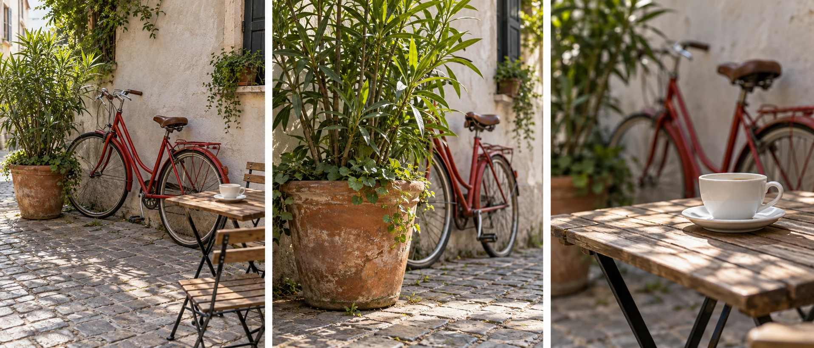

A bicycle leaning against a café wall is pleasant enough. Beside it, a plant spills from a
large terracotta pot. The bicycle's red paint echoes the pot, while its thin metal tubes
contrast with the unruly leaves. Suddenly the photograph can be about something more specific
than a bicycle or a plant. It can show two different ways of occupying this small corner.

Look for something happening between elements. A relationship might be visual, such as repeated
shapes, or suggestive, such as an empty chair beside a busy table. Include the elements that
make the connection readable and reduce details that compete with it. The subject is the
connection, so isolating either element can weaken the picture.

## Look between things

A useful mental model is a short sentence containing two nouns and a connecting word:
“the tree echoes the drawing,” “the person waits beneath the clock,” or “the little boat
contrasts with the cliff.” The sentence is a private aid to noticing. The final picture
need not have a literal caption explaining the connection.

Relationships give viewers something to compare. A repeated curve can join objects that are
otherwise unrelated. A difference in size can become legible because both objects are present.
A direction of gaze can connect a person to something outside their immediate surroundings.
The frame gathers those clues together. It also excludes whatever would complicate the reading,
which is why a convincing visual connection does not establish a fact about the wider world.

[[choose-your-subject|Choose Your Subject]] concerns the prior decision about what matters.
Here that decision is already a relationship. [[change-your-position|Change Your Position]]
helps you arrange the elements so the viewer can recognize it without your explanation.

## An echo across a street

Suppose a shop window contains a row of umbrellas, and a passerby carries a matching umbrella.
A very tight picture of the passerby loses the echo. A very wide picture includes so many
signs and vehicles that the umbrellas become incidental. You choose a frame large enough for
the window and the pavement, then wait for the moving umbrella to occupy a clear gap.

The result can feel humorous or quietly satisfying because two otherwise separate parts of
the scene share a shape. Exact matching is unnecessary. A near match may be more interesting
than a perfect duplicate. But a stranger's expression or appearance is not a prop you are
entitled to exploit. Respect requests to stop, consider local expectations, and avoid publishing
a juxtaposition that falsely implies something damaging about the person.

This example combines relationship with [[find-the-frame-then-wait|Find the Frame, Then Wait]].
The first pattern identifies the connection worth photographing; the second concerns holding
a composition while an event completes it. Neither requires following someone or directing them.

## Make contrast specific

In a garden, an old rough watering can sits next to a new glossy seed tray. “Old and new”
is an available interpretation, but the photograph needs visible evidence. Turn the can so
its worn handle catches side light, and leave the clean tray surface visible. If both are
tiny in a large shed scene, their surface contrast may disappear.

There is a tradeoff. A close view can make textures clear but remove the shared context of
gardening. A wider view can connect the objects through their use, even if their surfaces
matter less. The choice depends on whether the photograph concerns materials, time, or work.
Do not introduce artificial disorder and then describe the result as a discovery if the context
calls for an honest record. A deliberately arranged still life is also a valid photograph;
identify it as arranged when that distinction matters.

## A relationship can be a distance

At a family gathering, two people sit at opposite ends of a table while their hands reach
toward the same bowl. A frame including both gestures can express shared activity. Waiting
until the hands overlap may hide the relationship; photographing too early may leave only
two unrelated seated figures. The space between them is part of what the picture describes.

Alternatively, two people looking in different directions may create an image of divergence.
That reading belongs to the picture, not necessarily their relationship with each other. They
might simply have heard different sounds. Keep captions factual when presenting photographs
as documentation. [[tell-a-story-in-a-sequence|Tell a Story in a Sequence]] can supply context
that a single suggestive frame lacks.

## Avoid forcing a clever connection

This pattern helps in street scenes, travel, architecture, and familiar rooms where individual
objects seem ordinary. A phone works well because positioning and inclusion do much of the
work. When elements sit at different distances, check whether both remain recognizable. You
can consult [[choose-your-depth-of-field|Choose Your Depth of Field]] if one disappears into
blur, but equal sharpness is unnecessary when its outline already carries the connection.

Not every scene contains a worthwhile juxtaposition. A strained resemblance may require so
much explanation that it overwhelms the photograph. Too many simultaneous connections can
also become a puzzle without an emotional or visual center. Keep the strongest relationship
clear enough to discover, and allow other details to remain supporting material.

Finally, do not confuse a visual rhyme with a universal recipe for meaning. Color echoes
can make a pleasing picture without a deeper message. An unresolved distance can produce
uncertainty rather than a tidy story. The pattern is useful when it helps you notice what
two elements do together and make deliberate choices about preserving that interaction.
