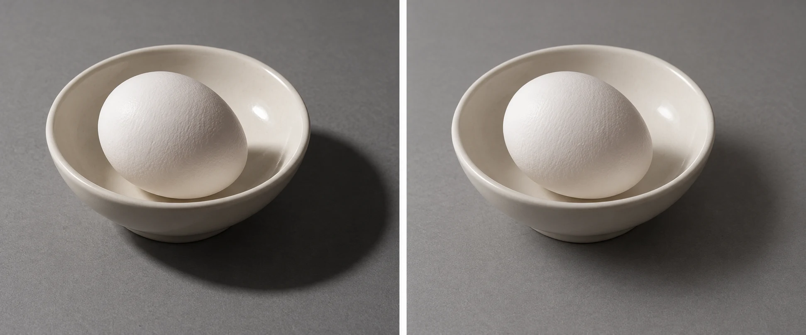

A friend's portrait in direct sunshine has a sharply defined nose shadow. Under an open
porch, with a broad area of sky lighting their face, the transition from light to shade
becomes gentler. The second location is not simply darker. The source occupies a different
amount of their view, and light reaches them from a broader range of directions.

Recognize soft light by gradual shadow transitions, then seek it when that appearance suits
the photograph. A broad nearby window, an overcast sky, or a large illuminated diffusion surface
can act as a soft source. Softness concerns how the light arrives at the subject, not
whether the photograph is bright, low in contrast, or emotionally gentle.

## Imagine the source from the subject's position

A useful mental model is the source as the subject sees it. A large nearby window can
fill a substantial part of that view. A small lamp across the room occupies a tiny angle.
Where some rays from a broad source are blocked, others can still reach the surface, producing
a gradual transition. A small apparent source produces a more abrupt boundary.

Distance matters as well as physical size. Move the same broad light farther away and it
appears smaller; move it closer and it appears larger. The sun is physically enormous but
very far away, so its apparent size is small enough to produce crisp shadows on clear days.
Clouds can turn a much larger area of sky into the effective source.

Softness is separate from contrast between lit and shaded sides. A large side window can
produce soft transitions while the room's unlit side remains dark. A small light plus a bright
reflecting wall can reduce shadow depth without making the main source larger. [[follow-the-light|Follow the Light]] separates direction from these other properties.

## A portrait near a window

Place a person near a broad window out of direct sun. The window may provide gradual facial
shading while maintaining a visible brighter side. If the person moves much farther into the
room, the window occupies a smaller angle and its light is weaker. Their shadow transitions
may become more defined, and the camera may need a longer exposure or higher ISO setting.

The exact result also depends on other light and reflections. Pale walls may fill shadows;
dark walls may leave them deep. A sheer curtain can help if a large area of it is actually
illuminated. A tiny translucent cap directly over a small flash does not automatically become
a large apparent source, especially at a distant subject. The size of the glowing area that
reaches the subject is what matters.

Keep the person's comfort central. Do not require them to stare into painful brightness or
hold an awkward position because the light looks attractive. A slight turn can preserve the
light while improving both expression and comfort. [[give-people-something-to-do|Give People Something to Do]] considers the interaction independently of illumination.

## Everyday objects and material detail

A small lamp makes a crisp shadow behind a bowl. That can clarify its outline and create
a graphic still life. A broad window gives a longer transition, which may make subtle ceramic
curves easier to see. Neither is the correct way to photograph a bowl. Choose whether the
picture concerns shape, texture, a bold shadow, or a quiet surface.

Soft light can also reduce the prominence of fine surface texture. That may suit a smooth
portrait or a pale flower, but hide the roughness of a carved stone. If the texture is
the subject, a smaller source or a more grazing direction can help. Do not treat reduced
visible texture as proof of a better photograph.

Glossy surfaces add another consideration. A large source can create a broad reflection. That
reflection may beautifully describe a curve or obscure an important label. Move the object,
source, or camera to inspect the effect rather than choosing softness alone.

## Outdoors, look for the effective source

Open shade can offer a broad patch of sky as a source. Near its edge, the light may
still have a clear direction; deep under an overhang, light may become weak or come mainly
from a smaller opening. A person standing under foliage can receive a mixture of broad sky
light and small patches of direct sun, producing inconsistent bright spots across the face.

Shade can also be bluer than direct sunlight, and nearby painted surfaces can reflect color.
White balance can change the rendering, but it cannot make several differently colored sources
identical. [[photography-foundations|Photography Foundations]] explains the terminology. Notice skin,
white objects, and background colors before assuming all shade behaves alike.

This pattern helps when hard shadow edges distract from expressions or subtle shapes. It
works with any camera because the effect exists before capture. Avoid confusing soft light
with a blurry image or with reducing contrast in editing. [[edit-to-guide-attention|Edit to Guide Attention]] can adjust tones afterward, but it cannot reconstruct all the physical
gradations and occlusions a different source would have produced.
