A shopfront, pale pavement, and dark doorway form an interesting arrangement. You make a picture,
but it feels incomplete. A pedestrian crossing the open pavement could give the architecture
scale and a point of attention. Instead of following every passerby with the camera, you
choose the frame and keep it while the street changes inside it.

Establish a composition whose fixed elements already work, then wait for an event that adds
something specific. It could be a person entering a gap, a wave reaching a rock, a shadow
crossing a wall, or a face turning within a stable portrait arrangement. The event completes
the relationship; the frame supplies its structure.

[Source and credit](https://commons.wikimedia.org/wiki/File:Video_Codec_Test_pedestrian_area_1080p25.y4m.webm)
· [CC0](https://creativecommons.org/publicdomain/zero/1.0/). Selected frames are shown in chronological order.

## Separate the structure from the event

Think of the photograph as having two parts: a frame you can prepare and an event you
cannot guarantee. Preparing the frame reduces the number of decisions you must make when
the event arrives. You can inspect backgrounds, edges, light, and likely focus distances
before deciding when to release the shutter.

The static-camera sequence makes one consequence visible. The storefront geometry remains
the same while people form different groupings and obscure different areas. An event is
not useful merely because someone appears. It matters where their outline, gesture, and
relationship to the fixed scene become readable.

[[work-the-scene|Work the Scene]] explores deliberate variations while shooting. Here you have
temporarily stopped varying the composition. [[anticipate-the-moment|Anticipate the Moment]]
uses behavior to prepare for a brief opportunity and may involve following a moving subject.
You can combine the approaches without confusing their different jobs.

## A gap in a street composition

Imagine a bright wall with a dark doorway and a clear stretch of pavement. A person walking
through the open area can become a distinct shape. At one instant they overlap the doorway
and disappear into its tone; a moment later they stand against the wall and become easier
to see. The difference can be small in time but large in the photograph.

Decide what the person should add. If their role is scale, an anonymous full outline may
be enough. If gesture is the subject, you need room for hands and limbs to separate. A
bright bag might become a welcome color accent or an unwanted competitor. Waiting is selective
observation, not a demand that any moving object improve the image.

Respect people and local expectations. Remain in a place where you can photograph without
blocking the way, stop if someone objects, and avoid a framing that falsely associates a
person with a sign or situation. [[find-a-relationship|Find a Relationship]] explains both
the power and the interpretive limits of juxtaposition.

## A wave inside a prepared landscape

At a safe coastal viewpoint, arrange a rock, a strip of water, and distant land. Inspect
the boundaries so the rock does not nearly touch an edge. Then keep the frame while waves
change the shape of the water around it. One interval may connect the foreground to the
distance with a curve of foam; another may obscure the rock entirely.

You can choose whether water appears distinct or blurred. A long exposure integrates an
interval rather than preserving one exact crest. [[freeze-or-show-motion|Freeze or Show Motion]]
explains that difference. Do not assume the largest splash is the most useful event: a
smaller movement may preserve the relationships better.

If conditions change enough that the fixed composition no longer works, re-evaluate it. Waiting
does not require loyalty to a frame that has lost its light or become unsafe. Leave room
for the scene to tell you that another arrangement is needed.

## A portrait within an agreed arrangement

A person sits comfortably near a window. You agree on the frame and continue talking while
watching for a pause or a glance. Keeping the arrangement steady can let you concentrate
on expression rather than repeatedly adjusting the camera. It can also become uncomfortable
if the person feels they must hold still indefinitely.

Explain what you are doing and offer breaks. A small natural movement may improve the
portrait; if it changes the focus distance substantially, update focus rather than preserving
a technically obsolete lock. [[focus-on-what-matters|Focus on What Matters]] and [[give-people-something-to-do|Give People Something to Do]] support the technical and collaborative parts of that process.

## Prepare what can be prepared

Check exposure while the scene is stable. If automatic brightness shifts dramatically as
dark or light people enter, an appropriate exposure lock or manual settings may keep the
rendering more consistent. Those are optional controls. A phone with ordinary automatic capture
can still use this pattern; inspect whether its focus and exposure follow your intended target.

This approach helps when fixed geometry interests you, when pursuing every subject produces
random backgrounds, or when a scene needs a specific relationship. It can fail through
indefinite waiting or wishful thinking. The event may never happen, and the empty composition
may already be complete. Choose a reasonable stopping point, retain the frame that serves
the purpose, and move on when waiting no longer produces useful observation. Patience has
value because it protects a deliberate composition, not because time spent guarantees a picture.
