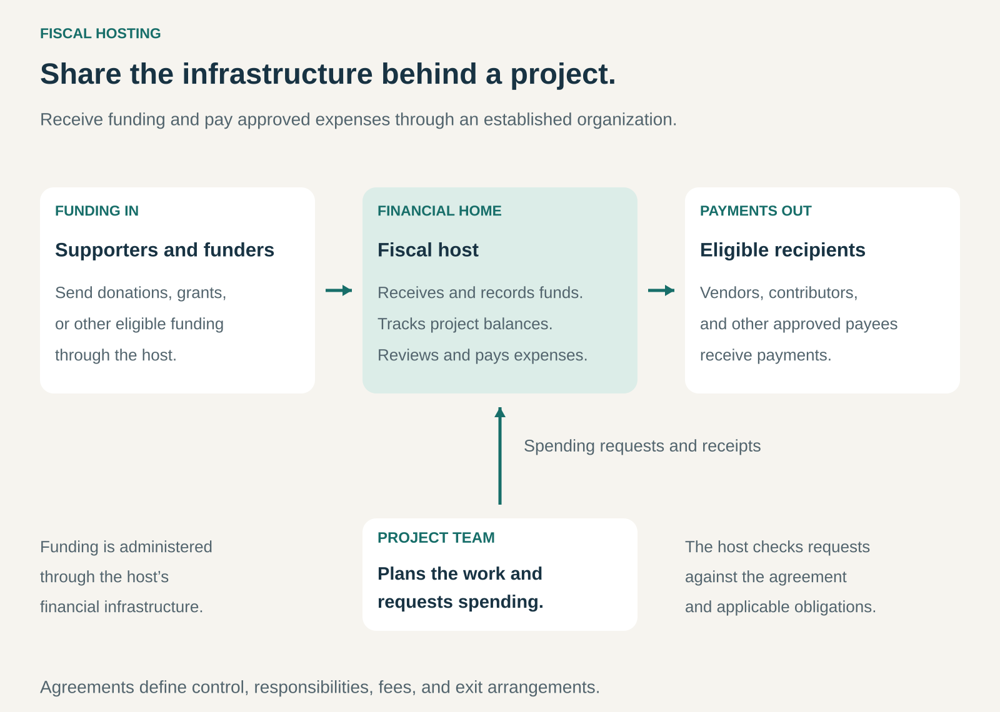

## What it is for

A community project wins funding, but has no organization able to receive it. An open-source team needs to pay contributors. A group wants to run events without asking one volunteer to manage everyone’s money through a personal account.

The work is ready to happen. The financial infrastructure is missing.

Fiscal Hosting lets a project receive and spend money through an established organization. The host provides agreed financial, administrative, and legal capabilities while the project concentrates on its activities.

It is useful when a group needs dependable organizational infrastructure but does not yet need—or want—to establish and maintain a separate entity.

## The core idea

**Share the infrastructure of an established organization across several projects.**

A fiscal host receives eligible funding, keeps project-level financial records, reviews expenditure, and makes approved payments.

The project supplies the purpose, people, and work. The host supplies the agreed organizational framework.

The arrangement is often described as _fiscal sponsorship_, although its legal structure and level of integration vary. Some projects operate within the host’s organization. Others remain independent and receive defined support through a sponsorship relationship.

The agreement determines the boundaries: which activities are covered, who approves spending, what the host can sign, how assets are treated, and how the relationship can end.

A host commonly charges a percentage of incoming funds, a fixed fee, activity-based charges, or a combination. Those payments support the people and systems needed to administer the service.

Open Collective describes the underlying mechanism as sharing the overhead of having a legal entity. Its platform supplies software used by fiscal hosts; the platform and the host are distinct roles. [Open Collective: fiscal hosting](https://opencollective.com/fiscal-hosting)

## How it works

**Establish a suitable relationship.** The host assesses whether the project fits its purpose, capabilities, and operating requirements. Both parties agree on services, responsibilities, fees, and decision-making.

**Receive funding through the host.** Donations, grants, sponsorship payments, or other permitted income enter the host’s financial infrastructure under the applicable arrangements.

**Maintain project-level records.** The host tracks the project’s receipts, expenditure, commitments, and available balance. Restrictions attached to particular funds must remain visible.

**Review spending requests.** Project representatives submit invoices, reimbursement claims, or other requests. The host checks them against the agreement, available funds, and applicable obligations.

**Make payments and maintain records.** The host pays eligible recipients and performs the agreed bookkeeping, reporting, and administrative work.

**Adapt or conclude the relationship.** A project might remain hosted, become a separate organization, move to another host, or close. Transfers and remaining assets follow the agreement and relevant restrictions.

Additional services can include contracts, payroll, insurance, or grant administration. Their availability depends on the host and the particular arrangement.

## Why it works

The first mechanism is shared overhead. Many projects need similar administrative capabilities, but each may be too small to maintain them economically.

The second is specialization. A host can develop expertise in payments, financial records, funding agreements, and the recurring problems of its chosen community.

The third is continuity. Project money and records can remain within an organizational system as volunteers or team members change.

Hosting can also make funding more practical. A funder has an established counterparty able to receive money, document its use, and handle agreed reporting. Individual grants still have their own eligibility requirements.

For the host, the model creates income tied to providing infrastructure and stewardship. For the project, it converts some organizational overhead into a service cost.

The relationship depends on a workable division of authority. Projects need room to pursue their purpose; hosts need enough oversight to fulfill their responsibilities.

## Famous examples

### Open Source Collective — infrastructure for projects such as webpack and Babel

Open Source Collective provides fiscal hosting for open-source communities, including webpack and Babel.

Its services include receiving funds, managing project balances, processing expenses, and handling agreed contracts and administrative responsibilities. It uses the Open Collective platform to support fundraising and transparent financial records.

The distinction between the two organizations matters: Open Source Collective is the fiscal host; Open Collective provides the software platform.

Open Source Collective is a US 501(c)(6) nonprofit rather than a 501(c)(3) charity. Its documentation explains that contributions are not charitable tax-deductible donations. The hosting model therefore supports collective financial activity without promising the same tax treatment as a charitable sponsor. [Open Source Collective: project services](https://oscollective.org/projects/), [Fiscal-hosting model and tax status](https://docs.oscollective.org/welcome-and-introduction-to-osc/what-is-fiscal-hosting)

### Software in the Public Interest — fiscal sponsorship for Debian

Software in the Public Interest, or SPI, acts as a fiscal sponsor for associated free and open-source projects, including Debian.

When a donor directs a contribution toward a project, SPI records it accordingly. A designated project liaison requests actions, and SPI reviews those requests against its purposes, obligations, available resources, and the project’s funds.

SPI explicitly states that associated projects remain independent. Association does not make SPI the owner or governing body of the project.

This example shows that fiscal sponsorship can provide defined financial support while preserving a project’s separate identity and governance. The host still exercises independent judgment over actions it undertakes. [SPI: Debian](https://www.spi-inc.org/projects/debian/), [SPI: relationship with associated projects](https://www.spi-inc.org/projects/relationship/)

### Hack Club’s HCB — sponsorship combined with financial tools

Hack Club’s HCB combines fiscal sponsorship through The Hack Foundation with software for receiving donations, paying expenses, tracking receipts, and managing spending.

It began by supporting teen-led clubs and hackathons and now serves a wider range of community projects.

Its model is more integrated than SPI’s independent-project relationship. HCB’s agreement establishes the project under The Hack Foundation’s nonprofit structure and defines a restricted fund for its activities.

The example demonstrates how hosting can combine organizational administration with practical, everyday tools. It also shows why the agreement matters: HCB specifies conditions concerning other registrations and the transfer of funds and assets when a project leaves. [HCB: fiscal sponsorship](https://hackclub.com/fiscal-sponsorship), [HCB: sponsorship agreement](https://help.hcb.hackclub.com/en/articles/15409924-what-is-the-fiscal-sponsorship-agreement)

## The economics

Consider a hypothetical host administering €2 million of annual funding across 100 projects.

Suppose it charges an 8% hosting fee and absorbs the service costs shown below.

| Annual item                                            |      Amount |
| ------------------------------------------------------ | ----------: |
| Hosting fees: €2 million × 8%                          |    €160,000 |
| Finance and project-support staff                      |    −€80,000 |
| Accounting and legal support                           |    −€30,000 |
| Platforms and payment processing                       |    −€20,000 |
| Insurance, onboarding, and review                      |    −€20,000 |
| **Surplus before other overhead and applicable taxes** | **€10,000** |

These figures are illustrative, not a typical fee schedule.

The €2 million describes project funding administered. It is not all unrestricted income available to run the hosting service.

The €160,000 fee income must cover the service’s actual workload. An additional €100 of support cost per project would consume the entire surplus.

Funding volume alone is therefore an imperfect pricing measure. One large, straightforward grant can require less work than hundreds of small payments, reimbursements, or transactions with complicated conditions.

For the project, the comparison is between the full hosting cost and the cost, effort, and responsibilities of maintaining an appropriate independent organization.

## Useful when

- **A project needs to transact before incorporating.** It has legitimate funding and expenses but lacks suitable infrastructure.
- **Several groups have similar administrative needs.** Shared systems can serve them efficiently.
- **Leadership changes regularly.** Organizational records and financial continuity matter.
- **Funders need an established counterparty.** The host can meet the particular funding arrangement’s requirements.
- **The mission fits the host.** Its purposes and capabilities support the proposed work.
- **The team accepts shared authority.** Spending and other actions follow agreed approval processes.

## Common mistakes and limits

**Treating the host as a bank account.** Hosting includes responsibilities and oversight. The host must be able to review or decline requests.

**Assuming every host provides charitable status.** Legal form and donor treatment vary. In the US, contributions to 501(c)(6) organizations are not deductible as charitable contributions. [IRS: 501(c)(6) contributions](https://www.irs.gov/charities-non-profits/other-non-profits/tax-treatment-of-donations-501c6-organizations)

**Assuming every obligation is covered.** Employment, insurance, contracts, taxes, and permitted activities require a defined service scope.

**Confusing a project balance with unrestricted spending authority.** Funding restrictions and existing commitments affect what can be paid.

**Underpricing administration.** A host that cannot sustain its staff, systems, and oversight puts every hosted project’s continuity at risk.

**Leaving exit arrangements unclear.** Records, intellectual property, contracts, and remaining funds may have different transfer conditions.

## Related patterns

- [[managed-service|Managed Service:]] The host takes responsibility for agreed administrative functions.
- [[shared-access|Shared Access:]] Several projects use common organizational capabilities.
- [[voluntary-support|Voluntary Support / Donations and Patronage:]] Hosting supplies infrastructure for receiving and administering support.
- [[open-source-with-paid-services|Open Source with Paid Services:]] Hosting can support the financial operations surrounding an open-source community, while remaining a distinct service.
