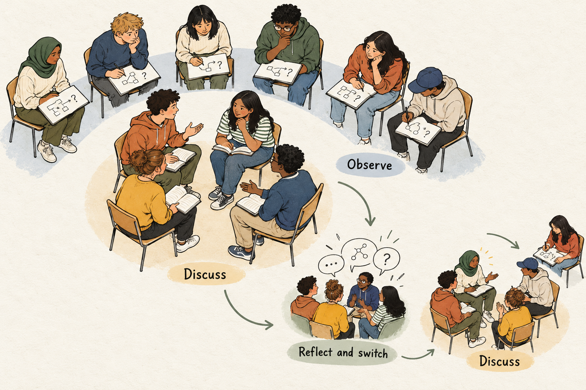

## Learn to discuss by observing how discussion works

A classroom discussion ends with several thoughtful contributions. Learners referred to the reading, offered interpretations, and disagreed politely. The teacher describes it as a good discussion.

Yet some important moments went unnoticed. A question changed the direction of the conversation. A claim was repeated without supporting evidence. One learner tried to clarify a disagreement, but nobody responded.

Learners participated in the discussion without examining how it developed.

Fishbowl Discussion makes that process available for study. A small group discusses a question while others observe with a specific focus. Participants and observers then reflect together, exchange roles, and use what they noticed to improve a subsequent conversation.

## Give speaking and observing different responsibilities

In a typical fishbowl, an inner group discusses while an outer group listens and takes notes. The arrangement can use concentric circles, a small group at the front, or an online space.

The inner group needs a worthwhile question, relevant preparation, and clear expectations. The observers need an equally purposeful task. They might trace how claims are supported, notice when speakers build on an earlier contribution, or identify questions that uncover assumptions.

[The University of Washington’s discussion guidance](https://teaching.washington.edu/engaging-students/active-learning/discussions/) recommends preparation for discussants, guiding questions for observers, and a debrief addressing learning and future improvements.

The arrangement separates two demanding activities: contributing to a conversation and examining its development. Both roles should remain connected to the subject being discussed.

## Observe moments, not personalities

“Watch the discussion” gives observers little direction. “Identify one moment when a question helped someone clarify an idea” gives them something to investigate.

Observation should focus on events that others can recognize. “There were three claims about the narrator, but only one was linked to a passage” offers evidence for reflection. “The group was bad at explaining” supplies a judgment without showing what happened.

A narrow focus is often more manageable than a long checklist. Different observers can examine evidence, connections between contributions, or the treatment of disagreement.

Speaking time can be worth noticing, but counting contributions tells only part of the story. A brief clarification may move the discussion further than a long speech. Silence also requires interpretation: an observer cannot infer someone’s understanding or motivation merely from their lack of speech.

## A classroom example: when contributions fail to connect

Imagine a literature class discussing a fictional short story told by a narrator who describes an argument with a friend. Learners have read the story and annotated passages relevant to the question:

*“How reliable is the narrator’s account of the argument?”*

Four learners form the inner group. Observers have two tasks: record how claims connect to textual evidence, and identify moments when a contribution receives a substantive response.

Owen argues that the narrator is unreliable because he sounds angry. Sana points out that the narrator describes a private conversation he apparently did not witness. Before she develops the point, another speaker offers a different example of the narrator’s anger.

The group accumulates observations, but Sana’s challenge remains unexplored.

Later, one learner asks Owen whether anger necessarily makes an account inaccurate. He pauses and qualifies his claim: anger might influence the narrator’s interpretation, but it does not establish that the events were invented.

During the debrief, an observer identifies that question as a turning point. Another notes that Sana’s observation received no follow-up.

The teacher invites the discussants to respond. Sana explains that she was unsure whether her point had been understood. Owen says the clarification question helped him distinguish emotional tone from factual accuracy.

The class identifies a practical intention for the next round: before adding another example, examine one claim already on the table.

A new inner group continues the inquiry. A learner returns to Sana’s passage and asks whether the narrator could have learned about the private conversation afterward. Others search the text for clues.

The second discussion develops an unresolved issue from the first. Observation has supplied something specific to act on.

## Turn reflection into another attempt

A debrief should connect what happened, what it meant, and what participants might try next.

Begin with recognizable moments. Invite discussants to explain their experience before observers’ interpretations harden into conclusions. Then identify a manageable change: ask for clarification, connect a contribution to an earlier claim, or examine evidence before introducing another example.

[Facing History’s fishbowl guidance](https://www.facinghistory.org/resource-library/fishbowl) emphasizes explicit expectations and reflection on both listening and participation.

A subsequent attempt matters because recognizing a useful discussion move is different from being able to use it. Role exchanges let learners test what they observed. Several short fishbowls across lessons may provide more opportunities for that exchange than one extended performance.

## What the evidence suggests

The structure offers plausible learning opportunities: observers can examine interactions without simultaneously preparing to speak, and discussants can receive feedback about moments they overlooked. These opportunities depend on the task and facilitation.

A 2025 study involved 72 Taiwanese university learners of English in two classes. Both received explicit discussion-skills instruction; one used an adapted small-group fishbowl format. In the final comparison, the fishbowl class used more paraphrasing, while the regular-discussion class more frequently built on peers’ ideas. [Tsai, 2025](https://www.tandfonline.com/doi/full/10.1080/2331186X.2025.2516389)

The study involved a particular language-learning context, two classes, and a package of instruction and practice. It does not establish that observing a fishbowl alone improves discussion, or that one format develops every discussion skill better.

## Adapt the format to the learning goal

Fishbowls suit tasks where both subject understanding and conversational practice deserve attention: examining interpretations, evaluating arguments, or investigating a shared problem.

Learners need sufficient preparation to contribute. Provide the question and materials beforehand where appropriate. Brief writing or pair discussion can help them enter with an idea.

The whole class need not watch one group. Several small fishbowls can run simultaneously, with roles rotating. Online, observers can examine a live discussion or an appropriately shared recording or transcript. Written discussion threads can also support analysis of how contributions connect.

Choose arrangements that allow learners to hear, see, and follow the exchange. The physical circle is a means of organizing attention.

## Avoid turning the fishbowl into a performance test

Being watched can inhibit discussion. Explain the observation focus in advance, model constructive feedback, and keep attention on shared learning goals. Avoid rewarding polished speech as though it established sound reasoning.

Observers can become passive when their task is vague or the discussion runs too long. Discussants can become overly cautious if every hesitation feels assessable. The teacher should monitor both conditions and intervene when necessary.

**[[think-pair-share|Think–Pair–Share]]** supports preparation before discussion. **[[think-aloud-pair-problem-solving|Think-Aloud Pair Problem Solving]]** gives a listener responsibility for examining one solver’s reasoning. **[[structured-academic-controversy|Structured Academic Controversy]]** organizes listening across competing positions.

Fishbowl Discussion creates a wider view of interaction. Its most useful outcome is a change learners can identify in their next conversation: a question followed through, an assumption examined, or an earlier contribution finally developed.
