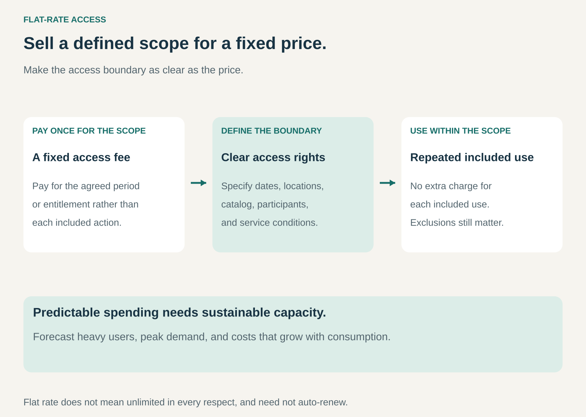

## What it is for

A customer wants to watch films, visit a gym, or travel without reconsidering the price of every included use. A provider wants to sell access to an established resource or service while making the buying decision simpler.

Flat-Rate Access provides a defined scope for a fixed charge. Within that scope, the price does not increase with each additional included use.

The pattern is useful when predictable spending and freedom to use the offering are valuable, and the provider can support the resulting demand.

## The core idea

**Sell an agreed access boundary instead of charging separately for every included action.**

The boundary might concern a period, location, catalog, group of participants, or class of service. A monthly film plan and a travel pass can both express the pattern, even though one renews and the other may expire without renewal.

Flat rate does not mean unlimited in every respect. Concurrent users, opening hours, eligible routes, reservation requirements, and exclusions can still matter. A customer should be able to understand exactly what the fixed price covers.

## How it works

Define the scope of access and the price. Explain the applicable dates, locations, service levels, capacity rules, and additional charges. The customer purchases that entitlement and uses the included service within those conditions.

The provider forecasts demand across the customer population. Some people use the offering lightly, others heavily. The provider must support the combined workload while covering content, staff, facilities, maintenance, infrastructure, or other costs.

Capacity deserves particular attention. A digital service may have relatively low costs for another ordinary use, but a physical facility can become crowded. Even digital services have infrastructure, rights, and abuse constraints. A flat price transfers billing uncertainty; it does not remove operating limits.

A fair-use rule needs enough clarity to preserve the promise. A plan that silently adds a charge after routine consumption creates a different customer experience from one that genuinely includes that consumption.

## Why it works

A fixed price helps customers budget. Once they have purchased access, the marginal price of another included use is zero, which can make exploration and regular participation easier.

The provider receives payment for making access available, including from people who use the service infrequently. Shared facilities, reusable content, and pooled demand can make this workable when the overall usage distribution fits the price.

The business should still provide value to light users. Building the model around confusion, forgotten renewals, or obstacles to cancellation can undermine trust and retention.

Flat rates also attract people who expect to use the service heavily. Forecasts based only on average consumption before introducing the plan can therefore be misleading. The offer itself changes who buys and how much they consume.

## Famous examples

### Netflix — viewing within a plan

Netflix's Standard and Premium plans describe unlimited ad-free movies, television shows, and games within the service's availability and account rules. Customers do not buy a separate ticket for every included program they watch.

The plans still distinguish concurrent devices and other entitlements. The example is the fixed-price viewing scope, rather than a claim that every title, location, or account-sharing arrangement is included. Monthly renewal is a separate subscription feature. [Netflix plans](https://help.netflix.com/en/node/24926)

### PureGym — repeat visits within membership rights

PureGym's UK membership structure includes plans with different access hours and other benefits. Customers purchase membership access rather than paying a new admission charge for every ordinary included visit.

The access boundary matters: off-peak and broader access plans differ, locations have their own prices and conditions, and personal training or other extras can have separate charges. The example shows how a flat-rate core can coexist with tiering and add-ons. [PureGym membership options](https://www.puregym.com/membership-options/)

### Eurail — rail access within a pass

The Eurail Global Pass offers travel across participating rail networks, with options based on defined travel days or continuous validity. The traveler buys a specified access entitlement instead of buying an ordinary separate fare for every covered journey.

The pass does not erase every trip cost or constraint. Some trains require reservations and additional fees, and the chosen pass determines valid travel days. It illustrates why an access boundary must be explained alongside the fixed price. [Eurail Global Pass](https://www.eurail.com/en/eurail-passes/global-pass)

## The economics

Consider a fictional facility with 100 members paying $30 monthly. Revenue is $3,000. Assume 150 monthly visits cost an additional $2 each to serve, producing $300 of visit-related costs. With $2,500 of monthly fixed operating costs, $200 remains before other overhead and tax.

If the same members make 600 visits, the assumed visit-related costs rise to $1,200. Revenue remains $3,000, leaving a $700 shortfall after the same fixed costs.

The example assumes a simple per-visit cost. Real facilities can encounter additional staffing or capacity costs at particular demand levels. Heavy use also matters when it concentrates at peak times, even if monthly totals appear manageable.

Price, customer mix, visit frequency, and the scope of access must therefore be considered together. A larger membership base can improve cost sharing and create congestion at the same time.

## Useful when

- Customers value predictable expenditure and repeated access.
- The included scope can be stated clearly.
- Expected use and peak demand fit the provider's resources.
- Shared or reusable assets make pooled access economical.
- The provider can monitor service quality without making ordinary use unnecessarily restrictive.

## Common mistakes and limits

Do not confuse a flat fee with an all-inclusive promise. An inexpensive pass can become costly if the customer's typical journey requires many extras. Material exclusions belong where buyers can understand them before purchasing.

Average usage can conceal heavy users, peak demand, and changes caused by the new offer. A successful plan can increase consumption enough to require more capacity.

The pattern fits less well when each additional use creates substantial bespoke work or unpredictable external costs. A defined allowance, metered charge, or mixed arrangement may be more sustainable.

Finally, recurring payment and flat-rate access are independent choices. A subscription can bill for measured use, while a nonrenewing pass can provide flat-rate access.

## Related patterns

[[subscription|Subscription]] determines recurring payment. [[membership|Membership]] adds participation or privileges. [[shared-access|Shared Access]] concerns common resources used by several customers. [[pay-per-use|Pay per Use]] makes the bill respond to each measured unit instead.
