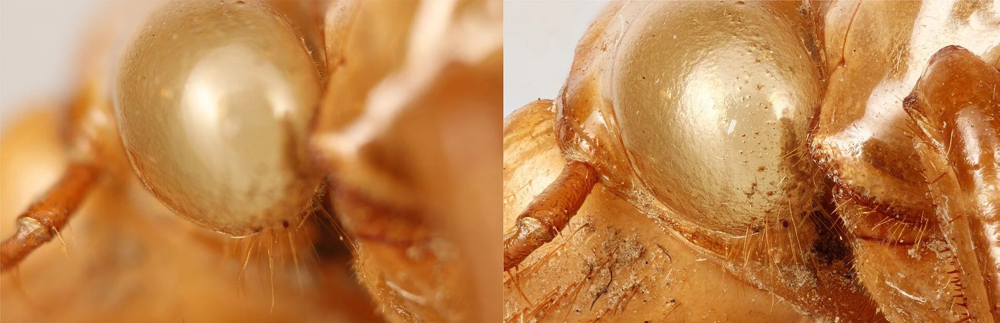
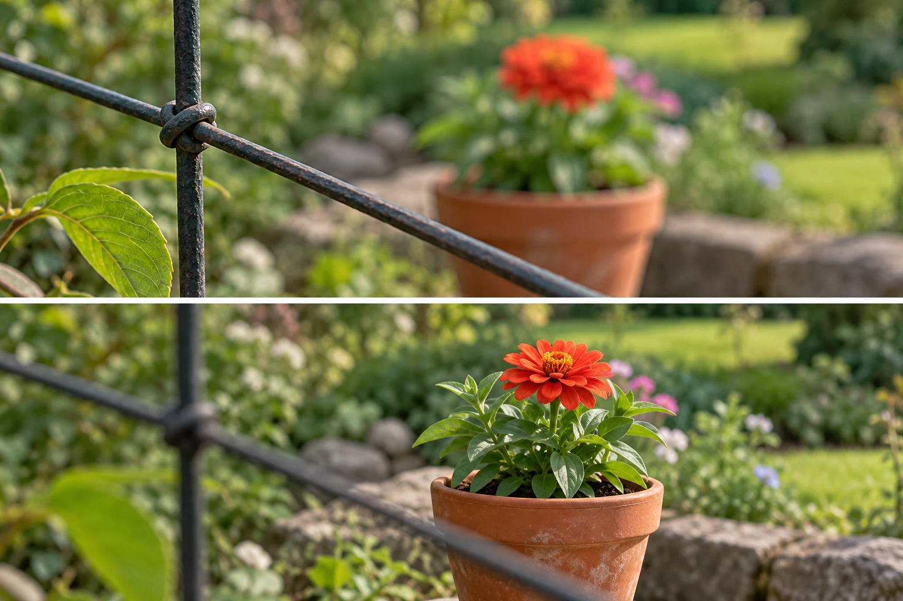

Your friend's face looks soft, but the hedge behind them is beautifully detailed. The camera
did achieve focus. It achieved focus at the wrong distance for your intention. Increasing
sharpness in editing will not make that choice equivalent to having focused on the face.

Choose where focus belongs before assuming the camera will infer it. On a phone, that often
means tapping the intended subject. On a camera, it may mean moving an autofocus area, selecting
a detected face or eye, or using manual focus when appropriate. Confirm that the chosen
target remains the one you want as the scene changes.

[Source and attribution](https://commons.wikimedia.org/wiki/File:Focus_stack_focus_comparison.jpg)
· [CC BY-SA 3.0](https://creativecommons.org/licenses/by-sa/3.0/). Resized and converted to WebP.

## Place the sharp region deliberately

Think of focus as choosing a distance where the lens forms its sharpest image. Surrounding
distances may also appear acceptably sharp, depending on depth of field and viewing conditions.
The focus target and the width of that acceptable range are different decisions. [[choose-your-depth-of-field|Choose Your Depth of Field]] concerns the range; this pattern concerns where you place it.

Autofocus evaluates available signals and the mode you have selected. Strong edges, nearby
objects, a detectable face, or movement can influence its choice. It does not understand
your story reliably. A hedge may present clearer contrast than a shaded face, and a camera
looking through a fence may select the fence unless you direct it otherwise.

Focus also differs from general visual emphasis. A sharply focused subject can still disappear
against a similarly detailed background. [[separate-subject-and-background|Separate Subject and Background]] deals with that distinction. Conversely, an intentionally soft figure can be
the main subject through shape, placement, and light. Sharpness is a tool serving intention,
not a required ranking of importance for every photograph.

## A portrait with two people

Two friends stand at different distances from the camera. You select the nearer person's eye
because their expression is the main subject. If the farther person is only context, a
softer rendering may be appropriate. If the relationship depends on both expressions, focusing
correctly on one does not solve the whole problem. You may need more depth of field, a
different position, or to bring them closer to the same distance.

On many phones, tapping a face sets a focus target and influences exposure at the same time.
Some allow a press-and-hold lock; others handle tracking differently. Watch the actual focus
indicator and check your device's controls. Do not assume a tap remains locked indefinitely
or that selecting an eye guarantees a sharp result if the person moves immediately afterward.

With an interchangeable-lens camera, eye detection can be useful, but check which person's
eye is selected. A small selectable focus area can be more predictable when detection switches
between people. The convenient mode is the one that stays aligned with your subject, not
necessarily the most automated or the most manual option.

## Photograph through an obstruction

At a garden fence, you want a flower beyond the wire. A broad autofocus area repeatedly
chooses the nearer wire. Place a smaller focus area over a visible flower detail, move
to a gap if possible, or use manual focus when the camera supports it. Keep the composition
and exposure useful while you do so.

Moving closer can sometimes make a foreground wire less conspicuous, but respect barriers
and access restrictions. Never reach into unsafe areas for a clearer view. You can also
choose an image about the barrier rather than pretending it is absent. The focus choice
will then express a different intention.

Very close objects create another limit: the lens may not focus as near as you are holding
it. A phone may switch cameras or enter a macro mode, changing the view. Backing away
slightly can be more effective than repeatedly tapping. [[photography-foundations|Photography Foundations]]
explains minimum focusing distance and computational phone behavior in plain terms.

## Match the focus behavior to movement

A stationary cup usually does not require continuous tracking. A child approaching the camera
may move out of a previously selected distance almost immediately. Many cameras distinguish
single autofocus, which acquires and then holds focus, from continuous autofocus, which keeps
updating while activated. Names and controls differ by model.

If you focus and then turn the camera substantially to recompose at a close distance, the
important detail can leave the narrow sharp region. Moving the focus area to its final
position avoids some of that uncertainty. With moving subjects, also check shutter speed:
correct focus does not prevent motion blur. [[freeze-or-show-motion|Freeze or Show Motion]]
helps diagnose that separate cause of softness.

## Check the result that matters

This pattern helps when backgrounds are sharper than faces, the camera selects obstructions,
or a series has inconsistent sharpness. Inspect an important eye, lettering, or surface at
enough magnification to judge the intended use. A screen-sized family picture may be adequate
even when a large print would reveal limits.

Avoid chasing perfect detail at the expense of gesture and comfort. A slightly imperfect
but meaningful expression may serve the photograph better than a technically pristine empty
moment. [[select-the-strongest-frame|Select the Strongest Frame]] considers that tradeoff. The
purpose of deliberate focus is to avoid unintended targets while keeping sharpness in its
proper role among the other choices that make a photograph work.
