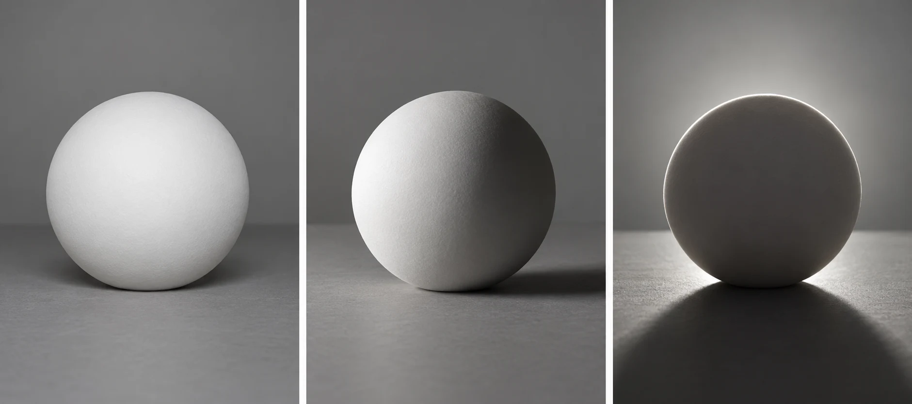

You photograph a pale bowl on a table. From one side it looks almost flat. Moving around
the table reveals a bright rim, a shaded interior, and a shadow that gives the bowl shape.
The object is unchanged. You have changed the relationship between the camera and the light
already falling on it.

Before changing exposure, notice the direction of illumination. Look at the lit surfaces, the
shaded surfaces, and the cast shadows. Then choose a camera position, subject orientation, or
location that makes those relationships useful. Light is not just the quantity available to
the camera. Its direction helps describe shape, texture, and atmosphere.

## Read surfaces and shadows

Think of light as revealing some surfaces more directly than others. With front light, the
camera sees much of the illuminated side. With side light, it sees a transition between
lit and shaded surfaces. With backlight, the visible front may be dark while edges or translucent
materials receive light from behind. These are positions on a continuum, not three fixed recipes.

A cast shadow offers another clue. It extends away from the source across whatever surface
receives it. The softness of its boundary is a different property from its direction. A
large nearby window and a small distant lamp can illuminate from the same side while producing
different shadow transitions. [[find-soft-light|Find Soft Light]] develops that distinction.

Brightness, contrast, direction, and color also vary independently. A dim light can cast a
hard-edged shadow. A bright overcast sky can give soft illumination. Do not call every difficult
exposure “harsh light” when the actual problem is a bright background or a mixture of colors.
[[photography-foundations|Photography Foundations]] explains exposure and white balance separately.

## A portrait beside a window

Suppose a friend sits facing a broad window while you photograph from between them and the
window. Their face may be evenly lit, with small visible shadows. That can suit a direct,
open portrait. If they turn partly sideways, one cheek becomes brighter and the other more
shaded. The gradient can make facial shape more apparent.

Turn too far and an eye may fall into deep shade. That is not automatically wrong, but
it changes what remains readable. Discuss the person's preferences and comfort rather than
assuming a more dramatic pattern is always flattering. Moving slightly back toward the window
or using light reflected from a pale wall can soften the contrast without changing the
portrait into something else.

On a phone, the preview may lift the shaded side automatically. A camera's processed preview
may also differ from the eventual raw development. Judge the actual result, including the
expression, rather than only the live screen. [[expose-for-what-matters|Expose for What Matters]]
helps when preserving one part of the face requires a brightness compromise elsewhere.

## Let texture appear when it matters

A weathered wooden door can look smooth under light near the camera axis. Light arriving
across its surface creates small shadows in grooves and around raised grain. Photographing
at a different time, or moving a portable light sideways, can make that texture visible.

For a glossy object, the reflection of the source may matter more than the cast shadow.
Moving the camera can shift a bright reflection away from an important marking, or deliberately
place it along a curve to describe the surface. A reflection is not necessarily an error.
The question is whether it reveals useful shape or obscures what you need to show.

This example also illustrates a limit: changing camera position does not change the illumination
of a fixed door. It changes which lit surfaces and reflections the camera sees. To change
where shadows fall, change the light, subject orientation, or time. Keep those causes separate
when learning from your photographs.

## A landscape across the day

At a viewpoint, low side light may make ridges visible through alternating light and shade.
With the sun behind you, the same hills may look clearer in color but less strongly modeled.
Backlight through haze can make distant layers pale and atmospheric. The preferred relationship
depends on whether you care about rock texture, local color, silhouettes, or distance.

You cannot move the sun, but you can choose a different direction to photograph, wait for
clouds, or return later. [[return-to-the-same-place|Return to the Same Place]] helps develop
that understanding. Do not assume a particular clock time guarantees the same result: season,
terrain, weather, and the direction you face all matter.

## Start with observation

This pattern helps whenever an interesting subject looks flat, texture seems missing, or a
portrait's light feels accidental. It requires no manual mode. A small rotation of an object
or a different place to stand can be enough. [[use-backlight|Use Backlight]] develops one
particular direction when transmission, outlines, or silhouettes serve the picture.

Avoid moving so quickly toward a familiar lighting formula that you stop seeing the actual
scene. Front light can be expressive; side light can be distracting; backlight can conceal
important detail. The useful habit is reading what the light reveals, then choosing the
relationship that makes your subject understandable in the way you intend.
