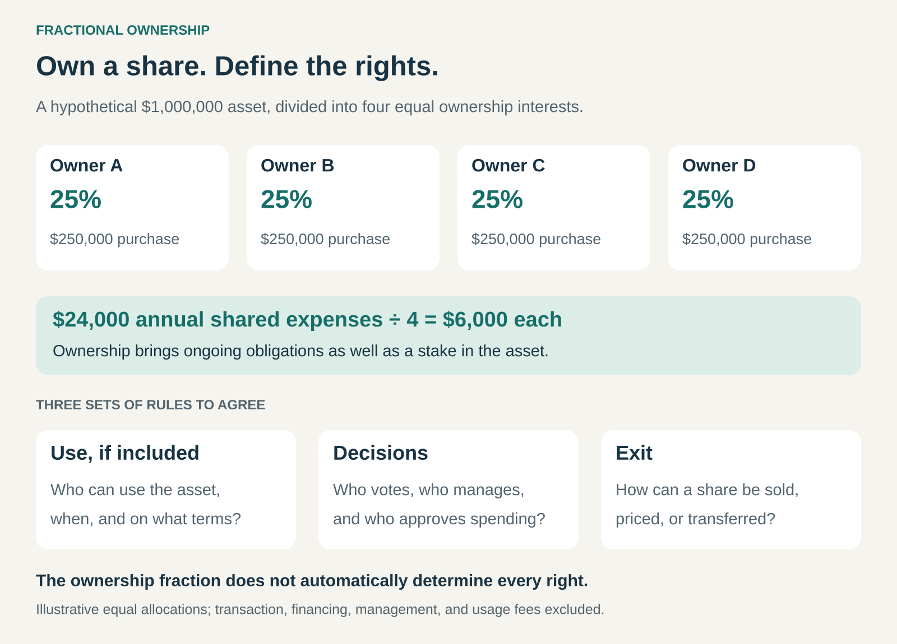

## What it is for

Let several customers own an interest in an asset that would be expensive, underused, or impractical for each to own alone. Fractional Ownership combines a smaller ownership commitment with shared costs, defined rights, and an arrangement for managing the whole asset.

A family wants a second home for part of the year. A business needs private aircraft capacity but cannot justify owning an entire jet. An investor wants economic exposure to an artwork without purchasing the whole piece.

In each case, the asset can remain intact while ownership interests are divided.

The customer acquires a defined stake in the asset—or in an entity that holds it. What that stake provides depends on the accompanying agreements.

## The core idea

Divide ownership without physically dividing the asset.

The arrangement commonly combines three elements:

- **An ownership interest:** a direct share in an asset or an interest in an asset-holding entity.
- **A set of rights and obligations:** covering costs, decisions, use where applicable, and transfers.
- **A management structure:** responsible for operations, maintenance, administration, or eventual sale.

Two forms are especially useful to distinguish.

**Ownership for use** combines an ownership stake with access to an asset or managed fleet. Aircraft and second homes are familiar examples.

**Ownership for economic participation** provides an interest in the asset’s financial outcome without necessarily providing personal use. Fractional interests connected to artworks illustrate this form.

The ownership percentage alone does not explain the complete offer. Usage, voting power, fees, and exit conditions need separate definition.

## How the arrangement works

In this simplified example, four owners each contribute $250,000 toward a $1,000,000 asset. Each holds a 25% interest.

Annual shared expenses of $24,000 are allocated equally, producing a $6,000 obligation per owner before the additional fees excluded from the illustration.

The arithmetic is straightforward. The coordination requires more design.

If the asset is a holiday home, who receives the most popular weeks? Who approves a substantial renovation? What happens if an owner does not pay their contribution? How can someone sell their interest?

Those rules turn a collection of owners into a workable ownership arrangement.

## Why it works

Fractional Ownership reduces the scale of an individual commitment.

Customers can participate in ownership without acquiring an entire asset. In use-focused arrangements, they can also avoid paying alone for capacity they rarely need.

Professional management can make the arrangement more practical. A specialist handles tasks that would otherwise fall to a group of owners: scheduling, maintenance, administration, and coordination.

For the operator, the opportunity is to assemble demand, structure the ownership, and provide continuing management. Its revenue may come from arranging sales, management services, usage charges, or other disclosed fees.

The tradeoff is shared control. Owners gain a stake while accepting constraints that make collective ownership possible.

The model works best when the rights are understandable and the interests of owners and managers remain reasonably aligned.

## Famous examples

### NetJets: ownership combined with managed aviation

NetJets offers an asset-ownership version of its Share program alongside a leasing alternative. Ownership involves an initial capital investment. Its pricing explanation also identifies continuing management charges and flight-related charges. [NetJets’ Share program](https://www.netjets.com/en-us/private-jet-share-program), [NetJets’ cost components](https://www.netjets.com/en-us/private-jet-cost-pricing).

The customer combines an ownership interest with a managed aviation service rather than independently purchasing, staffing, and operating a whole aircraft.

This also demonstrates why the ownership purchase is only one part of the economics. Keeping aircraft available and operating flights requires continuing expenditure.

The distinction between the ownership and leasing versions matters: similar travel benefits can sit on different underlying financial arrangements.

### Pacaso: ownership through a property-specific company

Pacaso’s model lets customers purchase interests in a property-specific limited liability company. The LLC holds title to the home, while owners hold interests in that company.

Pacaso manages the property and provides a scheduling system. Its owner guidance describes voting by share and operating budgets that can require adjustments or additional assessments. [Pacaso’s ownership structure](https://www.pacaso.com/faq/owner), [Pacaso’s scheduling explanation](https://www.pacaso.com/faq).

The arrangement combines an economic stake in a particular property with defined opportunities to stay there.

Owners do not individually control the entire home. Scheduling and collective decisions remain necessary, and professional management does not make operating costs disappear.

The example shows how the ownership structure, booking system, and management service work together.

### Masterworks: economic participation in an artwork

Masterworks offers artwork-related investments through company shares. For example, the SEC-filed annual report for Masterworks 263 describes a company formed to finance an individual Shara Hughes painting, maintain it, and hold it for a future sale. [Masterworks 263’s annual report](https://www.sec.gov/Archives/edgar/data/1971649/000149315226020555/partii.htm).

Investors hold shares in an entity connected to the artwork rather than physically dividing the painting.

This illustrates the economic-participation version of the pattern. The proposition concerns the financial outcome of holding and selling an asset, rather than allocating personal-use periods.

Management authority, fees, ownership structure, and sale arrangements therefore become central parts of what the customer receives.

## The economics

A smaller ownership fraction reduces the capital required compared with owning the whole asset. It does not establish that the arrangement is inexpensive or financially attractive.

For use-focused ownership, costs can include the share purchase, financing, management, fixed operating expenses, usage charges, and contributions toward major repairs.

The meaningful comparison considers the benefit actually received. A share can be poorly matched to a customer who rarely uses their allocation or cannot obtain suitable dates.

For economic-participation arrangements, the result depends on the asset’s eventual value, holding costs, fees, and the terms governing distributions.

In either form, the resale price of a fractional interest need not equal a simple percentage of the whole asset’s estimated value. Restrictions, obligations, buyer demand, and the difficulty of selling can affect it.

An ownership stake can lose value. The ability to offer it for sale does not guarantee a willing buyer.

## Useful when

This pattern is especially useful when:

- **The whole asset requires a substantial commitment:** dividing ownership makes participation practical.
- **Customers want an ownership stake:** access alone does not meet their objective.
- **Shared management adds value:** specialists can handle operations more effectively than informal coordination.
- **Rights can be allocated clearly:** use, decisions, expenses, and transfers have workable rules.
- **Owners can accept a continuing commitment:** the arrangement does not depend on immediate, effortless resale.

For use-focused models, it also helps when customers’ needs can be accommodated without everyone requiring the asset simultaneously.

It becomes harder when owners want unrestricted control, disagree about major expenditure, or need a quick exit.

## Common mistakes and limits

**Confusing ownership with unlimited access.** A substantial stake can still come with booking limits, notice requirements, and restricted availability.

**Assuming every owner has equivalent control.** Economic interests, voting rights, and management powers may be allocated differently.

**Underbudgeting continuing costs.** Repairs, reserves, operating expenses, and management charges can materially change the total commitment.

**Treating fractional interests as readily liquid.** Transfers may require approvals, contractual procedures, or a suitable buyer.

**Relying on marketing labels.** “Fractional,” “club,” and “timeshare” do not fully describe the rights acquired. Some timeshares confer deeded ownership; others provide contractual usage rights. The underlying documents determine the arrangement. [FTC explanation of timeshare structures](https://consumer.ftc.gov/articles/timeshares-vacation-clubs-and-related-scams).

**Leaving conflict and default unresolved.** A workable structure needs rules for unpaid contributions, major decisions, manager replacement, and eventual disposal of the asset.

## Related patterns

- [[access-over-ownership|Access over Ownership:]] provides usage rights without requiring an ownership stake. Fractional Ownership adds an asset-related interest and its obligations.
- [[leasing|Leasing:]] provides use through a contractual commitment. An ownership interest is a different component, even when both options appear within one program.
- [[outright-sale|Outright Sale:]] can transfer a fractional interest as well as an entire asset; Fractional Ownership adds the continuing shared arrangement.
- [[solution-provider|Solution Provider:]] can bundle ownership administration, scheduling, maintenance, and support around the customer’s intended benefit.
