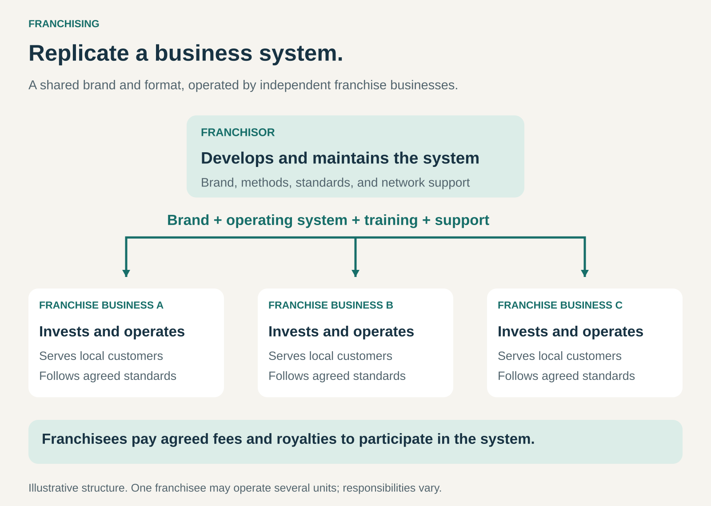

## What it is for

Expanding a repeatable business through independent operators who invest in and run businesses using a shared brand and operating system.

A successful restaurant may have more than a popular menu. It may also have reliable purchasing, staff training, kitchen routines, marketing, and a recognizable customer experience.

Franchising makes that broader system available to other business owners.

The franchisor develops and supports the format. Franchisees contribute investment, management, and local execution. Customers encounter a common brand across businesses with different owners.

## The core idea

**Replicate a business system through independent operators, and earn from their participation in that system.**

The **franchisor** provides rights to use the brand and business format, together with agreed support and standards.

The **franchisee** operates a business within that framework, bears its operating risks, and pays agreed fees.

This article focuses on **business-format franchising**: the transfer of a way of running a business, including methods, training, systems, and brand standards.

Compared with licensing a particular asset, the commercial package is broader. The franchisee adopts an operating framework that shapes how the business serves customers. The precise legal classification depends on the arrangement and jurisdiction.

Independence and consistency coexist. Franchisees own their businesses, but their freedom to change products, suppliers, presentation, or operating methods may be constrained by the franchise agreement. [FTC: how franchise arrangements work](https://www.ftc.gov/business-guidance/resources/consumers-guide-buying-franchise)

## How it works

The pattern connects four elements.

**A transferable operating system.** The business needs methods that other people can learn and reproduce. These might cover site selection, service delivery, purchasing, staffing, technology, quality control, and marketing.

**A local operating business.** The franchisee invests in establishing or acquiring an operation and manages it within the agreed framework. One franchisee may operate a single unit; another may own several.

**Ongoing support and oversight.** The franchisor maintains the brand and system, trains operators, introduces improvements, and monitors standards. The scope of support varies.

**Payments for participation.** These may include an initial franchise fee, continuing royalties, marketing contributions, technology charges, or other agreed payments. Some systems also involve property rental or product supply.

The allocation of investment varies too. A franchisee may fund equipment and fit-out while the franchisor controls the premises. In another system, the franchisee may arrange the property as well.

Franchising therefore distributes responsibilities across a network. It does not eliminate the work or cost of expansion.

## Why it works

The model combines shared capabilities with local ownership.

A common brand can help customers recognize the offer. Standard methods can reduce the need for every operator to develop purchasing, training, and service processes independently.

Franchisees bring capital and direct attention to local operations. Their financial interest can encourage careful management of staffing, service, and costs.

The franchisor can expand without directly financing and managing every outlet. In return, it takes on the task of supporting and governing a network of independent businesses.

That creates a central tension: customers expect consistency, while operators face different locations, costs, competitors, and customer preferences.

A strong system standardizes what makes the offer reliable while allowing appropriate local adaptation.

## Famous examples

### McDonald’s: a restaurant system with distinct ownership and operating roles

McDonald’s describes conventional franchise arrangements that combine rights to operate using its system with, in most cases, access to a restaurant facility. Conventional franchisees pay initial fees, royalties, and rent; they also reinvest capital in their businesses over time. [McDonald’s 2025 annual report](https://www.sec.gov/Archives/edgar/data/63908/000006390826000035/mcd-20251231.htm)

The example shows that franchising can combine several commercial relationships. The brand owner may also have a substantial property role, while the franchisee operates the restaurant.

It also illustrates why “franchised” does not mean the franchisor has no capital invested. McDonald’s retains significant responsibilities and assets, and its arrangements differ across markets.

### Marriott: hotel ownership can be separate from brand participation

Marriott’s hotel franchising arrangements allow owners to use its lodging brands and systems. Its annual report describes initial application fees, continuing royalties, and reimbursement for centralized programs such as reservations, marketing, and loyalty services. [Marriott’s description of its hotel arrangements](https://marriott.gcs-web.com/static-files/b82978a6-9d28-4e38-9855-fc4ae2cebe11)

A franchised hotel can combine a locally owned property and operating business with a recognized brand and shared commercial infrastructure.

Marriott also operates hotels under management agreements. Those arrangements are different: franchising and hotel management are separate ways of organizing the relationship.

The name above a hotel therefore does not, by itself, establish who owns or manages it.

### The UPS Store: a local service business supported by a network

The UPS Store states that its franchised locations are independently owned and operated. Its franchise training includes online learning, in-store experience, and business instruction covering areas such as operations, marketing, sales, and financial management. [The UPS Store ownership structure](https://www.theupsstorefranchise.com/about-us), [franchise training](https://www.theupsstorefranchise.com/how-it-works/franchise-training)

This demonstrates franchising beyond restaurants and hotels.

The local operator runs the business and employs its staff, while the network supplies a recognizable format and training infrastructure. Customers encounter a familiar service proposition through a separately owned local enterprise.

## The economics

Consider a hypothetical franchise outlet with **$1 million in annual sales**.

Assume it incurs:

| Annual item                                                                       |       Amount |
| --------------------------------------------------------------------------------- | -----------: |
| Sales                                                                             |   $1,000,000 |
| Local operating costs, including staff, management, rent, supplies, and utilities |    −$800,000 |
| Royalty at 6% of sales                                                            |     −$60,000 |
| Marketing contribution at 2% of sales                                             |     −$20,000 |
| Remaining operating surplus                                                       | **$120,000** |

The surplus is before depreciation, financing costs, and tax. It also needs to support recovery of the initial investment and future capital requirements.

If local operating costs rise by **$100,000**, the surplus falls to **$20,000**, assuming sales and fee rates remain unchanged.

The royalty is still **$60,000** because it is calculated on sales. The FTC notes that sales-based royalties can remain payable even when a franchisee is losing money. [FTC: continuing royalty payments](https://www.ftc.gov/business-guidance/resources/consumers-guide-buying-franchise)

For the franchisor, that royalty is revenue before the costs of supporting and maintaining the system. Marketing contributions should also be distinguished from unrestricted earnings.

The model needs sustainable economics for both parties. Strong franchisor revenue can coexist with weak franchisee returns.

## Useful when

- A business has demonstrated repeatable demand and sound operating economics.
- Its methods can be documented, taught, and monitored.
- Local management and ownership can improve execution.
- Shared branding, purchasing, marketing, or technology provide meaningful benefits.
- Expansion requires more capital or local operating capacity than the original business can supply alone.
- The franchisor can support a network while maintaining standards.

It is less suitable when success depends heavily on a founder’s personal talent, the format remains unproven, or the business cannot support both local returns and system fees.

## Common mistakes and limits

**Franchising before the model is repeatable.** A successful flagship location may depend on an exceptional site, unusually low rent, or the founder’s constant involvement. Those advantages may not transfer.

**Selling franchises faster than support can grow.** New units create demands for training, opening assistance, technology, and field support. Expansion can weaken the system if those capabilities lag.

**Confusing system sales with franchisor revenue.** Customer spending across the network belongs to the operating businesses. The franchisor receives its own contractual revenue streams.

**Ignoring franchisee returns.** High fees or costly requirements can leave operators with too little capacity to maintain service, reinvest, or withstand a downturn.

**Treating standardization as complete uniformity.** The system needs clear boundaries between essential standards and decisions best made locally.

**Underestimating shared reputation.** Poor performance at one outlet can affect customer expectations across the brand, including businesses run by other franchisees.

**Assuming the initial fee is the total investment.** Premises, equipment, inventory, working capital, and later refurbishment can require substantial additional funding. Renewal, transfer, and exit conditions also affect the long-term proposition.

## Related patterns

- [[licensing|Licensing:]] Provides rights to use intellectual property; franchising combines those rights with a broader operating framework.
- [[orchestrator|Orchestrator:]] Coordinates independent businesses around a shared offer, with franchising supplying a particular structure for that coordination.
- [[revenue-sharing|Revenue Sharing:]] Sales-based royalties connect franchisor income to franchisee sales, although other fees may also apply.
- [[customer-loyalty-program|Customer Loyalty Program:]] A shared program can help customers recognize and use the network across independently operated locations.
