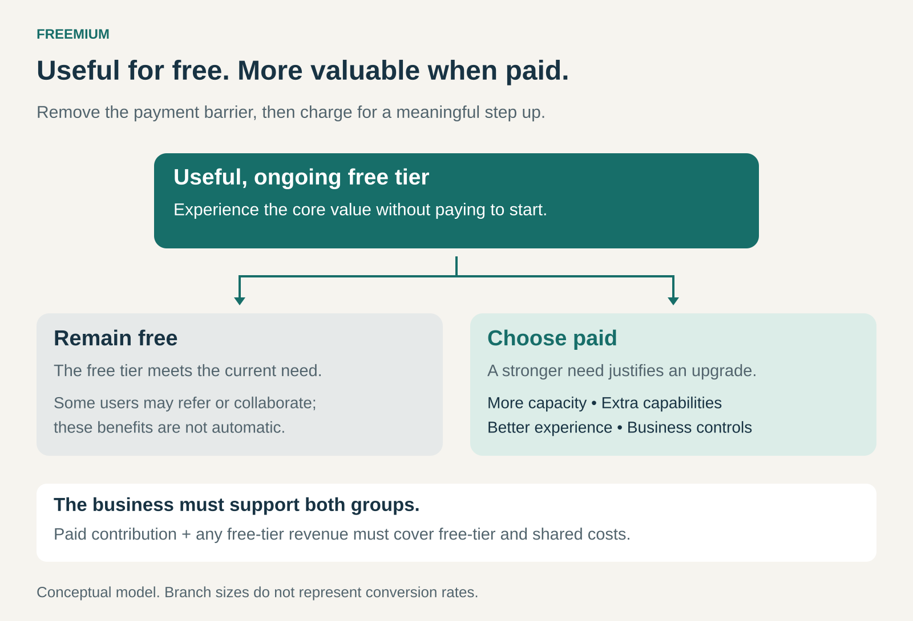

## What it is for

Use Freemium when customers can discover a product’s value through use, and some have needs substantial enough to justify paying for more.

A person may hesitate to buy unfamiliar software but happily use a free version. Over time, it becomes useful: files accumulate, colleagues join, or the product becomes part of a daily routine. Greater capacity or additional capabilities can then become worth paying for.

Freemium turns that progression into a business model: offer a useful, ongoing free tier, alongside paid options for customers who need more.

The central design challenge is to make the free product valuable enough to attract and retain users, while giving a sufficient number of them a compelling reason to upgrade.

## The core idea

Freemium combines two propositions:

- **Free:** a useful product within defined limits.
- **Premium:** additional value that particular customers will pay for.

The boundary can follow several dimensions. Customers might pay for more storage, longer sessions, advanced features, collaboration, administrative controls, or an experience without advertising.

A free trial offers temporary access before a deadline. A freemium tier supports continued use within its limits. A company can offer both: an ongoing free plan and a temporary trial of premium features.

The free tier therefore needs its own coherent purpose. Someone who never upgrades should still be able to accomplish something worthwhile.

## Why it works

Paying before experiencing a product creates uncertainty. Customers must judge whether it will work, whether they will use it, and whether its benefits justify the price.

A free tier lets experience answer some of those questions. Customers can develop familiarity and establish a routine before making a purchasing decision.

Freemium also allows customers with different needs to choose different levels of service. A casual user might remain satisfied with limited capacity. A professional using the same product every day may value additional capacity, reliability, or control much more highly.

Free use can also introduce the product to others. A shared document, meeting invitation, or collaborative project may expose new people to it. That benefit depends on how the product works; simply having many free accounts does not automatically create referrals or network effects.

## Famous examples

### Spotify: pay for a better listening experience

Spotify offers a free, advertising-supported music service alongside Premium subscriptions. Premium benefits include music listening without advertising and downloading music for offline use. [Spotify’s Premium offering](https://www.spotify.com/us/premium/)

The upgrade follows a recognizable difference in preference. Some listeners accept advertising. Others listen frequently enough, or spend enough time away from a reliable connection, to value uninterrupted and offline listening.

Spotify also shows how Freemium can combine with another revenue model. Advertising generates revenue from free listening, while subscribers pay for Premium. Free users can therefore contribute revenue without converting.

The economic question extends beyond how many people subscribe: both forms of listening have associated costs.

### Dropbox: pay when storage needs grow

Dropbox Basic provides 2 GB of free storage, with tools for accessing and sharing files. Its paid plans offer substantially greater capacity. [Dropbox Basic](https://www.dropbox.com/basic)

A person can experience the central benefit—keeping files accessible and sharing them—before needing a large amount of space.

As that person stores more material, capacity can become a reason to upgrade. The paid proposition builds on an already understood benefit: more room for the files the customer wants to keep using.

This illustrates a useful boundary for Freemium: allow customers to experience the core function, then charge when their needs grow beyond a defined allowance.

### Zoom: pay for longer meetings

Zoom’s Basic licenses generally limit hosted meetings to 40 minutes. Paid licenses support meetings lasting up to 30 hours, subject to Zoom’s documented conditions. [Zoom’s meeting time limits](https://support.zoom.com/hc/en/article?id=zm_kb&sysparm_article=KB0067966)

A brief conversation may fit comfortably within the free allowance. A workshop, client meeting, or longer team discussion creates a stronger reason to pay.

Meeting invitations also expose participants to the product. People can experience a call before deciding whether they need their own paid hosting capabilities.

The important unit is the host’s license: participants do not all need to become subscribers for a paid host to receive value.

### Where to draw the boundary

A useful free tier should let customers reach a meaningful result. If the restrictions prevent that first success, users may leave before understanding the product.

The paid tier should address a need customers recognize.

Capacity limits work when greater use tends to create greater value. Feature limits work when advanced capabilities matter to a distinct group. Business controls work when organizations need coordination and oversight beyond what an individual requires.

These boundaries need careful judgment. A feature that sounds “advanced” may be essential to completing an ordinary task. Conversely, an apparently small capability may save a professional enough time to justify a subscription.

The strongest boundary connects the price to something the customer values.

### The economics behind the free tier

Free to the customer still costs the business money.

Storage, bandwidth, licensing, computing, support, and abuse prevention can all rise with usage. A free tier involving expensive computation or substantial human attention can become costly quickly.

Paid customers’ contribution, after the costs of serving them, together with any revenue from free users, must support the free tier and shared business costs.

A large audience alone does not establish that this will happen. Conversion, retention, spending, and service costs all matter. There is no universal conversion rate that makes Freemium viable.

Timing matters too. Costs may accumulate long before someone upgrades. A business needs enough resources to support that interval, including users who remain free indefinitely.

## Useful when

Freemium is especially useful when customers can start independently, experience value relatively quickly, and move into a paid tier without a complicated transition.

It fits situations where the market contains meaningful differences in usage, professional requirements, or willingness to pay. Some customers can remain well served by the free version while others receive substantial value from upgrading.

It is harder to sustain when every additional user requires expensive service, customers need extensive assistance before receiving value, or the free offer already satisfies nearly everyone who could plausibly pay.

## Common mistakes and limits

**Making the free product too restricted.** Registration numbers can look encouraging while few people reach a useful result. The business then has an acquisition funnel with little reason to continue.

**Making premium difficult to justify.** Customers may like the product but see no benefit worth purchasing. Popularity cannot substitute for a paid proposition.

**Treating every free user as a future subscriber.** Some will never need more. Their costs and any contribution to distribution or revenue belong in the model from the beginning.

**Optimizing upgrades at the expense of retention.** Pressure can produce purchases that customers soon regret or cancel. A higher conversion rate can coexist with a weaker business.

**Changing limits carelessly.** Customers may build routines around the free tier. Removing capabilities can damage trust, especially when their work or files depend on continued access.

## Related patterns

- [[good-better-best|Good-Better-Best:]] organizes offerings into tiers. Freemium makes one tier free; additional paid tiers can segment larger needs.
- [[core-plus-add-ons|Core plus Add-Ons:]] charges for optional extensions to a core offer. A free core can support this approach.
- [[subscription|Subscription:]] provides recurring paid access and commonly supplies Freemium’s premium revenue.
- **Advertising:** can fund free usage, as Spotify illustrates, alongside revenue from customers who upgrade.
