Water crossing a small cascade can become separate sparkling shapes or a continuous flowing
surface. A cyclist can appear suspended against a clear street or move through streaked
surroundings. Both treatments can communicate something useful. The decision is whether the
photograph needs to describe a shape at an instant or movement across an interval.

Choose an exposure time that supports that intention, then check what actually moved. A short
time can reduce visible displacement. A longer one records more of the subject's changing
position. But a blurry image may also result from movement of the camera, missed focus,
or computational processing. Diagnose the cause before changing settings at random.

[Original photographic comparison](https://commons.wikimedia.org/wiki/File:Shutter_speed_waterfall.gif)
· [GNU Free Documentation License 1.2](../assets/photography/licenses/gfdl-1-2.txt).
Static frames extracted from the source animation and laid out for comparison; original labels retained.

## Think in terms of displacement

The useful mental model is how far an image feature travels during capture. A fast movement
across the frame can blur in a time that leaves a slowly turning head relatively clear.
A nearby subject or a larger magnification can show more visible displacement. Direction,
speed, distance, and final viewing size all matter, so no single shutter speed freezes every
kind of action.

For a moving child, a camera might need a much shorter time than for a person holding
still. A waterfall can show motion even while its surrounding rocks remain clear. A long
exposure of an empty room can remain sharp if the camera and scene stay still. Exposure
time is a control, not a label dividing photographs into sharp and blurred categories.

[[photography-foundations|Photography Foundations]] explains shutter-speed notation. A time such
as 1/500 second is shorter than 1/30 second. Camera displays sometimes omit the numerator,
so distinguish a displayed fraction from a whole-second value before making a large change.

## Freeze a gesture when shape matters

At a playground, you want a clear expression and the arc of a jumping child's body. A
shorter exposure may preserve those shapes. Check a test image where movement is fastest,
and shorten further if the important detail still smears. Avoid assuming that a sharp background
means the child's movement is controlled.

In shutter-priority mode, you choose the time and the camera adjusts aperture, within available
limits. Auto ISO may raise the ISO setting when light is insufficient. That can help maintain
brightness, but cannot create extra photons at a fixed aperture and time. If the image
is too dark or noisy for its purpose, seek more light, accept a different rendering, or
choose a moment with less movement. Manual mode is not a prerequisite.

[[anticipate-the-moment|Anticipate the Moment]] can make this easier by preparing for a readable
gesture. A very short exposure of an unhelpful instant is still an unhelpful photograph.

## Show movement while keeping a reference

For a stream, support the camera and try a longer time. Water can become continuous while
rocks provide a stable reference. The result may emphasize flow rather than individual splashes.
If the entire image smears, the camera probably moved too, or the support was insufficient.

A tripod, stable surface, timer, or appropriate stabilization can help with camera movement.
Stabilization does not stop a person or a leaf from moving. In bright daylight, a very
long exposure may exceed the camera's brightness limits even at a small aperture and low
ISO. A neutral-density filter is one option on suitable cameras, but is optional equipment,
not a necessary beginner purchase. Shade, dusk, or a less extreme effect may already work.

More blur is not automatically more convincing. If water loses every trace of structure,
the image may feel less energetic rather than more. Compare the amount of continuity and
texture against what you wanted to show.

## Panning changes the reference

With a cyclist moving across your view, following them smoothly during the exposure can
reduce their movement relative to the camera while the background streaks. This is panning.
Parts of the bicycle and body may still blur because they move differently from the overall
travel. A clear face with moving wheels can communicate speed effectively.

Panning differs from holding the camera still while the cyclist crosses. It also differs
from accidental shake, which moves stationary scene details without a deliberate tracking
relationship. Practice and timing matter, and many attempts may fail. Keep your position
safe and predictable around traffic; a legal path or organized event offers better conditions
than stepping into a road for the shot.

## Know what your phone is making

Phones often choose exposure time automatically and may merge several captures. Night modes
can preserve a stationary scene yet produce ghosts around moving people. Some long-exposure
effects combine a burst rather than recording one long interval. Those results can be expressive,
but a displayed duration is not always the shutter time of one photograph.

This pattern helps whenever motion appearance is part of the intention or unexplained softness
recurs. [[focus-on-what-matters|Focus on What Matters]] helps separate focus errors from movement.
[[review-one-thing-at-a-time|Review One Thing at a Time]] helps compare one cause without
changing every variable. Aim for enough technical control to express movement deliberately,
while leaving room for the unpredictable shapes that make action photographs interesting.
